# 第一部分： Speculative Decoding 基础与架构总览

## 1.1 Speculative Decoding 原理

### 1.1.1 推测解码的基本思想

Speculative Decoding（推测解码）是一种通过"先猜测后验证"的范式来加速大语言模型推理的技术。其核心思想是： 

> **使用一个更小、更快的 Draft Model 先预测多个未来 token，然后使用 Target Model 并行验证这些预测，如果验证通过则一次性接受多个 token，从而减少 Target Model 的调用次数。**

传统自回归推理： 
```
Target： [t0] → [t1] → [t2] → [t3] → [t4] → [t5]
        6 次串行 forward
```

Speculative Decoding： 
```
Draft：   [t0] → [d1] → [d2] → [d3] → [d4] → [d5]
                  (快速预测 5 个 token)
                  ↓
Target：  [t0, d1, d2, d3, d4, d5] (并行验证)
                  ↓
输出：    [t0, d1, d2] (假设 d3 被拒绝)
        1 次 Target forward 输出 3 个 token
```

**关键洞察**： 
1. Draft Model 的预测不需要完全准确，只需要有一定概率与 Target Model 一致
2. 通过 Rejection Sampling 保证最终输出分布与 Target Model 完全一致
3. 当接受率足够高时，可以显著减少 Target Model 的 forward 次数

### 1.1.2 Draft-Verify 范式工作流程

Speculative Decoding 的一个完整迭代包含以下步骤： 

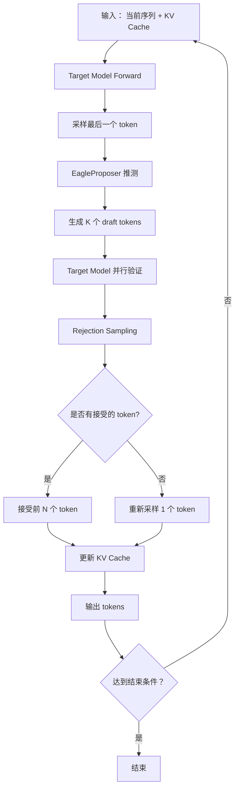

**详细步骤说明**： 

| 步骤 | 说明 | 关键代码位置 |
|------|------|-------------|
| 1. Target Forward | 对当前输入执行前向传播，输出 hidden states 和 logits | `gpu_model_runner.py` |
| 2. 采样 | 从 logits 采样得到下一个 token | `rejection_sampler.py` |
| 3. 推测 | EagleProposer 使用 hidden states 生成 K 个 draft tokens | `spec_decode/eagle.py` |
| 4. 验证 | Target Model 对所有 draft tokens 并行验证 | `gpu_model_runner.py` |
| 5. Rejection Sampling | 计算接受概率，决定接受哪些 tokens | `rejection_sampler.py` |
| 6. 状态更新 | 更新 KV Cache、seq_lens 等状态 | `gpu_model_runner.py` |

### 1.1.3 接受率与加速比理论分析

#### 接受率分析

假设 Draft Model 生成的第 i 个 token 被 Target Model 接受的概率为 $p_i$，则： 

- 第 1 个 token 被接受的概率： $P_1 = p_1$
- 前 2 个 token 都被接受的概率： $P_2 = p_1 \times p_2$
- 前 k 个 token 都被接受的概率： $P_k = \prod_{i=1}^{k} p_i$

**期望接受 token 数**： 
$$E[\text{accepted}] = \sum_{k=1}^{K} P_k = p_1 + p_1 p_2 + p_1 p_2 p_3 + \cdots + \prod_{i=1}^{K} p_i$$

当假设所有 $p_i = p$（独立同分布）时： 
$$E[\text{accepted}] = p + p^2 + p^3 + \cdots + p^K = \frac{p(1-p^K)}{1-p}$$

#### 加速比分析

定义： 
- $T_{target}$： Target Model 一次 forward 的时间
- $T_{draft}$： Draft Model 一次 forward 的时间
- $\gamma = T_{draft} / T_{target}$： Draft 与 Target 的时间比（通常 $\gamma \ll 1$）
- $E$： 期望接受的 token 数

**传统自回归**生成 K 个 token 的时间： $K \times T_{target}$

**Speculative Decoding** 生成 K 个 token 的时间（近似）： 
- 1 次 Target forward for verification： $T_{target}$
- K 次 Draft forward： $K \times T_{draft} = K \gamma T_{target}$
- 总计： $(1 + K\gamma) T_{target}$

**理论加速比**： 
$$\text{Speedup} = \frac{K}{1 + K\gamma} \times \frac{1}{1 - \text{reject rate}}$$

更精确的，考虑接受率后的加速比： 
$$\text{Speedup} = \frac{E + 1}{1 + K\gamma}$$

其中 $E+1$ 是因为除了接受的 E 个 token 外，还会重新采样 1 个 token。

**数值示例**： 
- 假设 $\gamma = 0.1$ (Draft 是 Target 的 1/10 速度)
- 假设 $p = 0.8$ (每个 token 有 80% 接受率)
- $K = 5$： $E \approx 3.36$
- $\text{Speedup} = \frac{3.36 + 1}{1 + 0.5} \approx 2.9\times$

### 1.1.4 关键性能指标定义

| 指标 | 定义 | 计算公式 |
|------|------|----------|
| **Acceptance Rate** | 每个位置的平均接受率 | $\frac{1}{K}\sum_{i=1}^{K} p_i$ |
| **Expected Tokens/Step** | 每步期望输出的 token 数 | $E + 1$ |
| **Speedup** | 相比自回归的加速比 | $\frac{T_{autoregressive}}{T_{spec}}$ |
| **Efficiency** | 有效 token 输出比例 | $\frac{\text{accepted tokens}}{\text{total forward tokens}}$ |
| **Draft Model Overhead** | Draft Model 的时间开销占比 | $\frac{K \times T_{draft}}{T_{total}}$ |

---

## 1.2 vLLM Spec Decode 整体架构

### 1.2.1 系统架构总览图

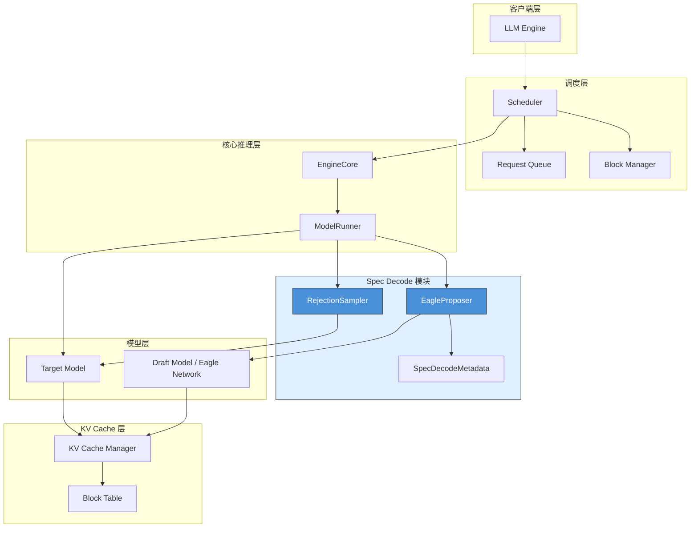

### 1.2.2 核心组件与职责划分

| 组件 | 文件路径 | 职责 |
|------|---------|------|
| **EngineCore** | `vllm/v1/engine/core.py` | 推理引擎主循环，协调调度器和模型执行 |
| **Scheduler** | `vllm/v1/core/sched/scheduler.py` | 请求调度，决定每批执行哪些请求 |
| **ModelRunner** | `vllm/v1/worker/gpu_model_runner.py` | 模型执行器，管理 forward 和采样 |
| **EagleProposer** | `vllm/v1/spec_decode/eagle.py` | Eagle 推测器，生成 draft tokens |
| **RejectionSampler** | `vllm/v1/sample/rejection_sampler.py` | 拒绝采样器，验证并接受/拒绝 draft tokens |
| **SpecDecodeMetadata** | `vllm/v1/spec_decode/metadata.py` | Spec decode 元数据，传递配置信息 |
| **KVCacheManager** | `vllm/v1/core/kv_cache_manager.py` | KV Cache 管理，负责内存分配 |

### 1.2.3 与 Target Model 的协作流程

Spec Decode 与 Target Model 的协作采用"流水线"模式：

**核心思想**：每一轮使用**上一轮生成的 draft tokens**作为输入，本轮 forward 后再为下一轮生成新的 draft tokens。

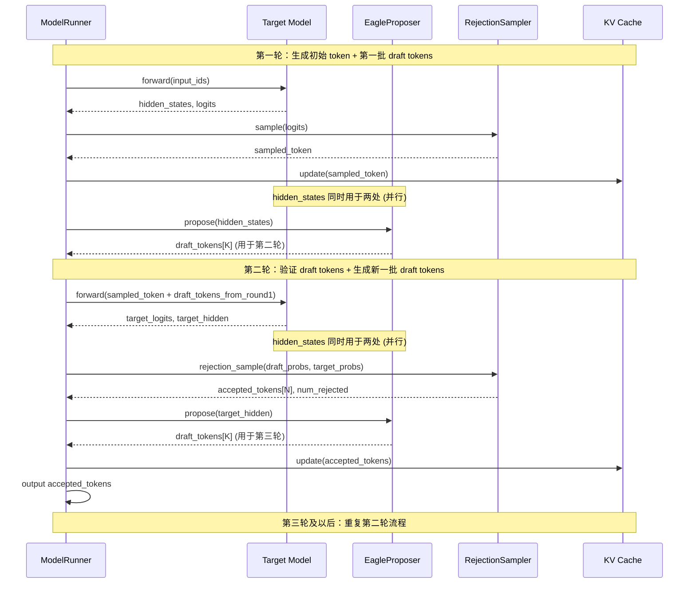

**关键点说明**：
1. `propose()` 使用的是**当前轮** target model 输出的 `hidden_states`
2. `propose()` 生成的 `draft_tokens` 是供**下一轮**使用的，不是当前轮
3. 每一轮的 forward 输入包含：上一轮接受的 token + 上一轮生成的 draft tokens

### 1.2.4 数据流与控制流分析

**数据流**（Data Flow）：
```
第一轮：
输入 tokens → Embedding → Target Model → hidden_states → sampled_token
                                              │
                                              └─────────────► EagleProposer
                                                                    ↓
                                                            draft_tokens (用于下一轮)

第二轮及以后：
上一轮 accepted_token + 上一轮 draft_tokens → Target Model → hidden_states
                                                        │
                                          ┌─────────────┴─────────────┐
                                          ↓                           ↓
                                RejectionSampler (验证)         EagleProposer
                                          │                    (为下一轮生成 draft)
                                          ↓
                                accepted tokens → KV Cache → Output

关键：RejectionSampler 和 EagleProposer 都使用 Target Model 输出的 hidden_states，
     两者是并行关系，不是串行依赖。
```

**控制流**（Control Flow）：
```
EngineCore.execute_request()
    └─► Scheduler.schedule()
        └─► ModelRunner.execute_model()
            ├─► 如果是 prefilled 请求
            │   └─► TargetModel.forward()
            │   └─► Sample()
            │   └─► EagleProposer.propose() (为下一轮生成 draft tokens)
            │
            └─► 如果是 decoding 请求 (有 draft tokens)
                ├─► TargetModel.forward(输入包含上一轮的 draft tokens)
                │   └─► 输出：hidden_states, logits
                │
                ├─► RejectionSampler.sample() (验证 draft tokens)
                │   └─► 使用：hidden_states 计算的 target_probs
                │
                └─► EagleProposer.propose() (为下一轮生成新的 draft tokens)
                    └─► 使用：hidden_states (与 RejectionSampler 并行，非串行)
```

---

## 1.3 Spec Decode 执行流程详解 - 以多轮推理为例

> 从 token 角度追踪 spec decode 在 vLLM 中的完整执行过程

### 1.3.1 示例场景设定

为了具体说明 Spec Decode 的执行流程，我们设定以下场景：

**配置参数**：
- `num_speculative_tokens = 5`（每次最多推测 5 个 token）
- `batch_size = 2`（两个并发请求）
- Token Tree 结构： `[(0,), (0,1), (0,2), (0,3), (0,4)]`（线性链，非树状）

**初始状态**（两个请求）：

| 请求 | Prompt | Token IDs | 当前 seq_len | KV Cache Block 分配 (Logical → Physical) | h_req 含义 |
|------|--------|-----------|--------------|------------------------------------------|------------|
| Req-0 | "The cat" | [BOS, The, Ġcat] | 3 tokens | Logical Block 0 → Physical Block 5 (占用 slot 0,1,2，共 3/16) | `h_req0` = Req-0 最后一个 token 的 hidden state，形状 [768] |
| Req-1 | "Hello" | [BOS, Hello] | 2 tokens | Logical Block 0 → Physical Block 8 (占用 slot 0,1，共 2/16) | `h_req1` = Req-1 最后一个 token 的 hidden state，形状 [768] |

**关键概念澄清**：

1. **Logical Block vs Physical Block**：
   - **Logical Block**： 每个请求**独立**的逻辑视图，从 0 开始编号 (Logical Block 0, 1, 2...)
   - **Physical Block**： 全局 KV Cache 内存池中的**实际物理块**，所有请求共享

2. **为什么 Req-0 和 Req-1 都有 "Logical Block 0"?**
   - 因为 Logical Block 是 per-request 的概念，每个请求都从 Logical Block 0 开始
   - Req-0 的 Logical Block 0 映射到 Physical Block 5
   - Req-1 的 Logical Block 0 映射到 Physical Block 8
   - 两个请求**不会**互相干扰

3. **示例中的正确理解**：
   - Req-0： 3 tokens → 只需要 3 个 slots → Logical Block 0 (3/16 占用，partial)
   - Req-1： 2 tokens → 只需要 2 个 slots → Logical Block 0 (2/16 占用，partial)

#### Token Tree 结构详解

Token Tree 用于表示 draft tokens 与已生成 token 之间的依赖关系。在我们的线性链场景中：

```
Token Tree 结构可视化：

位置 0： (0,)          ← 根节点，表示上一轮采样的 token (target_token)
        │
位置 1： (0,1)         ← 第 1 个 draft token，依赖于位置 0
        │
位置 2： (0,2)         ← 第 2 个 draft token，依赖于位置 0→1
        │
位置 3： (0,3)         ← 第 3 个 draft token，依赖于位置 0→1→2
        │
位置 4： (0,4)         ← 第 4 个 draft token，依赖于位置 0→1→2→3
```

**元组含义**： 每个元组 `(p0, p1, p2, ...)` 表示从根节点到当前节点的**路径索引**
- `(0,)` 表示根节点（第 0 个位置的 token）
- `(0,1)` 表示从根节点的第 0 个分支到第 1 个子节点
- 在线性链中，简化为 `(0,), (0,1), (0,2)...` 表示一条直线

**为什么需要 Tree 结构**：
- 在更复杂的**树状推测**（Tree Speculative Decoding）中，每个位置可能有多个候选 token
- Tree Attention 机制允许一个 token attend 到它的所有祖先节点
- 线性链是树状结构的特例（退化为链表）

#### Token 计数详解："The cat" 为什么是 3 个 tokens？

```
原始文本："The cat"

分词过程（使用 BPE/WordPiece 等 tokenizer）：

方案 1（LLaMA 系列使用的 SentencePiece BPE）：
  "The cat" → ["The", "Ġcat"]  ← 2 个 tokens
  说明：Ġ 表示前面的空格，是 LLaMA tokenizer 的特殊标记

方案 2（带特殊 token 的完整序列）：
  输入序列 = [BOS, "The", "Ġcat"]  ← 3 个 tokens
  说明：BOS (Beginning Of Sequence) 是序列起始标记

本例采用的计数方式：
  "The cat" → [BOS, "The", "Ġcat"] = 3 tokens

  具体对应：
  - Token ID 0： BOS (特殊标记，<s>)
  - Token ID 1： "The"
  - Token ID 2： "Ġcat"

  seq_len = 3 表示已经处理了 3 个 token
```

**常见 Tokenizer 示例**：
```python
# LLaMA 2 Tokenizer 示例
from transformers import LlamaTokenizer

tokenizer = LlamaTokenizer.from_pretrained("meta-llama/Llama-2-7b")
text = "The cat"
encoded = tokenizer.encode(text, add_special_tokens=True)
# 输出：[1, 450, 3350]  ← BOS + "The" + "Ġcat"
# add_special_tokens=False 时：[450, 3350]  ← 2 tokens

# 注意：不同 tokenizer 的行为不同
# GPT-2： "The cat" → [464, 1212]  ← 2 tokens (无 BOS)
# Qwen：  "The cat" → [151643, 791, 374]  ← BOS + "The" + "Ġcat"
```

#### KV Cache Block 划分详解

vLLM 使用 **Paged Attention** 技术，将 KV Cache 划分为固定大小的 block：

```
KV Cache Block 结构：

Block 大小配置：block_size = 16（常见配置，可配置为 8/16/32/64）

每个 Block 包含的 KV 槽位：
┌─────────────────────────────────────────┐
│  Block 0 (physical block #0)            │
│  ┌─────┬─────┬─────┬─────┬────────┐     │
│  │slot0│slot1│slot2│slot3│...slot15│    │
│  │ (K) │ (K) │ (K) │ (K) │  (K)   │     │
│  │ (V) │ (V) │ (V) │ (V) │  (V)   │     │
│  └─────┴─────┴─────┴─────┴────────┘     │
│  每个 slot 存储一个 token 的 K 和 V 向量    │
└─────────────────────────────────────────┘

对于 "The cat" (3 tokens) 的 Block 分配：

逻辑序列：[BOS, "The", "Ġcat"]
           ↑      ↑       ↑
         pos=0  pos=1   pos=2

Block Table (逻辑 block → 物理 block 映射)：
┌──────────────────────────────────────┐
│  Logical Block 0 → Physical Block 5  │
│  (存储 token 0~15，当前占用 slot 0,1,2)│
│  使用率：3/16 = 18.75%                │
└──────────────────────────────────────┘

当生成更多 token 后（例如生成了 15 个 token）：
┌──────────────────────────────────────┐
│  Logical Block 0 → Physical Block 5  │
│  (slot 0~15 全部占满)                 │
│  使用率：16/16 = 100% (full)          │
├──────────────────────────────────────┤
│  Logical Block 1 → Physical Block 3  │
│  (存储 token 16~31，当前占用 slot 0)   │
│  使用率：1/16 = 6.25% (partial)       │
└──────────────────────────────────────┘
```

**Block 分配状态说明**：
| 状态 | 含义 | 示例 |
|------|------|------|
| `full` | Block 的所有 slot 都被占用 | Block-0 有 16 个 token，使用率 100% |
| `partial` | Block 部分 slot 被占用 | Block-1 有 3 个 token，使用率 18.75% |
| `empty` | Block 未被分配或所有 slot 空闲 | 新请求或请求完成后释放 |

#### h_req 含义详解

`h_req`（或 `h_req0`, `h_req1`）表示**请求级别的 hidden states**。

```
Hidden States 张量结构：

对于单个请求 Req-0：
- 输入：[BOS, "The", "Ġcat"]  ← 3 tokens
- Target Model Forward 后输出：

hidden_states 形状：[seq_len=3, hidden_size=4096]
┌─────────────────────────────────────────────┐
│  h[0] = h_req0[0] = BOS 的 hidden state     │  ← [4096] 向量
│  h[1] = h_req0[1] = "The" 的 hidden state   │  ← [4096] 向量
│  h[2] = h_req0[2] = "Ġcat" 的 hidden state  │  ← [4096] 向量
└─────────────────────────────────────────────┘

在采样时，我们只关心最后一个位置的 hidden state：
- last_hidden = h_req0[-1] = h_req0[2]  ← "Ġcat" 对应的 hidden state
- 用于：LM Head 投影 → logits → 采样下一个 token
```

**Hidden States 的用途**：
```
                    Target Model Forward
                          │
                          ▼
              hidden_states = [h₀, h₁, h₂, ..., hₙ]
                          │
          ┌───────────────┴───────────────┐
          │                               │
          ▼                               ▼
   ┌─────────────┐                 ┌─────────────┐
   │   LM Head   │                 │  EagleHead  │
   │  (采样用)    │                 │ (推测用)     │
   └─────────────┘                 └─────────────┘
          │                               │
          ▼                               ▼
       logits                        draft tokens
          │
          ▼
      sample() → next_token
```

### 1.3.2 第一轮推理（Step 1）

#### Target Model 前向

```
Req-0 输入：[BOS, The, Ġcat] + KV Cache (3 tokens)
Req-1 输入：[BOS, Hello] + KV Cache (2 tokens)
```

**执行流程**： 

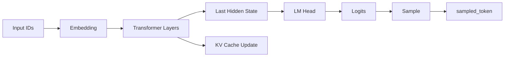

**输出**： 

| 请求 | Output Hidden States | Sampled Token |
|------|---------------------|---------------|
| Req-0 | `h_req0[2]` | `t3 = " sat"` |
| Req-1 | `h_req1[1]` | `t3 = " world"` |

#### EagleProposer 推测（Step 1 → Step 5）

**输入准备**： 
```python
# 拼接输入： shifted input_ids + last sampled token
input_ids = [t1, t2, t3]  # 右移一位，末尾补 sampled token
hidden_states = [h0, h1, h2]  # 来自 Target Model
```

**5 步推测流程**： 

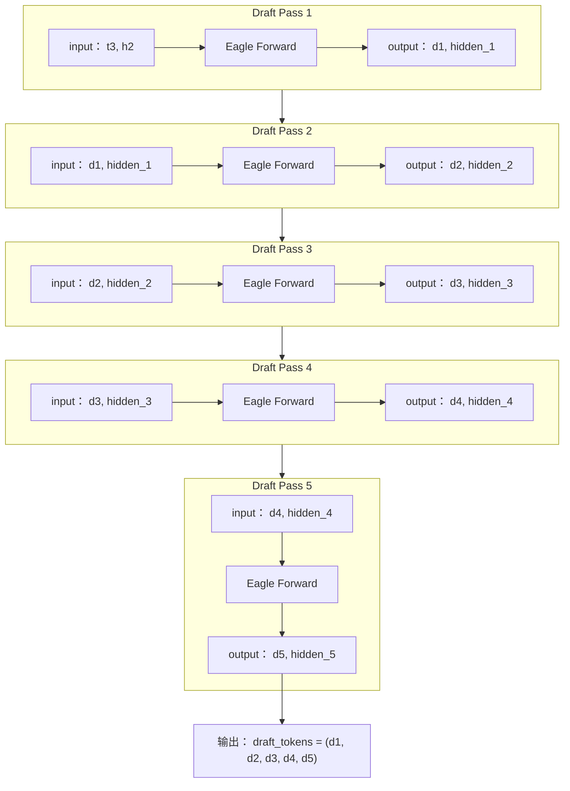

**详细输出**（假设值）： 

| 请求 | Draft Token 1 | Draft Token 2 | Draft Token 3 | Draft Token 4 | Draft Token 5 |
|------|---------------|---------------|---------------|---------------|---------------|
| Req-0 | " on" | " the" | " mat" | "." | `<EOS>` |
| Req-1 | "!" | `<EOS>` | - | - | - |

#### Target Model 验证

**验证输入构造**： 
```
Req-0： [t3=" sat", d1=" on", d2=" the", d3=" mat", d4=".", d5=<EOS>]
Req-1： [t3=" world", d1="!", d2=<EOS>, PAD, PAD]
```

**Tree Attention 构建**：
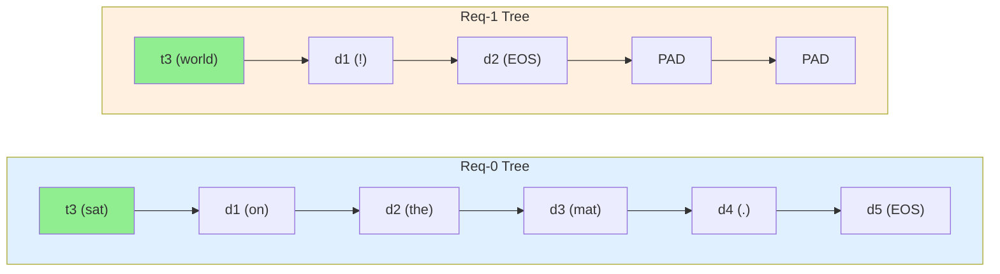

每个 token 只能 attend 到它前面的 token（causal mask + tree structure）。

**验证输出**： 

| 请求 | Position | Target Logits | Target Probs |
|------|----------|---------------|--------------|
| Req-0 | 0 (t3) | logits_t3 | p_t3 |
| Req-0 | 1 (d1) | logits_d1 | p_d1 |
| Req-0 | 2 (d2) | logits_d2 | p_d2 |
| Req-0 | 3 (d3) | logits_d3 | p_d3 |
| Req-0 | 4 (d4) | logits_d4 | p_d4 |
| Req-0 | 5 (d5) | logits_d5 | p_d5 |

#### Rejection Sampling

**接受概率计算**： 
```python
# 对每个 draft token 计算接受概率
accept_prob[i] = min(1, target_prob[draft_token[i]] / draft_prob[draft_token[i]])
```

**假设结果**： 

| 请求 | Draft Token | Target Prob | Draft Prob | Accept Prob | 结果 |
|------|-------------|-------------|------------|-------------|------|
| Req-0 | d1=" on" | 0.75 | 0.70 | 1.0 | ✓ 接受 |
| Req-0 | d2=" the" | 0.60 | 0.65 | 0.92 | ✓ 接受 |
| Req-0 | d3=" mat" | 0.30 | 0.55 | 0.55 | ✗ 拒绝 |
| Req-0 | d4="." | - | - | - | ✗ 跳过 |
| Req-0 | d5=<EOS> | - | - | - | ✗ 跳过 |
| Req-1 | d1="!" | 0.85 | 0.80 | 1.0 | ✓ 接受 |
| Req-1 | d2=<EOS> | 0.20 | 0.45 | 0.44 | ✗ 拒绝 |

**重新采样**： 
对于第一个被拒绝的位置（Req-0 的 d3），计算 residual distribution： 
```python
residual_prob = target_prob - accept_prob * draft_prob
resampled_token = sample(residual_prob)  # 例如： "floor"
```

**最终输出**： 

| 请求 | Accepted Tokens | Num Accepted | Resampled | Final Output |
|------|-----------------|--------------|-----------|--------------|
| Req-0 | [" on", " the"] | 2 | " floor" | [" on", " the", " floor"] |
| Req-1 | ["!"] | 1 | " today" | ["!", " today"] |

#### 状态更新

**KV Cache 更新**： 
```
Req-0： 新增 3 个 token 的 KV → Logical Block 0 (6/16，部分占用)
Req-1： 新增 2 个 token 的 KV → Logical Block 0 (4/16，部分占用)

说明：两个请求初始分别在各自的 Logical Block 0 中有 3 和 2 个 token，
     新增 3 和 2 个 token 后，总共 6 和 4 个 token，都还在 Logical Block 0 内
     （因为 block_size = 16，6 < 16 且 4 < 16，不需要分配新 block）
```

**请求状态更新**： 
```python
# Req-0
req_0.seq_len += 3  # 3 → 6
req_0.token_ids.extend([" on", " the", " floor"])
req_0.num_rejected_tokens = 3  # d3, d4, d5 被拒绝/跳过

# Req-1
req_1.seq_len += 2  # 2 → 4
req_1.token_ids.extend(["!", " today"])
req_1.num_rejected_tokens = 1  # d2 被拒绝
```

### 1.3.3 第二轮推理（Step 2）

#### 输入状态继承

| 请求 | Last Accepted Token | Current seq_len | num_rejected |
|------|---------------------|-----------------|--------------|
| Req-0 | " floor" | 6 | 3 |
| Req-1 | " today" | 4 | 1 |

#### 执行流程（简化）

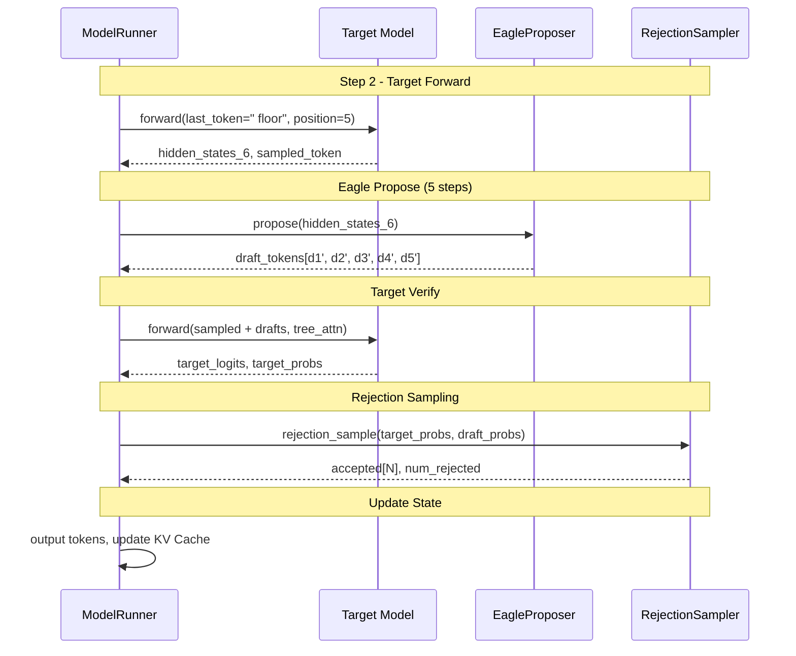

### 1.3.4 多轮推理的状态传递

#### Token 级别状态

| 状态变量 | 类型 | 用途 | 更新时机 |
|----------|------|------|----------|
| `last_sampled_tokens` | Tensor[max_num_reqs] | 上一轮采样的 token | 每轮采样后 |
| `num_rejected_tokens` | Tensor[max_num_reqs] | 被拒绝的 token 数 | Rejection Sampling 后 |
| `seq_lens` | Tensor[max_num_reqs] | 当前序列长度 | KV Cache 更新后 |
| `token_ids` | List[Tensor] | 每请求的 token 序列 | 每轮输出后 |

#### KV Cache 状态

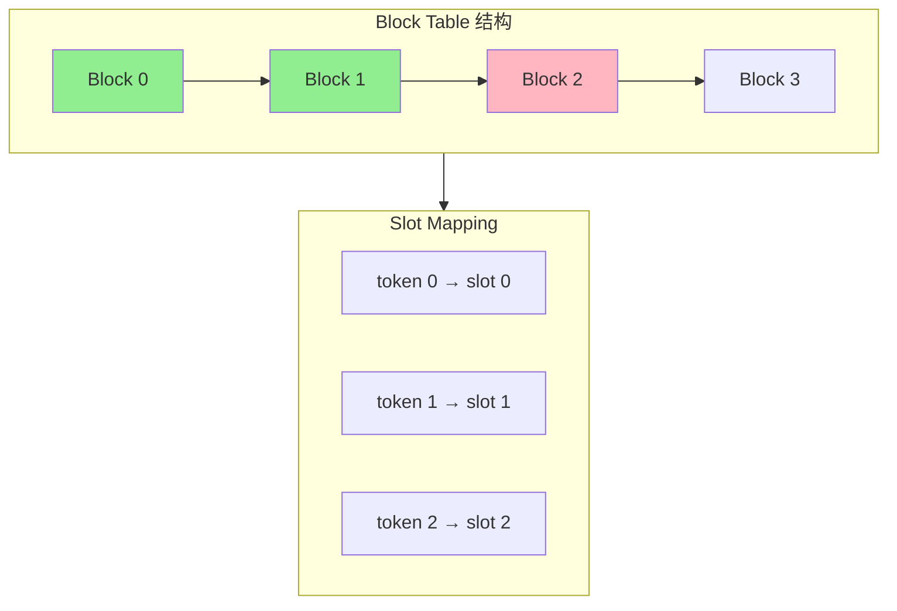

**增量更新机制**： 
- 新接受的 token 分配到下一个可用的 slot
- Block Table 动态扩展（当当前 block 满时分配新 block）

#### Proposer 内部状态

| 缓冲区 | 大小 | 用途 |
|--------|------|------|
| `input_ids` | [max_num_tokens] | 当前输入 token IDs |
| `positions` | [max_num_tokens] | 位置 IDs |
| `hidden_states` | [max_num_tokens, hidden_size] | 隐藏状态 |
| `draft_tokens` | [max_num_reqs, num_spec_tokens] | 生成的 draft tokens |

### 1.3.5 Token 流动全景图

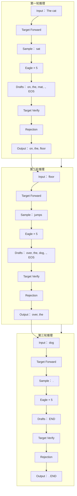

### 1.3.6 关键代码位置索引

| 文件 | 路径 | 关键函数/类 |
|------|------|-------------|
| **调度循环入口** | `vllm/v1/engine/core.py` | `EngineCore.execute_model()` |
| **Model Runner** | `vllm/v1/worker/gpu_model_runner.py` | `GPUModelRunner._execute_model()` |
| **EagleProposer** | `vllm/v1/spec_decode/eagle.py` | `EagleProposer.propose()` |
| **RejectionSampler** | `vllm/v1/sample/rejection_sampler.py` | `RejectionSampler.rejection_sample()` |
| **SpecDecodeMetadata** | `vllm/v1/spec_decode/metadata.py` | `SpecDecodeMetadata` |
| **Tree Attention** | `vllm/v1/attention/backends/tree_attn.py` | `TreeAttentionMetadata` |

---

## 1.4 vLLM-Ascend 架构差异

### 1.4.1 昇腾硬件特性概述

**昇腾 NPU 架构**： 
- **计算单元**： 达芬奇架构（Cube + Vector + Scalar 单元）
- **内存层次**： Global Memory → L1 Buffer → L0 Buffer → Register
- **通信**： HCCL（Huawei Collective Communication Library）

**与 GPU 的主要差异**： 

| 特性 | NVIDIA GPU | Ascend NPU |
|------|------------|------------|
| 计算单元 | CUDA Core / Tensor Core | Cube / Vector / Scalar |
| 内存模型 | HBM → L2 → L1 → Register | HBM → Global Memory → L1 → L0 |
| 通信库 | NCCL | HCCL |
| 编程模型 | CUDA | CANN (Compute Architecture for Neural Networks) |
| 图执行 | CUDA Graph | ACL Graph |

### 1.4.2 vLLM 与 vLLM-Ascend 的协作模式

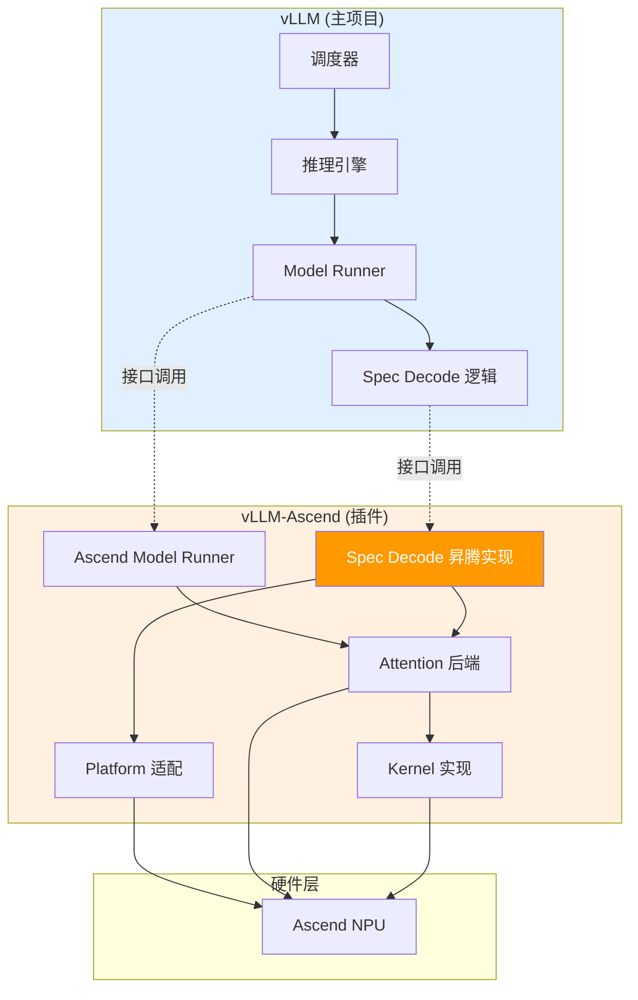

**插件化设计原则**：
1. vLLM 定义标准接口
2. vLLM-Ascend 实现昇腾特定的后端
3. 运行时通过 `current_platform` 自动选择

### 1.4.3 差异化实现总览

| 模块 | vLLM (GPU) | vLLM-Ascend (NPU) | 差异说明 |
|------|------------|-------------------|----------|
| **通信** | NCCL | HCCL | 集合通信 API 不同 |
| **Attention** | FlashAttention / Triton | Ascend Flash Attention | Kernel 实现不同 |
| **Spec Decode** | CUDA Kernel | Ascend Kernel / Triton | Kernel 适配 |
| **CUDA Graph** | CUDA Graph | ACL Graph | 图捕获 API 不同 |
| **内存管理** | torch.cuda | torch_npu | 内存分配器差异 |
| **编译** | torch.compile | torch.compile + CANN | 后端编译器不同 |

### 1.4.4 架构对比图

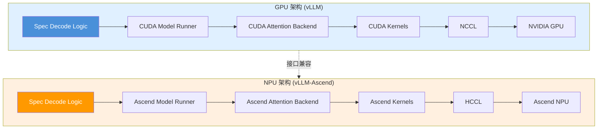

---

