# Qwen3MoE TP(Tensor Parallel) 并行推理流程详解

## 集合通信

### Broadcast
Broadcast操作是将通信域内root节点的数据广播到其他rank。

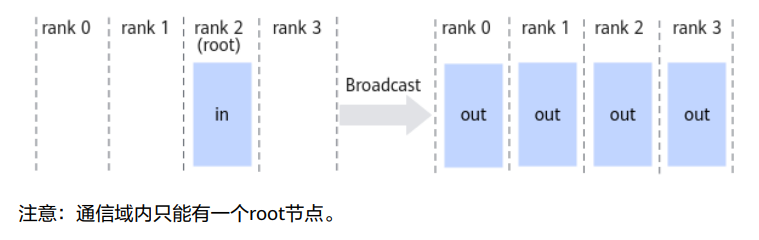

### Scatter
Scatter操作是将通信域内root节点的数据均分并散布至其他rank。

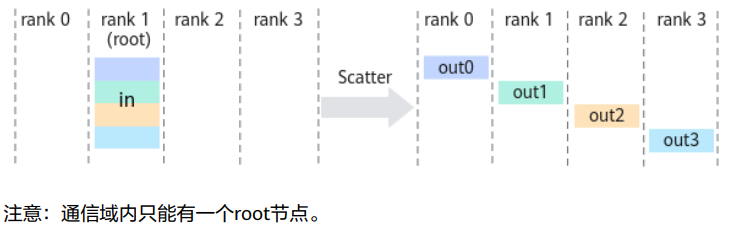

### Reduce
Reduce操作是将通信域内所有rank的输入数据进行归约操作后（支持sum、prod、
max、min），再把结果发送到root节点的输出buffer。

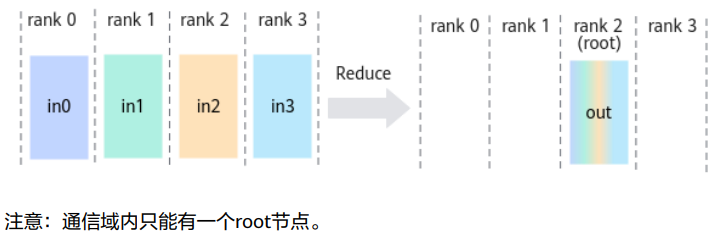

### AllReduce
AllReduce操作是将通信域内所有节点的输入数据进行归约操作后（支持sum、prod、
max、min），再把结果发送到所有节点的输出buffer。

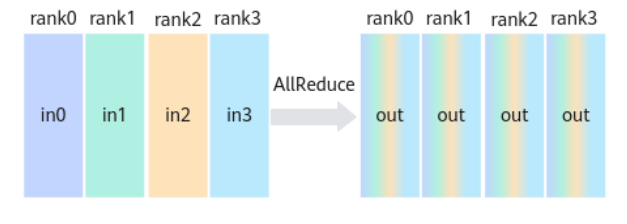

### ReduceScatter

ReduceScatter操作是将通信域内所有rank的输入数据均分成rank size份，然后分别取
每个rank的rank size之一份数据进行归约操作（如sum、prod、max、min）。最后，
将结果按照编号分散到各个rank的输出buffer。

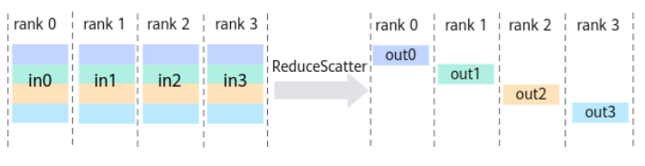

### ReduceScatterV

ReduceScatterV操作与ReduceScatter操作类似，不同点是支持为通信域内不同的节点
配置不同大小的数据量（同一rank不同编号的数据大小可设置，但不同rank间相同编
号的数据大小需保持一致），取每个rank对应编号的数据进行归约操作后（如sum、
prod、max、min）后，再把结果按照编号分散到各个rank的输出buffer。

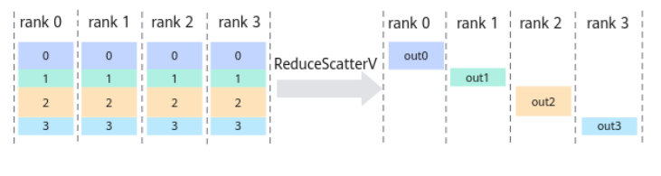

### AllGather
AllGather操作是将通信域内所有节点的输入按照rank id重新排序（rank id按照从小到
大的顺序排序），然后拼接起来，再将结果发送到所有节点的输出buffer。

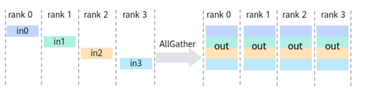

### AllGatherV
AllGatherV操作是将通信域内所有节点的输入按照rank id重新排序（rank id按照从小
到大的顺序排序），然后拼接起来，再将结果发送到所有节点的输出。与AllGather操
作不同的是，AllGatherV操作支持通信域内不同节点的输入配置不同大小的数据量。

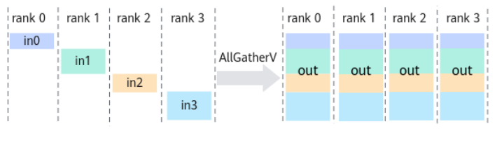

### AlltoAll
AlltoAll操作是向通信域内所有rank发送相同数据量的数据，并从所有rank接收相同数
据量的数据。AlltoAll操作将输入数据在特定的维度切分成特定的块数，并按顺序发送给其他rank，
同时从其他rank接收输入数据，按顺序在特定的维度拼接数据。

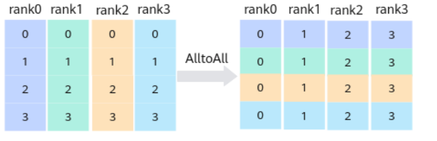

### AlltoAllV
AlltoAllV操作是向通信域内所有rank发送数据（数据量可以定制），并从所有rank接
收数据。

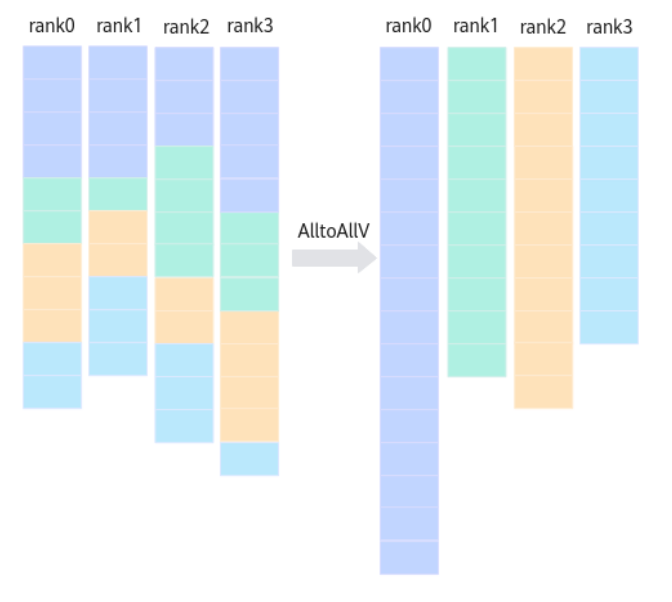

### AlltoAllVC
AlltoAllVC操作是向通信域内所有rank发送数据（数据量可以定制），并从所有rank接
收数据。相比于AlltoAllV，AlltoAllVC通过输入参数sendCountMatrix传入所有rank的
收发参数。

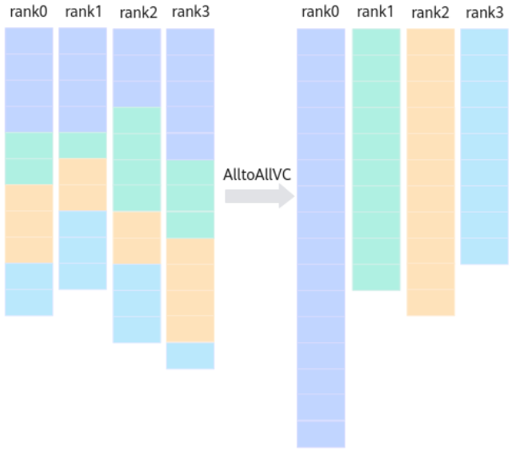

## 概述

本文档以 **TP=2**（2 张 GPU 做 Tensor Parallel）为例，详细描述 Qwen3MoE 在 vLLM 中每一步输入、权重、输出是如何切分和合并的。假设输入为 `tokens: [14, 26, 14, 37, 52]`（展平后 5 个 token），hidden_size=2048。

> **TP 的核心思想**：把权重矩阵沿某个维度切成 N 份，N 张 GPU 各持一份，各自算一部分结果，最后通过通信（all-reduce / all-gather）恢复完整结果。这样每张卡的显存需求降为 1/N，计算也分布在 N 张卡上。
>
> **切分术语**：
> - **列切**（ColumnParallel）：权重沿**输出维**切分。输入完整，每卡输出部分结果，通过 all-gather 或 all-reduce 合并。
> - **行切**（RowParallel）：权重沿**输入维**切分。输入天然已分片，每卡输出部分和，通过 all-reduce 求和。
> - **不切分**：权重完整复制到每张卡，各自独立计算，无需通信。

### TP=2 时的权重切分总览

| 层类型 | 切分方式 | 切分维度 | GPU0 持有 | GPU1 持有 | 前向通信 |
|--------|---------|---------|-----------|-----------|---------|
| **Embedding** | 特殊（mask + all-reduce） | vocab 维 | token 0~75967 的向量 | token 75968~151935 的向量 | all-reduce（输出） |
| **QKV 投影** | 列切 | head 维（输出维） | Q 的 head 0~15, KV head 0~1 | Q 的 head 16~31, KV head 2~3 | 无（各自持有独立 head） |
| **O 投影** | 行切 | 输入维 | W_O 的列 0~2047（左半） | W_O 的列 2048~4095（右半） | 输入天然已分片（各卡 Q head 独立），输出 all-reduce |
| **Router(gate)** | 不切分 | — | 完整 [128, 2048] | 完整 [128, 2048] | 无（ReplicatedLinear） |
| **MoE 专家 w13** | 列切 | 输出维 | 每个专家 w13 [768, 2048] | 每个专家 w13 [768, 2048] | 融合 kernel 算部分结果，外层 all-reduce |
| **MoE 专家 w2** | 行切 | 输入维 | 每个专家 w2 [2048, 384] | 每个专家 w2 [2048, 384] | 融合 kernel 算部分结果，外层 all-reduce |
| **LM Head** | 列切 | vocab 维 | token 0~75967 的 logits | token 75968~151935 的 logits | all-gather（输出） |

---

## 完整数据流图（TP=2）

```
                         input_ids = [14, 26, 14, 37, 52]
                                      │
                   ┌──────────────────┴──────────────────┐
                   ▼                                     ▼
┌──────────────────────────────┐              ┌───────────────────────────────┐
│       GPU 0 (rank=0)         │              │       GPU 1 (rank=1)          │
├──────────────────────────────┤              ├───────────────────────────────┤
│    VocabParallelEmbedding    │              │    VocabParallelEmbedding     │
│      weight [75968,2048]     │              │      weight [75968,2048]      │
│        (token 0~75967)       │              │     (token 75968~151935)      │
│ mask lookup → [5,2048] OK    │              │ mask lookup → [5,2048] zeros  │
│        │                     │              │                  │            │
│        └─────────────────────── all-reduce ────────────────────┘            │
│                 ▼            │              │             ▼                 │
│        [5,2048] complete     │              │      [5,2048] complete        │
├──────────────────────────────┤              ├───────────────────────────────┤
│        ×48 DecoderLayer      │              │        ×48 DecoderLayer       │
│    (2 all-reduce / layer)    │              │    (2 all-reduce / layer)     │
├──────────────────────────────┤              ├───────────────────────────────┤
│                              │              │                               │
│  ┌── 1 Layer (i) detail ───┐ │              │  ┌── 1 Layer (i) detail ───┐  │
│  │                         │ │              │  │                         │  │
│  │    RMSNorm (no-shard)   │ │              │  │    RMSNorm (no-shard)   │  │
│  │   [5,2048] -> [5,2048]  │ │              │  │   [5,2048] -> [5,2048]  │  │
│  │                         │ │              │  │                         │  │
│  │      QKV Proj (col)     │ │              │  │      QKV Proj (col)     │  │
│  │    W_QKV [2560,2048]    │ │              │  │    W_QKV [2560,2048]    │  │
│  │    Q(head0~15) 2048     │ │              │  │    Q(head16~31) 2048    │  │
│  │    KV(head0~1) 256+256  │ │              │  │    KV(head2~3) 256+256  │  │
│  │ [5,2048]@W^T->[5,2560]  │ │              │  │ [5,2048]@W^T->[5,2560]  │  │
│  │           |             │ │              │  │            |            │  │
│  │q[5,2048]k[5,256]v[5,256]│ │              │  │q[5,2048]k[5,256]v[5,256]│  │
│  │                         │ │              │  │                         │  │
│  │    QKNorm-RoPE-Attn     │ │              │  │    QKNorm-RoPE-Attn     │  │
│  │   (no-shard, GQA 8:1)   │ │              │  │   (no-shard, GQA 8:1)   │  │
│  │ -> attn [5,2048]        │ │              │  │ -> attn [5,2048]        │  │
│  │                         │ │              │  │                         │  │
│  │      O Proj (row)       │ │              │  │      O Proj (row)       │  │
│  │ W_O [2048,2048] (left)  │ │              │  │ W_O [2048,2048] (right) │  │
│  │ [5,2048]@W^T->[5,2048]  │ │              │  │ [5,2048]@W^T->[5,2048]  │  │
│  │      |                  │ │              │  │                |        │  │
│  │      └─────────────────────── all-reduce ────────────────────┘        │  │
│  │                ▼        │ │              │  │             ▼           │  │
│  │       [5,2048] complete │ │              │  │       [5,2048] complete │  │
│  │                         │ │              │  │                         │  │
│  │     RMSNorm (no-shard)  │ │              │  │     RMSNorm (no-shard)  │  │
│  │  [5,2048] -> [5,2048]   │ │              │  │  [5,2048] -> [5,2048]   │  │
│  │                         │ │              │  │                         │  │
│  │    Router (no-shard)    │ │              │  │    Router (no-shard)    │  │
│  │ W_gate [128,2048] full  │ │              │  │ W_gate [128,2048] full  │  │
│  │ [5,2048]@W^T->[5,128]   │ │              │  │ [5,2048]@W^T->[5,128]   │  │
│  │           |             │ │              │  │            |            │  │
│  │ topk(k=8)→w[5,8]id[5,8] │ │              │  │ topk(k=8)→w[5,8]id[5,8] │  │
│  │                         │ │              │  │                         │  │
│  │   FusedMoE (col+row)    │ │              │  │   FusedMoE (col+row)    │  │
│  │ w13[768,2048] gate+up   │ │              │  │ w13[768,2048] gate+up   │  │
│  │ w2 [2048,384] down      │ │              │  │ w2 [2048,384] down      │  │
│  │ per expert (128 total): │ │              │  │ per expert (128 total): │  │
│  │ [2048]->gate_up[768]    │ │              │  │ [2048]->gate_up[768]    │  │
│  │   gate[:384]*up[384:]   │ │              │  │   gate[:384]*up[384:]   │  │
│  │           |             │ │              │  │            |            │  │
│  │         [384]           │ │              │  │          [384]          │  │
│  │ [384]->down->[2048]xwt  │ │              │  │ [384]->down->[2048]xwt  │  │
│  │ -> partial [5,2048]     │ │              │  │ -> partial [5,2048]     │  │
│  │      |                  │ │              │  │                |        │  │
│  │      └─────────────────────── all-reduce ────────────────────┘        │  │
│  │                ▼        │ │              │  │            ▼            │  │
│  │       [5,2048] complete │ │              │  │       [5,2048] complete │  │
│  └─────────────────────────┘ │              │  └─────────────────────────┘  │
│                              │              │                               │
├──────────────────────────────┤              ├───────────────────────────────┤
│    Final RMSNorm (no-shard)  │              │    Final RMSNorm (no-shard)   │
│      [5,2048] → [5,2048]     │              │       [5,2048] → [5,2048]     │
├──────────────────────────────┤              ├───────────────────────────────┤
│       LM Head (col)          │              │       LM Head (col)           │
│ W_lm [75968,2048]            │              │ W_lm [75968,2048]             │
│ (token 0~75967 logits)       │              │ (token 75968~151935 logits)   │
│ [5,2048]@W^T → [5,75968]     │              │  [5,2048]@W^T → [5,75968]     │
│      │                       │              │                  │            │
│      └───────────────────────── all-gather ────────────────────┘            │
│                 ▼            │              │           ▼                   │
│      [5,151936] complete     │              │      [5,151936] complete      │
├──────────────────────────────┤              ├───────────────────────────────┤
│  LogitsProcessor → Sampler   │              │  LogitsProcessor → Sampler    │
│  → 1 new token / sequence    │              │  → 1 new token / sequence     │
└──────────────────────────────┘              └───────────────────────────────┘
```           

> **图例**：
> - `@` = 矩阵乘法（`F.linear`），`^T` = 转置
> - `col` = 列切（ColumnParallel，沿输出维），`row` = 行切（RowParallel，沿输入维）
> - `no-shard` = 不切分（权重完整复制），`full` = 完整权重副本
> - `└── all-reduce ──┼──┘` = TP 通信（每层 2 次：O 投影 + MoE）
> - all-reduce / all-gather 后，完整数据同时存在于两张 GPU 上
> - LM Head 的 all-gather 在 LogitsProcessor 采样阶段完成

---

## 阶段 1: Token 嵌入 (VocabParallelEmbedding) — **特殊（mask + all-reduce）**

### 权重切分

`VocabParallelEmbedding` 将 vocab_size=151936 的嵌入表沿 vocab 维均分到 2 张卡。Embedding 的切分模式特殊：每卡持有部分 token 的向量，前向时对不持有的 token 输出 0，通过 all-reduce 求和恢复完整结果。它不属于纯粹的列切或行切。

```
GPU0: embedding weight [75968, 2048]   ← token ID 0~75967 的向量
GPU1: embedding weight [75968, 2048]   ← token ID 75968~151935 的向量
```

### 前向计算

```
输入: input_ids = [14, 26, 14, 37, 52]   ← 每张卡收到相同的 input_ids

GPU0: 查表 → tokens 14,26,37,52 在 GPU0 的范围内 → 查到 [5, 2048]
      token "谁" (52 < 75968) → 正常查表
GPU1: 查表 → tokens 14,26,37,52 不在 GPU1 的范围内 → 查到 [5, 2048] 但全是 0
      token "谁" (52 < 75968) → 不在 GPU1，输出 mask 为零
```

关键步骤：
1. **mask 查表**：每张卡只知道自己的 token 应不应该查自己的表。不在范围内的 token 被 mask 为 0。
2. **all-reduce**：两张卡的输出做 all-reduce（求和），因为各卡对非自己范围的 token 输出为 0，求和后就是完整的 embedding。

```
GPU0 输出: [emb(14), emb(26), emb(14), emb(37), emb(52)]  ← 全部查表成功
GPU1 输出: [ 0     ,  0     ,  0     ,  0     ,  0      ]  ← 全不在范围内
                                      ↓ all-reduce (sum)
结果:     [emb(14), emb(26), emb(14), emb(37), emb(52)]  ← [5, 2048]
```

---

## 阶段 2: Transformer Decoder Layer

### 2.1 输入层归一化 (RMSNorm) — **不切分**

RMSNorm **不做 TP 切分**，每张卡持有完整的 `γ` 权重（2048 维），在各自的 hidden_states 上独立计算。

```
GPU0/1 输入: hidden_states [5, 2048]   ← 上一步 all-reduce 后的完整结果
GPU0/1 输出: normalized [5, 2048]
```

---

### 2.2 自注意力 (Qwen3MoeAttention)

#### 2.2.a QKV 投影 (QKVParallelLinear) — **列切**

这是 TP 最经典的模式之一。**列切**：权重沿输出维（head 维）切分，每卡持有部分 head 的 Q、K、V 投影权重。Qwen3MoE 30B 有 32 个 Q head、4 个 KV head，TP=2 时：

```
Q 的划分: 32 heads / 2 = 每卡 16 个 Q head → 16×128 = 2048 维
KV 的划分: 4 KV heads / 2 = 每卡 2 个 KV head → 2×128 = 256 维
             (4 KV heads >= TP=2，正常均分，不需要复制)
```

> 注：只有当 `tp_size > num_kv_heads` 时才需要复制 KV head（例如 1 个 KV head 配 TP=4 时）。


**权重切分**（沿输出维 = head 维切分）：

```
完整 QKV 权重: [5120, 2048]  ← [Q:4096, K:512, V:512]

GPU0: QKV 权重 [2560, 2048]   ← Q:2048(head0~15), K:256(head0~1), V:256(head0~1)
GPU1: QKV 权重 [2560, 2048]   ← Q:2048(head16~31), K:256(head2~3), V:256(head2~3)
```

**前向计算**：

```
输入: hidden_states [5, 2048]   ← 每卡相同（完整）

GPU0: [5, 2048] @ [2048, 2560]^T = [5, 2560]
      → q [5, 2048], k [5, 256], v [5, 256]
GPU1: [5, 2048] @ [2048, 2560]^T = [5, 2560]
      → q [5, 2048], k [5, 256], v [5, 256]
```

**不需要通信**：因为 Q 和 KV head 是均匀分配的（每个 head 独立做 attention，不需要跨卡交互），所以 `QKVParallelLinear` 的 `gather_output=False`（默认不收集）。

---

#### 2.2.b~d QKNorm → RoPE → Attention — **不切分**

这三个步骤每张卡各自在自己的 Q/KV head 上独立计算，不需要跨卡通信：

```
GPU0: q[5, 2048] (16 heads), k[5, 256] (2 heads), v[5, 256] (2 heads)
      → QKNorm → RoPE → GQA Attention (16 Q heads 对 2 KV heads, 每组 8 Q 共享 1 KV)
      → attn_output [5, 2048]  (16 heads × 128)

GPU1: q[5, 2048] (16 heads), k[5, 256] (2 heads), v[5, 256] (2 heads)
      → QKNorm → RoPE → GQA Attention (16 Q heads 对 2 KV heads)
      → attn_output [5, 2048]  (16 heads × 128)
```

**VLLM 的 PagedAttention kernel 内部已经处理了 GQA 的 repeat 和因果掩码**，每张卡独立完成。

---

#### 2.2.e O 投影 (RowParallelLinear) — **行切**

O 投影将 32 个 head（总共 4096 维）压缩回 hidden_size=2048。**行切**：权重沿输入维切分，每卡持有 W_O 的一半列（对应自己持有的 head 输出）。

**权重切分**：

```
完整 O 权重: [2048, 4096]   ← output_dim=2048, input_dim=4096

GPU0: O 权重 [2048, 2048]   ← 取左半 2048 列 (head 0~15 对应的列)
GPU1: O 权重 [2048, 2048]   ← 取右半 2048 列 (head 16~31 对应的列)
```

**前向计算**：

RowParallelLinear 的输入已经是"自然的并行状态"：GPU0 持有 Q head 0~15 的注意力输出（前 2048 维），GPU1 持有 head 16~31 的输出（后 2048 维）。

```
GPU0: [5, 2048] @ [2048, 2048]^T = [5, 2048]   ← 部分和
GPU1: [5, 2048] @ [2048, 2048]^T = [5, 2048]   ← 部分和
                                      ↓ all-reduce (sum)
结果: [5, 2048]  ← 完整的 O 投影输出
```


**为什么需要 all-reduce？** 每张卡的 O 权重只处理了部分 head 的输出，要得到完整的 2048 维结果，需要把两张卡的部分和加起来。

---

### 2.3 注意力后归一化 (RMSNorm) — **不切分**

与 2.1 相同，不做 TP 切分。每张卡在 all-reduce 后的完整 hidden_states 上独立计算。

---

### 2.4 MoE 块 (Qwen3MoeSparseMoeBlock)

这是 Qwen3MoE TP 并行最复杂的部分。MoE 的 TP 切分与普通 MLP 类似——遵循 "ColumnParallel + RowParallel" 模式，通过融合 CUDA kernel 完成专家计算，all-reduce 在 kernel 外层由 `MoERunner._maybe_reduce_final_output` 完成。

#### 2.4.a 路由器 (ReplicatedLinear) — **不切分**

路由器是 `ReplicatedLinear`，权重**不切分**，每张卡持有完整副本：

```
GPU0: gate weight [128, 2048]  ← 完整
GPU1: gate weight [128, 2048]  ← 完整（复制）
```

```
输入: hidden_states [5, 2048]   ← 每卡相同（all-reduce 后的完整结果）
GPU0: [5, 2048] @ [2048, 128]^T = [5, 128]  ← router_logits
GPU1: [5, 2048] @ [2048, 128]^T = [5, 128]  ← 相同结果
```

因为权重完全相同、输入完全相同，两张卡算出的 `router_logits` 也相同，后续 top-k 选择结果自然也相同。

---

#### 2.4.b 专家权重切分 (RoutedExperts)

MoE 的每个专家就是一个 SwiGLU MLP：`w1(gate_proj) + w3(up_proj) + w2(down_proj)`。

**TP=2 时的专家权重切分逻辑**（当 `enable_expert_parallel=False`）：

MoE 内部创建了 `FusedMoEParallelConfig`，TP=2 且不启用 EP 时：
- `tp_size=2`, `tp_rank=0/1` — 专家权重沿 TP 切分
- `intermediate_size_per_partition = moe_intermediate_size / tp_size = 768 / 2 = 384`

**w13 (gate_up_proj) — 列切**，沿输出维切分：

```
完整 w13: [1536, 2048]   ← gate_proj(768) + up_proj(768) = 1536
                          (类比 MergedColumnParallel，沿输出维 1536 切分)

GPU0: 每个专家 w13 [768, 2048]  ← 完整 w13 的前 768 行
                                  → gate_proj 的前 384 行 + up_proj 的前 384 行
GPU1: 每个专家 w13 [768, 2048]  ← 完整 w13 的后 768 行
                                  → gate_proj 的后 384 行 + up_proj 的后 384 行
```


**w2 (down_proj) — 行切**，沿输入维切分：

```
完整 w2: [2048, 768]   ← output=2048, input=768
                        (类比 RowParallel，沿输入维 768 切分)

GPU0: 每个专家 w2 [2048, 384]  ← 完整 w2 的前 384 列（输入维 0~383）
GPU1: 每个专家 w2 [2048, 384]  ← 完整 w2 的后 384 列（输入维 384~767）
```


#### 2.4.c 前向计算：FusedMoE 融合 Kernel

前向计算不是分别调 ColumnParallel → RowParallel，而是通过一个融合 CUDA/Triton kernel 一次性完成。

**关键：EP=False（纯 TP 模式）时，没有 all-to-all 分发，两张卡持有相同 token 的相同路由器结果，各自算一部分输出，最后 all-reduce。**

```
输入: hidden_states [5, 2048]   ← 每卡相同
      router_logits [5, 128]    ← 每卡相同（Replicated gate）

GPU0: 对每个被激活的专家，仅用 w13 的前 768 行 和 w2 的前 384 列做计算
      → partial_output [5, 2048]  ← 每个 token 的 8 个专家输出的部分和

GPU1: 对每个被激活的专家，仅用 w13 的后 768 行 和 w2 的后 384 列做计算
      → partial_output [5, 2048]  ← 每个 token 的 8 个专家输出的部分和

                              ↓ all-reduce (sum)
结果: final_hidden_states [5, 2048]
```


当融合 kernel 的 `output_is_reduced()` 返回 False（即 kernel 内部不做 reduce），则 `MoERunner.forward()` 会调用 `_maybe_reduce_final_output` 进行 all-reduce。

**融合 kernel 内部等价于**（伪代码）：

```python
# 对于 token t，选了 8 个专家 e1..e8
for e in [e1, e2, ..., e8]:
    # GPU0 持有 w13_e 的前 768 行(384gate+384up)，w2_e 的前 384 列(输入维)
    # GPU1 持有 w13_e 的后 768 行(384gate+384up)，w2_e 的后 384 列(输入维)
    gate_up = hidden_states[t] @ w13_e^T    # [2048] @ [2048, 768] = [768]
    gate, up = gate_up[:384], gate_up[384:]  # 各自 384 = intermediate_size_per_partition
    activated = SiLU(gate) * up              # [384]
    partial = activated @ w2_e^T             # [384] @ [384, 2048] = [2048]
    result[t] += partial * weight
```

两张卡的 partial 都是 [5, 2048]，all-reduce 后得到完整结果。

---

### 2.5 完整一层的 TP 通信汇总

以 TP=2、不用 SP（sequence parallel）为例，一层 Decoder Layer 的通信如下：

```
Layer N:
  RMSNorm (input)        → 无通信
  QKV 投影               → 无通信（head 独立）
  QKNorm + RoPE          → 无通信
  PagedAttention         → 无通信（每卡独立的 head）
  O 投影                 → all-reduce (1 次)
  RMSNorm (post-attn)    → 无通信
  Router (Replicated)    → 无通信
  FusedMoE               → all-reduce (1 次)
```

**每层共 2 次 all-reduce**。

---

## 阶段 3: 最终 RMSNorm — **不切分**

与其它 RMSNorm 一样，不做 TP 切分，在完整 hidden_states [5, 2048] 上独立计算。

---

## 阶段 4: LM Head (ParallelLMHead) — **列切**

`ParallelLMHead` 沿 vocab 维切分。**列切**：权重沿输出维（vocab）切分，每卡持有部分 token 对应的 logits 权重。逻辑上类似 ColumnParallel，但不在此处 all-gather——而是在 LogitsProcessor 采样阶段做 all-gather。

**权重切分**：

```
完整 LM Head 权重: [151936, 2048]   ← vocab × hidden

GPU0: [75968, 2048]   ← token 0~75967 的 logits
GPU1: [75968, 2048]   ← token 75968~151935 的 logits
```

**前向计算**：

```
GPU0: [5, 2048] @ [2048, 75968]^T = [5, 75968]   ← 仅 token 0~75967 的 logits
GPU1: [5, 2048] @ [2048, 75968]^T = [5, 75968]   ← 仅 token 75968~151935 的 logits
```

**不在此处通信**。LM Head 的输出不是通过 all-gather 合并，而是通过 vLLM 内部的 `LogitsProcessor` 在采样阶段做 **all-gather**：


采样时的 logits 合并：`LogitsProcessor` 调用 `tensor_model_parallel_all_gather` 将两张卡的 logits 拼成 `[5, 151936]`，再做 sampling。

---

## TP 通信模式总结

### ColumnParallel 模式（QKV 投影、LM Head）

```
权重沿输出维切分 → 输入完整 → 输出只含部分 → 需要 all-gather 或 all-reduce
```

- QKV 投影：沿 head 维切分，gather_output=False，各自独立 attention 不需要通信
- LM Head：沿 vocab 维切分，采样时 all-gather 拼接完整 logits

### VocabParallel 模式（Embedding）

```
权重沿 vocab 维切分 → 输入完整 → mask 查表（不持有设 0）→ all-reduce 求和
```

与标准列切/行切不同：每卡对不持有的 token 输出 0，all-reduce 求和后得到完整 embedding。

### RowParallel 模式（O 投影）

```
权重沿输入维切分 → 输入天然已分片 → 输出为部分和 → 需要 all-reduce
```

### MoE 专家模式（按 EP 开关分情况）

当 **EP=False（纯 TP）**：

```
w13 沿输出维切分 + w2 沿输入维切分 → 输入完整 → 融合 kernel 算部分结果 → all-reduce
```

当 **EP=True**：
- 专家权重按专家分配到不同卡（不再沿维度切分）
- 通过 all-to-all 将 token 分发到对应专家所在的卡
- TP 在专家内部退化为 tp_size=1

---

## 关键源码路径索引

| 组件 | 文件 | 行号 |
|------|------|------|
| **ColumnParallelLinear** | `vllm/model_executor/layers/linear.py` | 394-574 |
| **QKVParallelLinear** | `vllm/model_executor/layers/linear.py` | 914-1113 |
| **RowParallelLinear** | `vllm/model_executor/layers/linear.py` | 1493-1662 |
| **VocabParallelEmbedding** | `vllm/model_executor/layers/vocab_parallel_embedding.py` | 198-500 |
| **ParallelLMHead** | `vllm/model_executor/layers/vocab_parallel_embedding.py` | 503-564 |
| **TP all-reduce** | `vllm/distributed/communication_op.py` | 12-14 |
| **TP all-gather** | `vllm/distributed/communication_op.py` | 17-21 |
| **FusedMoE 工厂** | `vllm/model_executor/layers/fused_moe/layer.py` | 103-391 |
| **FusedMoEParallelConfig** | `vllm/model_executor/layers/fused_moe/config.py` | 1014-1209 |
| **FusedMoEConfig (intermediate_size_per_partition)** | `vllm/model_executor/layers/fused_moe/config.py` | 1296-1301 |
| **RoutedExperts w13 加载** | `vllm/model_executor/layers/fused_moe/routed_experts.py` | 436-485 |
| **RoutedExperts w2 加载** | `vllm/model_executor/layers/fused_moe/routed_experts.py` | 487-530 |
| **MoERunner all-reduce** | `vllm/model_executor/layers/fused_moe/runner/moe_runner.py` | 431-451 |
| **MoERunner forward** | `vllm/model_executor/layers/fused_moe/runner/moe_runner.py` | 626-714 |
| **Qwen3MoeSparseMoeBlock** | `vllm/model_executor/models/qwen3_moe.py` | 137-258 |
| **Qwen3MoeAttention** | `vllm/model_executor/models/qwen3_moe.py` | 261-361 |

---

## 一句话总结

Qwen3MoE 的 TP=2 推理中，各层的切分方式如下：

| 阶段 | 层 | 切分方式 | 说明 |
|------|-----|---------|------|
| 1 | Embedding | **特殊** | vocab 维切分，mask 查表 + all-reduce |
| 2.1 | RMSNorm | **不切分** | 每卡独立计算 |
| 2.2a | QKV 投影 | **列切** | head 维切分（ColumnParallel），gather_output=False |
| 2.2b~d | QKNorm/RoPE/Attn | **不切分** | 各自在独立 head 上计算 |
| 2.2e | O 投影 | **行切** | 输入维切分（RowParallel），input_is_parallel=True，输出 all-reduce |
| 2.3 | RMSNorm | **不切分** | 每卡独立计算 |
| 2.4a | Router | **不切分** | ReplicatedLinear，每卡完整副本 |
| 2.4b | w13 (gate_up) | **列切** | 输出维切分（ColumnParallel） |
| 2.4b | w2 (down) | **行切** | 输入维切分（RowParallel） |
| 3 | 最终 RMSNorm | **不切分** | 每卡独立计算 |
| 4 | LM Head | **列切** | vocab 维切分（ColumnParallel），采样时 all-gather |

每层共产生 **2 次 all-reduce** 通信（O 投影 + MoE 输出），Router（gate）和 RMSNorm 不参与 TP 切分。
