# vLLM + vLLM-Ascend Spec Decode 特性代码走读技术文档

> **文档版本**: 1.0
> **分析代码版本**: vLLM 和 vLLM-Ascend main 分支（截至 2026-03）
> **最后更新**: 2026-03-04

---

## 文档概述

本文档是对 vLLM 与 vLLM-Ascend 项目中 Speculative Decoding（推测解码）特性的深度代码走读分析。文档聚焦于 Eagle3 实现，同时涵盖其他推测解码方法的架构对比，并详细分析 vLLM-Ascend 在昇腾硬件上的差异化实现。

**目标读者**:
- 想要深入理解 spec decode 原理的开发者和工程师
- 需要移植或优化 spec decode 的技术人员
- 架构师做技术选型参考

**阅读建议**:
- 第一部分 ~ 第三部分: 适合想深入理解 Eagle3 实现的开发者
- 第四部分 ~ 第六部分: 适合需要了解不同方法对比和昇腾适配的工程师
- 第七部分 ~ 第九部分: 适合想掌握完整流程和优化技术的读者
- 第十部分 + 附录: 配置参考和快速查阅

---

# 第一部分: Speculative Decoding 基础与架构总览

## 1.1 Speculative Decoding 原理

### 1.1.1 推测解码的基本思想

Speculative Decoding（推测解码）是一种通过"先猜测后验证"的范式来加速大语言模型推理的技术。其核心思想是: 

> **使用一个更小、更快的 Draft Model 先预测多个未来 token，然后使用 Target Model 并行验证这些预测，如果验证通过则一次性接受多个 token，从而减少 Target Model 的调用次数。**

传统自回归推理: 
```
Target: [t0] → [t1] → [t2] → [t3] → [t4] → [t5]
        6 次串行 forward
```

Speculative Decoding: 
```
Draft:   [t0] → [d1] → [d2] → [d3] → [d4] → [d5]
                  (快速预测 5 个 token)
                  ↓
Target:  [t0, d1, d2, d3, d4, d5] (并行验证)
                  ↓
输出:    [t0, d1, d2] (假设 d3 被拒绝)
        1 次 Target forward 输出 3 个 token
```

**关键洞察**: 
1. Draft Model 的预测不需要完全准确，只需要有一定概率与 Target Model 一致
2. 通过 Rejection Sampling 保证最终输出分布与 Target Model 完全一致
3. 当接受率足够高时，可以显著减少 Target Model 的 forward 次数

### 1.1.2 Draft-Verify 范式工作流程

Speculative Decoding 的一个完整迭代包含以下步骤: 

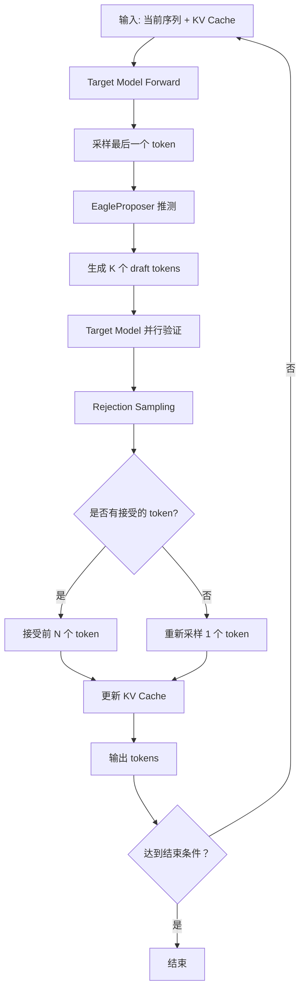

**详细步骤说明**: 

| 步骤 | 说明 | 关键代码位置 |
|------|------|-------------|
| 1. Target Forward | 对当前输入执行前向传播，输出 hidden states 和 logits | `gpu_model_runner.py` |
| 2. 采样 | 从 logits 采样得到下一个 token | `rejection_sampler.py` |
| 3. 推测 | EagleProposer 使用 hidden states 生成 K 个 draft tokens | `spec_decode/eagle.py` |
| 4. 验证 | Target Model 对所有 draft tokens 并行验证 | `gpu_model_runner.py` |
| 5. Rejection Sampling | 计算接受概率，决定接受哪些 tokens | `rejection_sampler.py` |
| 6. 状态更新 | 更新 KV Cache、seq_lens 等状态 | `gpu_model_runner.py` |

### 1.1.3 接受率与加速比理论分析

#### 接受率分析

假设 Draft Model 生成的第 i 个 token 被 Target Model 接受的概率为 $p_i$，则: 

- 第 1 个 token 被接受的概率: $P_1 = p_1$
- 前 2 个 token 都被接受的概率: $P_2 = p_1 \times p_2$
- 前 k 个 token 都被接受的概率: $P_k = \prod_{i=1}^{k} p_i$

**期望接受 token 数**: 
$$E[\text{accepted}] = \sum_{k=1}^{K} P_k = p_1 + p_1 p_2 + p_1 p_2 p_3 + \cdots + \prod_{i=1}^{K} p_i$$

当假设所有 $p_i = p$（独立同分布）时: 
$$E[\text{accepted}] = p + p^2 + p^3 + \cdots + p^K = \frac{p(1-p^K)}{1-p}$$

#### 加速比分析

定义: 
- $T_{target}$: Target Model 一次 forward 的时间
- $T_{draft}$: Draft Model 一次 forward 的时间
- $\gamma = T_{draft} / T_{target}$: Draft 与 Target 的时间比（通常 $\gamma \ll 1$）
- $E$: 期望接受的 token 数

**传统自回归**生成 K 个 token 的时间: $K \times T_{target}$

**Speculative Decoding** 生成 K 个 token 的时间（近似）: 
- 1 次 Target forward for verification: $T_{target}$
- K 次 Draft forward: $K \times T_{draft} = K \gamma T_{target}$
- 总计: $(1 + K\gamma) T_{target}$

**理论加速比**: 
$$\text{Speedup} = \frac{K}{1 + K\gamma} \times \frac{1}{1 - \text{reject rate}}$$

更精确的，考虑接受率后的加速比: 
$$\text{Speedup} = \frac{E + 1}{1 + K\gamma}$$

其中 $E+1$ 是因为除了接受的 E 个 token 外，还会重新采样 1 个 token。

**数值示例**: 
- 假设 $\gamma = 0.1$ (Draft 是 Target 的 1/10 速度)
- 假设 $p = 0.8$ (每个 token 有 80% 接受率)
- $K = 5$: $E \approx 3.36$
- $\text{Speedup} = \frac{3.36 + 1}{1 + 0.5} \approx 2.9\times$

### 1.1.4 关键性能指标定义

| 指标 | 定义 | 计算公式 |
|------|------|----------|
| **Acceptance Rate** | 每个位置的平均接受率 | $\frac{1}{K}\sum_{i=1}^{K} p_i$ |
| **Expected Tokens/Step** | 每步期望输出的 token 数 | $E + 1$ |
| **Speedup** | 相比自回归的加速比 | $\frac{T_{autoregressive}}{T_{spec}}$ |
| **Efficiency** | 有效 token 输出比例 | $\frac{\text{accepted tokens}}{\text{total forward tokens}}$ |
| **Draft Model Overhead** | Draft Model 的时间开销占比 | $\frac{K \times T_{draft}}{T_{total}}$ |

---

## 1.2 vLLM Spec Decode 整体架构

### 1.2.1 系统架构总览图

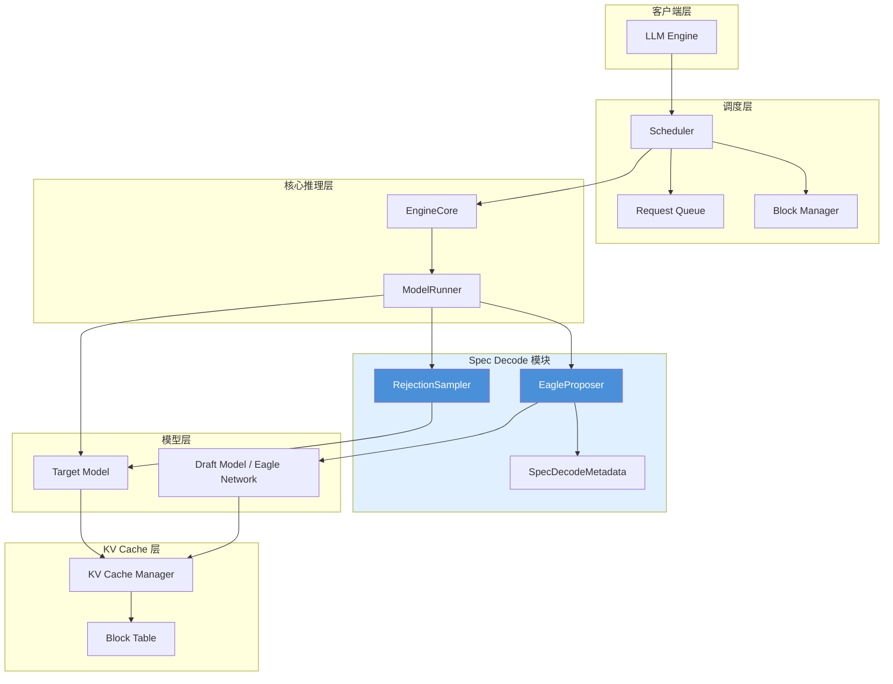

### 1.2.2 核心组件与职责划分

| 组件 | 文件路径 | 职责 |
|------|---------|------|
| **EngineCore** | `vllm/v1/engine/core.py` | 推理引擎主循环，协调调度器和模型执行 |
| **Scheduler** | `vllm/v1/core/sched/scheduler.py` | 请求调度，决定每批执行哪些请求 |
| **ModelRunner** | `vllm/v1/worker/gpu_model_runner.py` | 模型执行器，管理 forward 和采样 |
| **EagleProposer** | `vllm/v1/spec_decode/eagle.py` | Eagle 推测器，生成 draft tokens |
| **RejectionSampler** | `vllm/v1/sample/rejection_sampler.py` | 拒绝采样器，验证并接受/拒绝 draft tokens |
| **SpecDecodeMetadata** | `vllm/v1/spec_decode/metadata.py` | Spec decode 元数据，传递配置信息 |
| **KVCacheManager** | `vllm/v1/core/kv_cache_manager.py` | KV Cache 管理，负责内存分配 |

### 1.2.3 与 Target Model 的协作流程

Spec Decode 与 Target Model 的协作采用"插桩"模式: 

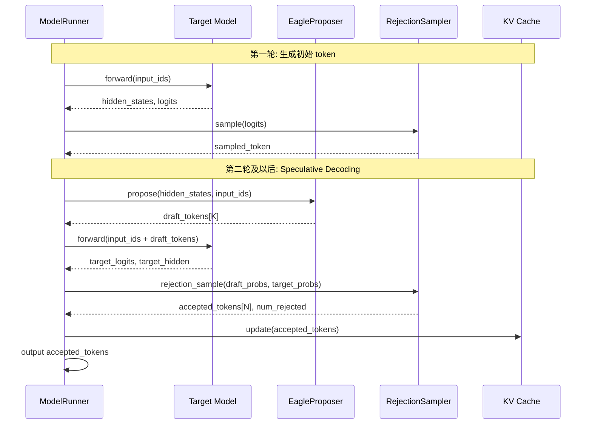

### 1.2.4 数据流与控制流分析

**数据流**（Data Flow）:
```
输入 tokens → Embedding → Target Model → hidden_states
                                       ↓
                                    EagleProposer
                                       ↓
                                 draft_tokens
                                       ↓
                            拼接 (input_ids + drafts)
                                       ↓
                              Target Model (验证)
                                       ↓
                                 RejectionSampler
                                       ↓
                                accepted tokens → KV Cache
```

**控制流**（Control Flow）:
```
EngineCore.execute_request()
    └─► Scheduler.schedule()
        └─► ModelRunner.execute_model()
            ├─► 如果是 prefilled 请求
            │   └─► TargetModel.forward()
            └─► 如果是 decoding 请求
                ├─► EagleProposer.propose()
                ├─► TargetModel.forward(验证)
                └─► RejectionSampler.sample()
```

---

## 1.3 Spec Decode 执行流程详解 - 以多轮推理为例

> 从 token 角度追踪 spec decode 在 vLLM 中的完整执行过程

### 1.3.1 示例场景设定

为了具体说明 Spec Decode 的执行流程，我们设定以下场景: 

**配置参数**: 
- `num_speculative_tokens = 5`（每次最多推测 5 个 token）
- `batch_size = 2`（两个并发请求）
- Token Tree 结构: `[(0,), (0,1), (0,2), (0,3), (0,4)]`（线性链，非树状）

**初始状态**（两个请求）: 

| 请求 | Prompt | 当前 seq_len | KV Cache Block 分配 |
|------|--------|--------------|---------------------|
| Req-0 | "The cat" | 3 tokens | Block-0 (full), Block-1 (partial) |
| Req-1 | "Hello" | 2 tokens | Block-0 (partial) |

### 1.3.2 第一轮推理（Step 1）

#### Target Model 前向

```
Req-0 输入: [The, cat] + KV Cache (3 tokens)
Req-1 输入: [Hello] + KV Cache (2 tokens)
```

**执行流程**: 

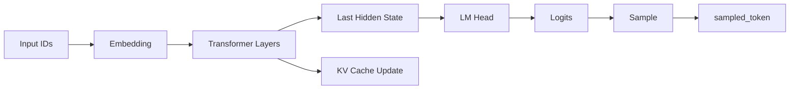

**输出**: 

| 请求 | Output Hidden States | Sampled Token |
|------|---------------------|---------------|
| Req-0 | `h_req0[768]` | `t3 = " sat"` |
| Req-1 | `h_req1[768]` | `t3 = " world"` |

#### EagleProposer 推测（Step 1 → Step 5）

**输入准备**: 
```python
# 拼接输入: shifted input_ids + last sampled token
input_ids = [t1, t2, t3]  # 右移一位，末尾补 sampled token
hidden_states = [h0, h1, h2]  # 来自 Target Model
```

**5 步推测流程**: 

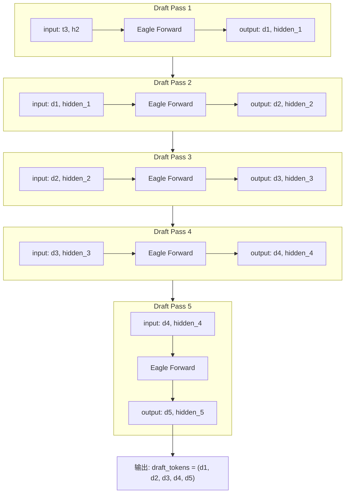

**详细输出**（假设值）: 

| 请求 | Draft Token 1 | Draft Token 2 | Draft Token 3 | Draft Token 4 | Draft Token 5 |
|------|---------------|---------------|---------------|---------------|---------------|
| Req-0 | " on" | " the" | " mat" | "." | `<EOS>` |
| Req-1 | "!" | `<EOS>` | - | - | - |

#### Target Model 验证

**验证输入构造**: 
```
Req-0: [t3=" sat", d1=" on", d2=" the", d3=" mat", d4=".", d5=<EOS>]
Req-1: [t3=" world", d1="!", d2=<EOS>, PAD, PAD]
```

**Tree Attention 构建**: 
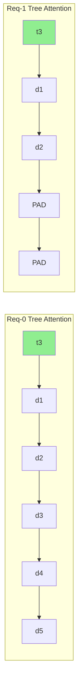

每个 token 只能 attend 到它前面的 token（causal mask + tree structure）。

**验证输出**: 

| 请求 | Position | Target Logits | Target Probs |
|------|----------|---------------|--------------|
| Req-0 | 0 (t3) | logits_t3 | p_t3 |
| Req-0 | 1 (d1) | logits_d1 | p_d1 |
| Req-0 | 2 (d2) | logits_d2 | p_d2 |
| Req-0 | 3 (d3) | logits_d3 | p_d3 |
| Req-0 | 4 (d4) | logits_d4 | p_d4 |
| Req-0 | 5 (d5) | logits_d5 | p_d5 |

#### Rejection Sampling

**接受概率计算**: 
```python
# 对每个 draft token 计算接受概率
accept_prob[i] = min(1, target_prob[draft_token[i]] / draft_prob[draft_token[i]])
```

**假设结果**: 

| 请求 | Draft Token | Target Prob | Draft Prob | Accept Prob | 结果 |
|------|-------------|-------------|------------|-------------|------|
| Req-0 | d1=" on" | 0.75 | 0.70 | 1.0 | ✓ 接受 |
| Req-0 | d2=" the" | 0.60 | 0.65 | 0.92 | ✓ 接受 |
| Req-0 | d3=" mat" | 0.30 | 0.55 | 0.55 | ✗ 拒绝 |
| Req-0 | d4="." | - | - | - | ✗ 跳过 |
| Req-0 | d5=<EOS> | - | - | - | ✗ 跳过 |
| Req-1 | d1="!" | 0.85 | 0.80 | 1.0 | ✓ 接受 |
| Req-1 | d2=<EOS> | 0.20 | 0.45 | 0.44 | ✗ 拒绝 |

**重新采样**: 
对于第一个被拒绝的位置（Req-0 的 d3），计算 residual distribution: 
```python
residual_prob = target_prob - accept_prob * draft_prob
resampled_token = sample(residual_prob)  # 例如: "floor"
```

**最终输出**: 

| 请求 | Accepted Tokens | Num Accepted | Resampled | Final Output |
|------|-----------------|--------------|-----------|--------------|
| Req-0 | [" on", " the"] | 2 | " floor" | [" on", " the", " floor"] |
| Req-1 | ["!"] | 1 | " today" | ["!", " today"] |

#### 状态更新

**KV Cache 更新**: 
```
Req-0: 新增 3 个 token 的 KV → Block-1 (完成), Block-2 (部分)
Req-1: 新增 2 个 token 的 KV → Block-0 (完成), Block-1 (部分)
```

**请求状态更新**: 
```python
# Req-0
req_0.seq_len += 3  # 3 → 6
req_0.token_ids.extend([" on", " the", " floor"])
req_0.num_rejected_tokens = 3  # d3, d4, d5 被拒绝/跳过

# Req-1
req_1.seq_len += 2  # 2 → 4
req_1.token_ids.extend(["!", " today"])
req_1.num_rejected_tokens = 1  # d2 被拒绝
```

### 1.3.3 第二轮推理（Step 2）

#### 输入状态继承

| 请求 | Last Accepted Token | Current seq_len | num_rejected |
|------|---------------------|-----------------|--------------|
| Req-0 | " floor" | 6 | 3 |
| Req-1 | " today" | 4 | 1 |

#### 执行流程（简化）

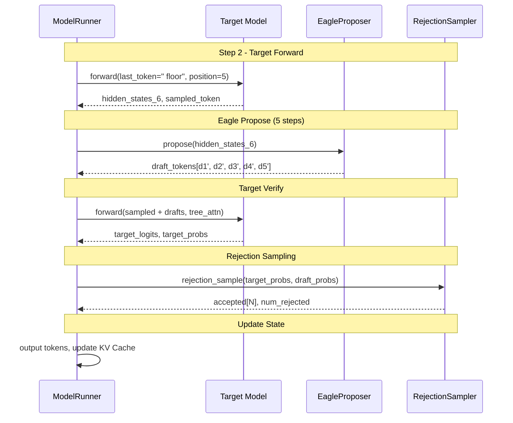

### 1.3.4 多轮推理的状态传递

#### Token 级别状态

| 状态变量 | 类型 | 用途 | 更新时机 |
|----------|------|------|----------|
| `last_sampled_tokens` | Tensor[max_num_reqs] | 上一轮采样的 token | 每轮采样后 |
| `num_rejected_tokens` | Tensor[max_num_reqs] | 被拒绝的 token 数 | Rejection Sampling 后 |
| `seq_lens` | Tensor[max_num_reqs] | 当前序列长度 | KV Cache 更新后 |
| `token_ids` | List[Tensor] | 每请求的 token 序列 | 每轮输出后 |

#### KV Cache 状态

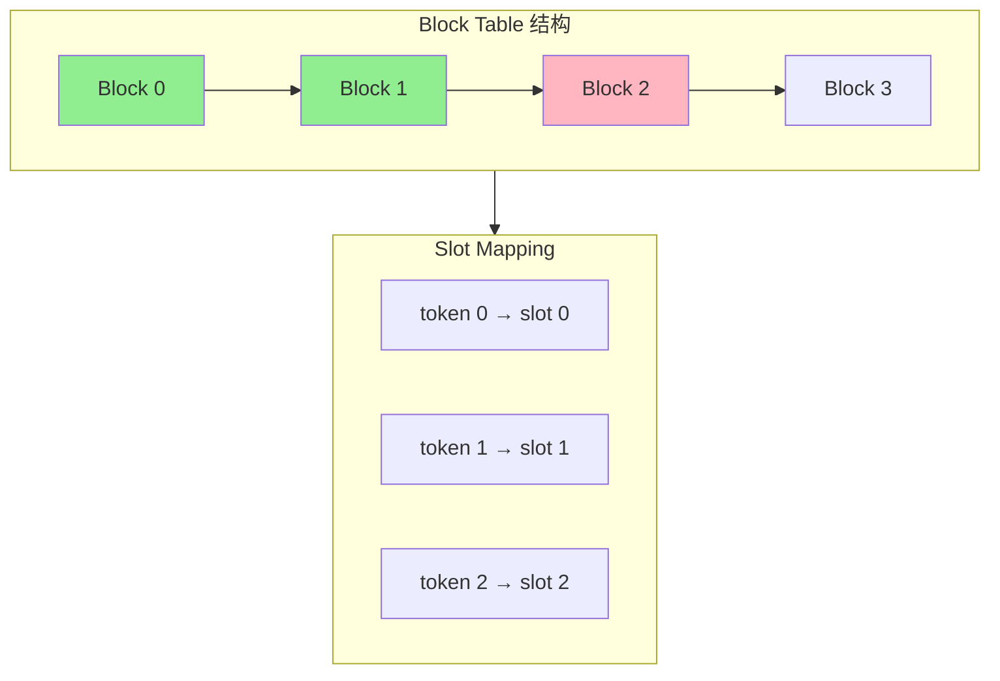

**增量更新机制**: 
- 新接受的 token 分配到下一个可用的 slot
- Block Table 动态扩展（当当前 block 满时分配新 block）

#### Proposer 内部状态

| 缓冲区 | 大小 | 用途 |
|--------|------|------|
| `input_ids` | [max_num_tokens] | 当前输入 token IDs |
| `positions` | [max_num_tokens] | 位置 IDs |
| `hidden_states` | [max_num_tokens, hidden_size] | 隐藏状态 |
| `draft_tokens` | [max_num_reqs, num_spec_tokens] | 生成的 draft tokens |

### 1.3.5 Token 流动全景图

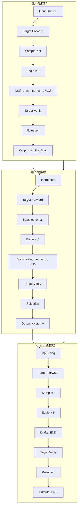

### 1.3.6 关键代码位置索引

| 文件 | 路径 | 关键函数/类 |
|------|------|-------------|
| **调度循环入口** | `vllm/v1/engine/core.py` | `EngineCore.execute_model()` |
| **Model Runner** | `vllm/v1/worker/gpu_model_runner.py` | `GPUModelRunner._execute_model()` |
| **EagleProposer** | `vllm/v1/spec_decode/eagle.py` | `EagleProposer.propose()` |
| **RejectionSampler** | `vllm/v1/sample/rejection_sampler.py` | `RejectionSampler.rejection_sample()` |
| **SpecDecodeMetadata** | `vllm/v1/spec_decode/metadata.py` | `SpecDecodeMetadata` |
| **Tree Attention** | `vllm/v1/attention/backends/tree_attn.py` | `TreeAttentionMetadata` |

---

## 1.4 vLLM-Ascend 架构差异

### 1.4.1 昇腾硬件特性概述

**昇腾 NPU 架构**: 
- **计算单元**: 达芬奇架构（Cube + Vector + Scalar 单元）
- **内存层次**: Global Memory → L1 Buffer → L0 Buffer → Register
- **通信**: HCCL（Huawei Collective Communication Library）

**与 GPU 的主要差异**: 

| 特性 | NVIDIA GPU | Ascend NPU |
|------|------------|------------|
| 计算单元 | CUDA Core / Tensor Core | Cube / Vector / Scalar |
| 内存模型 | HBM → L2 → L1 → Register | HBM → Global Memory → L1 → L0 |
| 通信库 | NCCL | HCCL |
| 编程模型 | CUDA | CANN (Compute Architecture for Neural Networks) |
| 图执行 | CUDA Graph | ACL Graph |

### 1.4.2 vLLM 与 vLLM-Ascend 的协作模式

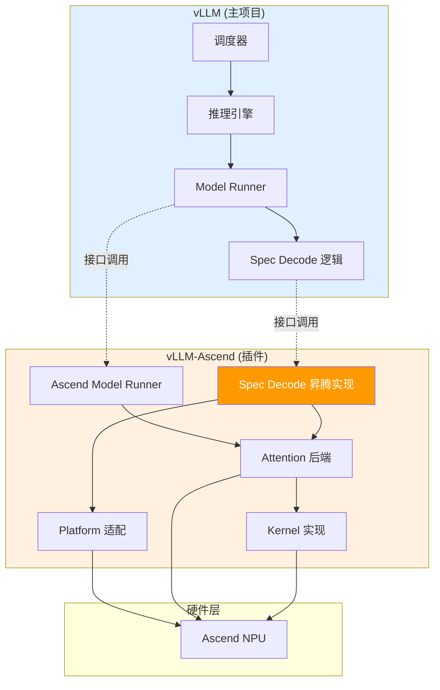

**插件化设计原则**: 
1. vLLM 定义标准接口
2. vLLM-Ascend 实现昇腾特定的后端
3. 运行时通过 `current_platform` 自动选择

### 1.4.3 差异化实现总览

| 模块 | vLLM (GPU) | vLLM-Ascend (NPU) | 差异说明 |
|------|------------|-------------------|----------|
| **通信** | NCCL | HCCL | 集合通信 API 不同 |
| **Attention** | FlashAttention / Triton | Ascend Flash Attention | Kernel 实现不同 |
| **Spec Decode** | CUDA Kernel | Ascend Kernel / Triton | Kernel 适配 |
| **CUDA Graph** | CUDA Graph | ACL Graph | 图捕获 API 不同 |
| **内存管理** | torch.cuda | torch_npu | 内存分配器差异 |
| **编译** | torch.compile | torch.compile + CANN | 后端编译器不同 |

### 1.4.4 架构对比图

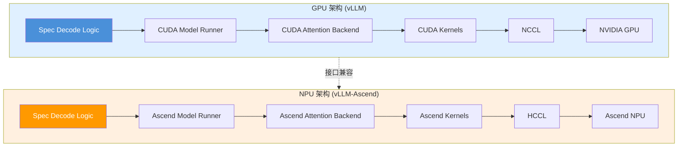

---

# 第二部分: Spec Decode 核心接口与基类分析

## 2.1 SpecDecodeBaseProposer 基类详解

### 2.1.1 类结构与核心属性

`SpecDecodeBaseProposer` 是所有推测解码方法的抽象基类，定义了统一的接口和共享的基础设施。

**类层次结构**: 
```
SpecDecodeBaseProposer (ABC)
├── EagleProposer (vllm/v1/spec_decode/eagle.py)
│   └── AscendEagleProposer (vllm_ascend/spec_decode/eagle_proposer.py)
├── DraftModelProposer
├── MtpProposer
├── MedusaProposer
├── NgramProposer
└── SuffixDecodingProposer
```

**核心属性**（`vllm/v1/spec_decode/base.py:39-270`）: 

```python
class SpecDecodeBaseProposer(ABC):
    def __init__(
        self,
        vllm_config: VllmConfig,
        device: torch.device,
        pass_hidden_states_to_model: bool = False,
        runner=None,
    ):
        # ========== 配置相关 ==========
        self.vllm_config = vllm_config
        self.speculative_config = vllm_config.speculative_config
        self.draft_model_config = self.speculative_config.draft_model_config
        self.method = self.speculative_config.method
        self.num_speculative_tokens = self.speculative_config.num_speculative_tokens

        # ========== 模型维度相关 ==========
        self.hidden_size = self.draft_model_config.get_hidden_size()
        self.inputs_embeds_size = self.draft_model_config.get_inputs_embeds_size()
        self.dtype = vllm_config.model_config.dtype
        self.max_model_len = vllm_config.model_config.max_model_len

        # ========== 并行配置 ==========
        self.dp_rank = vllm_config.parallel_config.data_parallel_rank
        self.parallel_drafting = self.speculative_config.parallel_drafting

        # ========== 缓冲区大小 ==========
        max_batch_size = vllm_config.scheduler_config.max_num_seqs
        self.max_num_tokens = vllm_config.scheduler_config.max_num_batched_tokens

        # ========== 持久化缓冲区 (CUDA Graph 兼容) ==========
        self.input_ids = torch.zeros(self.max_num_tokens, dtype=torch.int32, device=device)
        self.positions = torch.zeros(self.max_num_tokens, dtype=torch.int64, device=device)
        self.hidden_states = torch.zeros((self.max_num_tokens, self.hidden_size), dtype=self.dtype, device=device)
        self.inputs_embeds = torch.zeros((self.max_num_tokens, self.inputs_embeds_size), dtype=self.dtype, device=device)

        # ========== Tree Attention 相关 ==========
        self.tree_choices = ast.literal_eval(spec_token_tree)
        self.cu_drafts_per_level = [...]
        self.child_drafts_per_level = [...]
        self.tree_draft_pos_offsets = torch.arange(...)
```

### 2.1.2 初始化流程分析

**初始化流程图**: 

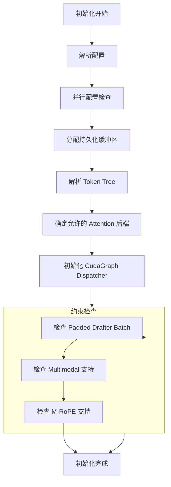

### 2.1.3 关键缓冲区设计

#### input_ids 缓冲区

```python
self.input_ids = torch.zeros(
    self.max_num_tokens, dtype=torch.int32, device=device
)
```

**用途**: 
- 存储当前迭代的输入 token IDs
- 对于 Eagle: 包含 shifted input_ids + last sampled token
- 对于 Draft Model: 包含完整的输入序列

**内存布局**: 
```
Batch: [Req-0 tokens] [Req-1 tokens] ... [Req-N tokens] [PAD ...]
       ← query_start_loc[0] → ← query_start_loc[1] →
```

#### positions 缓冲区

```python
if self.uses_mrope:
    self.mrope_positions = torch.zeros(
        (3, self.max_num_tokens + 1), dtype=torch.int64, device=device
    )
else:
    self.positions = torch.zeros(
        self.max_num_tokens, dtype=torch.int64, device=device
    )
```

**M-RoPE vs 1D-RoPE**: 
- M-RoPE: 3D 位置编码（文本、图像、视频维度）
- 1D-RoPE: 标准位置编码

#### hidden_states 缓冲区

```python
self.hidden_states = torch.zeros(
    (self.max_num_tokens, self.hidden_size), dtype=self.dtype, device=device
)
```

**用途**: 
- 存储 Target Model 输出的 hidden states
- 作为 EagleProposer 的输入
- 在多步推测中传递中间隐藏状态

### 2.1.4 CUDA Graph 支持机制

**CUDAGraphDispatcher**: 
```python
self.cudagraph_dispatcher = CudagraphDispatcher(self.vllm_config)
```

**工作模式**: 
| 模式 | 说明 | 适用场景 |
|------|------|----------|
| `NONE` | 不使用 CUDA Graph | 动态 batch |
| `FULL` | 完整 CUDA Graph | 固定 batch size |
| `PIECEWISE` | 分段 CUDA Graph | 部分动态场景 |

**捕获流程**: 
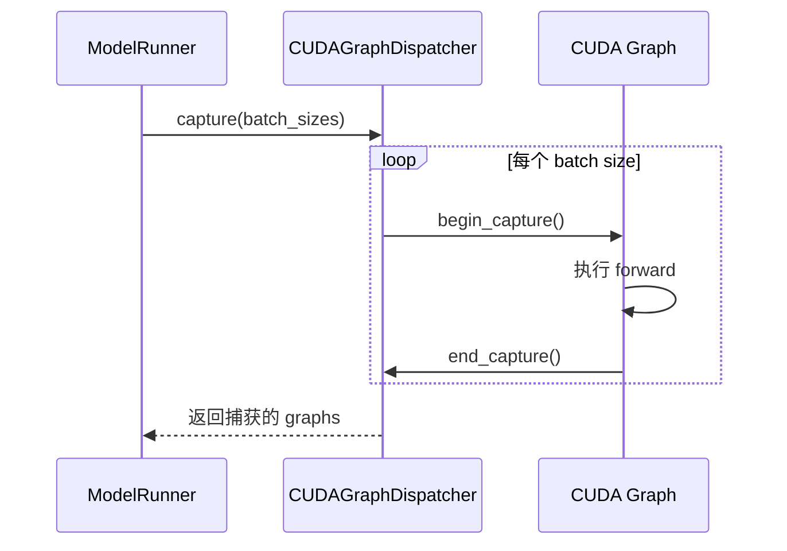

### 2.1.5 类图

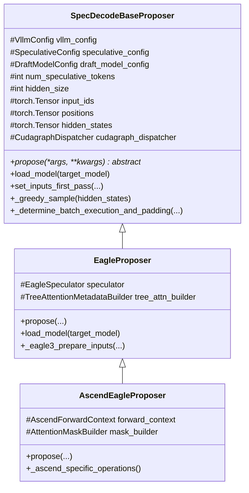

## 2.2 核心接口定义

### 2.2.1 `propose()` 接口规范

```python
@abstractmethod
def propose(self, *args, **kwargs):
    """Propose draft tokens for speculative decoding.

    Returns:
        Draft tokens tensor or list, depending on the proposer type.
    """
    raise NotImplementedError("Subclasses must implement propose()")
```

**EagleProposer 实现**（简化版）: 
```python
def propose(
    self,
    input_batch: InputBatch,
    attn_metadata: dict[str, Any],
    slot_mappings: dict[str, torch.Tensor],
    last_hidden_states: torch.Tensor,
    aux_hidden_states: list[torch.Tensor] | None,
    num_sampled: torch.Tensor,
    num_rejected: torch.Tensor,
    last_sampled: torch.Tensor,
    next_prefill_tokens: torch.Tensor,
    temperature: torch.Tensor,
    seeds: torch.Tensor,
) -> torch.Tensor:
    # 1. 准备 Eagle 输入
    last_token_indices = prepare_eagle_inputs(...)

    # 2. 运行 Eagle 模型 (prefill)
    last_hidden_states, hidden_states = self.run_model(...)

    # 3. 采样第一个 draft token
    draft_tokens[:, 0] = gumbel_sample(...)

    # 4. 多步 decode 生成剩余 draft tokens
    self.generate_draft(...)

    return draft_tokens
```

### 2.2.2 `load_model()` 接口规范

```python
def load_model(self, target_model: nn.Module) -> None:
    """Load the draft model or initialize the proposer."""
    pass
```

**EagleProposer 实现**: 
```python
def load_model(self, target_model: nn.Module) -> None:
    # 从 target model 构建 eagle 模型
    self.model = load_eagle_model(target_model, self.vllm_config)
```

### 2.2.3 `set_inputs_first_pass()` 接口规范

```python
def set_inputs_first_pass(
    self,
    target_token_ids: torch.Tensor,
    next_token_ids: torch.Tensor,
    target_positions: torch.Tensor,
    target_hidden_states: torch.Tensor,
    token_indices_to_sample: torch.Tensor | None,
    cad: CommonAttentionMetadata,
    num_rejected_tokens_gpu: torch.Tensor | None = None,
) -> tuple[int, torch.Tensor, CommonAttentionMetadata]:
    """Set inputs for the first pass of speculative decoding."""
    num_tokens = target_token_ids.shape[0]

    # 复制输入到缓冲区
    self.input_ids[:num_tokens] = target_token_ids
    self._set_positions(num_tokens, target_positions)
    self.hidden_states[:num_tokens] = target_hidden_states

    return num_tokens, token_indices_to_sample, cad
```

### 2.2.4 工具方法解析

#### `_greedy_sample()`

```python
def _greedy_sample(self, hidden_states: torch.Tensor) -> torch.Tensor:
    """Greedy-sample draft tokens from hidden states."""
    if self.use_local_argmax_reduction:
        return self.model.get_top_tokens(hidden_states)
    return self.model.compute_logits(hidden_states).argmax(dim=-1)
```

#### `_determine_batch_execution_and_padding()`

```python
def _determine_batch_execution_and_padding(
    self,
    num_tokens: int,
    use_cudagraphs: bool = True,
) -> tuple[CUDAGraphMode, int, torch.Tensor | None]:
    """Determine batch execution mode and padding for CUDA graphs."""
    cudagraph_mode, batch_desc = self.cudagraph_dispatcher.dispatch(
        num_tokens,
        valid_modes=({CUDAGraphMode.NONE} if not use_cudagraphs else None),
    )
    num_tokens_padded = batch_desc.num_tokens

    # DP coordination logic...

    return cudagraph_mode, num_tokens_padded, num_tokens_across_dp
```

## 2.3 vLLM-Ascend 的 Spec Decode 入口

### 2.3.1 `get_spec_decode_method()` 工厂函数分析

**代码位置**: `vllm_ascend/spec_decode/__init__.py`

```python
def get_spec_decode_method(method, vllm_config, device, runner):
    if method == "ngram":
        return NgramProposer(vllm_config, device, runner)
    elif method in ("eagle", "eagle3"):
        return EagleProposer(vllm_config, device, runner)
    elif method == "mtp":
        return MtpProposer(vllm_config, device, runner)
    elif method == "suffix":
        return SuffixDecodingProposer(vllm_config, device, runner)
    elif method == "medusa":
        return MedusaProposer(vllm_config, device, runner)
    else:
        raise ValueError(f"Unknown speculative decoding method: {method}")
```

### 2.3.2 五种推测方法的注册与分发

**支持的方法**: 

| 方法 | Proposer 类 | 文件路径 |
|------|-------------|----------|
| `ngram` | `NgramProposer` | `vllm_ascend/spec_decode/ngram_proposer.py` |
| `eagle`/`eagle3` | `EagleProposer` | `vllm_ascend/spec_decode/eagle_proposer.py` |
| `mtp` | `MtpProposer` | `vllm_ascend/spec_decode/mtp_proposer.py` |
| `suffix` | `SuffixDecodingProposer` | `vllm_ascend/spec_decode/suffix_proposer.py` |
| `medusa` | `MedusaProposer` | `vllm_ascend/spec_decode/medusa_proposer.py` |

### 2.3.3 代码位置

```
vllm-ascend/
└── vllm_ascend/
    └── spec_decode/
        ├── __init__.py              # get_spec_decode_method()
        ├── eagle_proposer.py        # EagleProposer (昇腾实现)
        ├── mtp_proposer.py          # MtpProposer
        ├── medusa_proposer.py       # MedusaProposer
        ├── ngram_proposer.py        # NgramProposer
        └── suffix_proposer.py       # SuffixDecodingProposer
```

---

---

# 第三部分: Eagle3 推测解码深度分析

## 3.1 Eagle3 算法原理

### 3.1.1 Eagle3 与 Eagle/Eagle2 的演进

Eagle（Extrapolation Algorithm for Greater Language-model Efficiency）系列是一种基于特征预测的推测解码方法。

**Eagle 系列演进**: 

| 版本 | 发布时间 | 核心改进 | 加速比提升 |
|------|----------|----------|------------|
| Eagle | 2024.06 | 使用特征预测代替自回归 | 2.0-2.5x |
| Eagle2 | 2024.10 | 引入树结构注意力 | 2.5-3.0x |
| Eagle3 | 2025.03 | 多隐藏状态融合 + 优化树结构 | 3.0-3.5x |

**Eagle3 的核心创新**: 

1. **多隐藏状态融合机制**: 
   - Eagle3 使用多层 hidden states 的组合作为输入
   - 通过 `combine_hidden_states()` 将多层特征融合
   - 提高了特征预测的准确性

2. **优化的树结构注意力**: 
   - 支持更复杂的 token tree 结构
   - 允许非线性的推测路径
   - 提高了长序列推测的准确性

3. **CPU-GPU 协同优化**: 
   - 关键 kernel 使用 Triton 实现
   - 减少 CPU-GPU 同步开销
   - 支持 CUDA Graph 捕获

### 3.1.2 特征提取器架构设计

**Eagle3 模型结构**: 

```
Target Model (Llama 架构)
├── Embedding
├── Transformer Layers × N
│   ├── Self-Attention
│   └── MLP
└── LM Head

Eagle3 Model (扩展架构)
├── Embedding (共享)
├── Transformer Layers × N
│   ├── Self-Attention (共享)
│   ├── MLP (共享)
│   └── Eagle Adapter (新增)
│       ├── Feature Extractor
│       └── Hidden State Combiner
└── LM Head (共享)
```

**Eagle Adapter 详细结构**: 

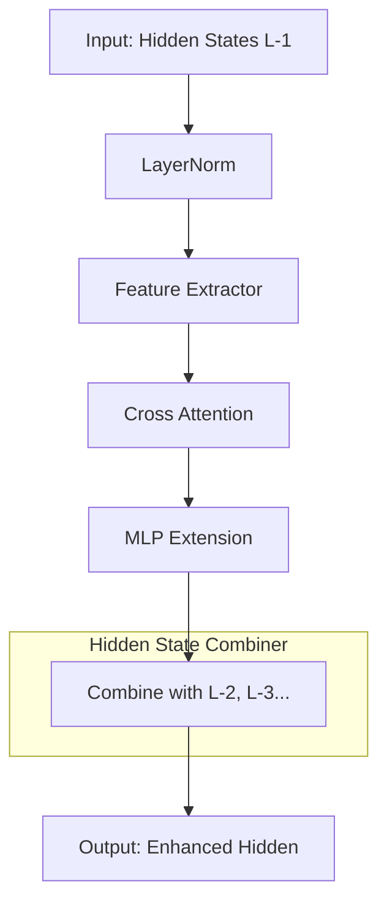

**代码位置**: `vllm/model_executor/models/llama_eagle3.py`

```python
class Eagle3LlamaForCausalLM(nn.Module):
    def combine_hidden_states(
        self, hidden_states: torch.Tensor
    ) -> torch.Tensor:
        """Combine multiple layers of hidden states.

        Eagle3 uses a learned combination of hidden states from
        multiple transformer layers to enhance feature representation.

        Args:
            hidden_states: Concatenated hidden states from multiple layers.
                          Shape: [num_tokens, num_layers * hidden_size]

        Returns:
            Combined hidden states with the same dimension as a single layer.
        """
        # Reshape: [num_tokens, num_layers * hidden_size]
        #       -> [num_tokens, num_layers, hidden_size]
        batch_size, seq_len = hidden_states.shape[:2]
        combined = hidden_states.view(batch_size, seq_len, self.num_hidden_layers, -1)

        # Apply learned weights for combination
        weights = F.softmax(self.combination_weights, dim=0)
        output = torch.einsum('blnh,l->bhn', combined, weights)

        return output
```

### 3.1.3 树结构注意力机制 (Tree Attention)

**Tree Attention 原理**: 

传统自回归注意力: 
```
Token:  [t0] [t1] [t2] [t3] [t4]
Attention Mask (Causal):
t0: [1 0 0 0 0]
t1: [1 1 0 0 0]
t2: [1 1 1 0 0]
t3: [1 1 1 1 0]
t4: [1 1 1 1 1]
```

Tree Attention（Eagle3）: 
```
Token Tree Structure:
        t0
       / | \
      d1 d2 d3
     / \
    d4  d5

Attention Mask (Tree-aware):
t0: [1 0 0 0 0 0]
d1: [1 1 0 0 0 0]
d2: [1 0 1 0 0 0]
d3: [1 0 0 1 0 0]
d4: [1 1 0 0 1 0]
d5: [1 1 0 0 0 1]
```

**Tree Attention 的优势**: 
1. 允许并行的多路径推测
2. 更有效地利用上下文信息
3. 提高长序列推测的准确性

### 3.1.4 Eagle3 工作流程图

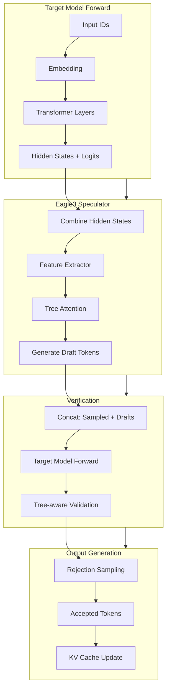

## 3.2 vLLM EagleProposer 实现 (v1 路径)

### 3.2.1 `EagleProposer` 类结构

**文件位置**: `vllm/v1/spec_decode/eagle.py`

```python
class EagleProposer(SpecDecodeBaseProposer):
    """Eagle 推测解码提案器。

    负责使用 Eagle/Eagle2/Eagle3 算法生成 draft tokens。
    """

    def __init__(
        self,
        vllm_config: VllmConfig,
        device: torch.device,
        pass_hidden_states_to_model: bool,
        runner=None,
    ):
        super().__init__(vllm_config, device, pass_hidden_states_to_model, runner)

        # Eagle 特定配置
        self.eagle3_use_aux_hidden_state = (
            self._get_eagle3_use_aux_hidden_state_from_config()
        )

        # Tree Attention 相关
        self.tree_choices = [...]  # 从配置解析
        self.cu_drafts_per_level = [...]
        self.child_drafts_per_level = [...]
```

**核心属性**: 

| 属性 | 类型 | 说明 |
|------|------|------|
| `tree_choices` | `list[tuple[int, ...]]` | Token Tree 结构定义 |
| `cu_drafts_per_level` | `list[int]` | 每层 draft token 的累积数量 |
| `child_drafts_per_level` | `list[int]` | 每层每个节点的子节点数 |
| `tree_draft_pos_offsets` | `torch.Tensor` | Tree 中的位置偏移 |

### 3.2.2 Token Tree 解析与展开

**Token Tree 配置**: 

```python
# 示例配置: 线性链 (Eagle/Eagle2)
speculative_token_tree = "[(0,), (0,1), (0,2), (0,3), (0,4)]"

# 示例配置: 树状结构 (Eagle3)
speculative_token_tree = "[(0,), (0,1), (0,2), (0,1,3), (0,1,4)]"
```

**解析过程**: 

```python
def __init__(...):
    spec_token_tree = self.speculative_config.speculative_token_tree
    assert spec_token_tree is not None

    # 解析树结构
    self.tree_choices = ast.literal_eval(spec_token_tree)
    tree_depth = len(self.tree_choices[-1])

    # 计算每层的 draft 数量
    num_drafts_per_level = [0] * tree_depth
    for node in self.tree_choices:
        num_drafts_per_level[len(node) - 1] += 1

    # 累积计算
    self.cu_drafts_per_level = [num_drafts_per_level[0]]
    self.child_drafts_per_level = [num_drafts_per_level[0]]
    for level in range(1, tree_depth):
        self.cu_drafts_per_level.append(
            self.cu_drafts_per_level[-1] + num_drafts_per_level[level]
        )
        self.child_drafts_per_level.append(
            num_drafts_per_level[level] // num_drafts_per_level[level - 1]
        )
```

**示例: 树结构展开**: 

```
输入配置: [(0,), (0,1), (0,2), (0,1,3), (0,1,4)]

树结构可视化: 
        root
       /    \
     d1(0)  d2(0)
    /   \
  d3(1) d4(1)

Flattened 顺序: [d1, d2, d3, d4]
cu_drafts_per_level: [2, 2]  # 第一层 2 个，累积 4 个
child_drafts_per_level: [2, 1]  # 第一层每节点 2 个子节点
```

### 3.2.3 输入准备流程 (`prepare_eagle_inputs`)

**Triton Kernel 实现**: 

```python
@triton.jit
def _prepare_eagle_inputs_kernel(
    last_token_indices_ptr,
    eagle_input_ids_ptr,
    eagle_positions_ptr,
    target_input_ids_ptr,
    target_positions_ptr,
    idx_mapping_ptr,
    last_sampled_ptr,
    next_prefill_tokens_ptr,
    num_sampled_ptr,
    num_rejected_ptr,
    query_start_loc_ptr,
    BLOCK_SIZE: tl.constexpr,
):
    batch_idx = tl.program_id(0)
    req_state_idx = tl.load(idx_mapping_ptr + batch_idx)

    query_start = tl.load(query_start_loc_ptr + batch_idx)
    query_end = tl.load(query_start_loc_ptr + batch_idx + 1)
    query_len = query_end - query_start

    # 考虑被拒绝的 token
    num_rejected = tl.load(num_rejected_ptr + batch_idx)
    query_len -= num_rejected

    num_sampled = tl.load(num_sampled_ptr + batch_idx)
    if num_sampled > 0:
        next_token = tl.load(last_sampled_ptr + req_state_idx).to(tl.int32)
    else:
        # Chunked prefilling
        next_token = tl.load(next_prefill_tokens_ptr + req_state_idx)

    # Shift target_input_ids by one
    for i in range(1, query_len, BLOCK_SIZE):
        block = i + tl.arange(0, BLOCK_SIZE)
        mask = block < query_len
        input_ids = tl.load(target_input_ids_ptr + query_start + block, mask=mask)
        tl.store(eagle_input_ids_ptr + query_start + block - 1, input_ids, mask=mask)

    last_token_index = query_start + query_len - 1
    tl.store(last_token_indices_ptr + batch_idx, last_token_index)
    tl.store(eagle_input_ids_ptr + last_token_index, next_token)

    # Copy positions
    for i in range(0, query_len, BLOCK_SIZE):
        block = i + tl.arange(0, BLOCK_SIZE)
        mask = block < query_len
        target_pos = tl.load(target_positions_ptr + query_start + block, mask=mask)
        tl.store(eagle_positions_ptr + query_start + block, target_pos, mask=mask)
```

**输入转换图示**: 

```
Target Model 输出: 
input_ids:    [t0, t1, t2, t3]  (prompt + sampled)
positions:    [0,  1,  2,  3]
hidden_states:[h0, h1, h2, h3]

Eagle 输入准备（shift by 1）: 
input_ids:    [t1, t2, t3, next_token]
positions:    [0,  1,  2,  3]       (保持不变)
hidden_states:[h0, h1, h2, h3]     (保持不变)
```

### 3.2.4 多步推测生成流程

**`propose()` 方法流程**: 

```python
def propose(
    self,
    target_token_ids: torch.Tensor,
    target_positions: torch.Tensor,
    target_hidden_states: torch.Tensor,
    next_token_ids: torch.Tensor,
    token_indices_to_sample: torch.Tensor | None,
    common_attn_metadata: CommonAttentionMetadata,
    sampling_metadata: SamplingMetadata,
    num_rejected_tokens_gpu: torch.Tensor | None = None,
    slot_mappings: dict[str, torch.Tensor] | None = None,
) -> torch.Tensor:

    # ========== Step 1: Eagle3 特殊处理 ==========
    if self.method == "eagle3":
        assert isinstance(self.model, Eagle3LlamaForCausalLM)
        target_hidden_states = self.model.combine_hidden_states(
            target_hidden_states
        )
        assert target_hidden_states.shape[-1] == self.hidden_size

    # ========== Step 2: 设置第一轮输入 ==========
    num_tokens, token_indices_to_sample, common_attn_metadata = (
        self.set_inputs_first_pass(...)
    )

    # ========== Step 3: 构建 Attention 元数据 ==========
    per_layer_attn_metadata = {}
    for attn_group in self.draft_attn_groups:
        attn_metadata = attn_group.get_metadata_builder().build_for_drafting(
            common_attn_metadata, draft_index=0
        )
        for layer_name in attn_group.layer_names:
            per_layer_attn_metadata[layer_name] = attn_metadata

    # ========== Step 4: 确定执行模式 (CUDA Graph) ==========
    cudagraph_runtime_mode, num_input_tokens, num_tokens_across_dp = (
        self._determine_batch_execution_and_padding(num_tokens)
    )

    # ========== Step 5: 处理多模态输入 ==========
    if self.supports_mm_inputs:
        mm_embeds, is_mm_embed = mm_embed_inputs or (None, None)
        self.inputs_embeds[:num_tokens] = self.model.embed_input_ids(
            self.input_ids[:num_tokens],
            multimodal_embeddings=mm_embeds,
            is_multimodal=is_mm_embed,
        )
        input_ids = None
        inputs_embeds = self.inputs_embeds[:num_input_tokens]
    else:
        input_ids = self.input_ids[:num_input_tokens]
        inputs_embeds = None

    # ========== Step 6: 第一轮 Forward (Prefill) ==========
    model_kwargs = {
        "input_ids": input_ids,
        "positions": self._get_positions(num_input_tokens),
        "inputs_embeds": inputs_embeds,
    }
    if self.pass_hidden_states_to_model:
        model_kwargs["hidden_states"] = self.hidden_states[:num_input_tokens]

    with set_forward_context(...):
        ret_hidden_states = self.model(**model_kwargs)
        if not self.model_returns_tuple():
            last_hidden_states = ret_hidden_states
            hidden_states = last_hidden_states
        else:
            last_hidden_states, hidden_states = ret_hidden_states

    # ========== Step 7: 采样第一个 draft token ==========
    sample_hidden_states = last_hidden_states[token_indices_to_sample]

    if self.num_speculative_tokens == 1:
        # 只需生成一个 draft token，直接返回
        draft_token_ids = self._greedy_sample(sample_hidden_states)
        return draft_token_ids.view(-1, self.num_speculative_tokens)

    # 准备后续步骤的输入
    if self.uses_mrope:
        positions = self.mrope_positions[:, token_indices_to_sample]
    else:
        positions = self.positions[token_indices_to_sample]

    if self.method == "mtp":
        hidden_states = self.hidden_states[token_indices_to_sample]
    else:
        hidden_states = hidden_states[token_indices_to_sample]

    # ========== Step 8: Tree Attention 或 串行生成 ==========
    if isinstance(attn_metadata, TreeAttentionMetadata):
        # 使用 Tree Attention 生成所有 draft tokens
        logits = self.model.compute_logits(sample_hidden_states)
        draft_token_ids_list = self.propose_tree(...)
        return torch.cat(draft_token_ids_list, dim=1)

    # 串行生成剩余的 draft tokens
    draft_token_ids = self._greedy_sample(sample_hidden_states)
    draft_token_ids_list = [draft_token_ids]

    for token_index in range(self.num_speculative_tokens - 1):
        # 更新输入
        input_ids = draft_token_ids_list[-1].int()
        positions += 1
        common_attn_metadata.seq_lens += 1

        # 计算 slot mapping
        block_size = self.draft_attn_groups[0].kv_cache_spec.block_size
        block_numbers = positions // block_size
        block_ids = common_attn_metadata.block_table_tensor.gather(...)
        common_attn_metadata.slot_mapping = block_ids * block_size + positions % block_size

        # 重建 Attention 元数据
        for attn_group in self.draft_attn_groups:
            attn_metadata = attn_group.get_metadata_builder().build_for_drafting(
                common_attn_metadata, draft_index=token_index + 1
            )
            for layer_name in attn_group.layer_names:
                per_layer_attn_metadata[layer_name] = attn_metadata

        # 复制输入到缓冲区（CUDA Graph 兼容）
        self.input_ids[:batch_size] = input_ids
        self.hidden_states[:batch_size] = hidden_states

        # 运行模型
        model_kwargs = {
            "input_ids": input_ids,
            "positions": self._get_positions(input_batch_size),
        }
        with set_forward_context(...):
            ret_hidden_states = self.model(**model_kwargs)
            last_hidden_states, hidden_states = ret_hidden_states

        # 采样下一个 draft token
        draft_token_ids = self._greedy_sample(last_hidden_states[:batch_size])
        draft_token_ids_list.append(draft_token_ids)

    # [batch_size, num_speculative_tokens]
    draft_token_ids = torch.stack(draft_token_ids_list, dim=1)
    return draft_token_ids
```

### 3.2.5 Tree Attention 元数据构建

**TreeAttentionMetadata 结构**: 

```python
class TreeAttentionMetadata:
    def __init__(
        self,
        query_start_loc: torch.Tensor,      # [batch_size + 1]
        seq_lens: torch.Tensor,             # [batch_size]
        block_table: torch.Tensor,          # [batch_size, max_blocks]
        tree_structure: list[tuple[int, ...]],  # Token Tree
        num_levels: int,                    # Tree 深度
    ):
        self.query_start_loc = query_start_loc
        self.seq_lens = seq_lens
        self.block_table = block_table
        self.tree_structure = tree_structure
        self.num_levels = num_levels

        # 预计算 Tree 相关的索引
        self._build_tree_indices()

    def _build_tree_indices(self):
        """构建 Tree 访问索引。"""
        # 为每个 token 计算其在 Tree 中的父节点索引
        self.parent_indices = []
        for node in self.tree_structure:
            if len(node) == 1:
                # 根节点的直接子节点
                self.parent_indices.append(-1)  # 无父节点
            else:
                # 找到父节点在扁平化列表中的索引
                parent_path = node[:-1]
                parent_idx = self.tree_structure.index(parent_path)
                self.parent_indices.append(parent_idx)
```

**Tree Attention Mask 构建**: 

```python
def build_tree_attention_mask(tree_structure):
    """构建树结构注意力掩码。

    每个 token 只能 attend 到: 
    1. 它的所有祖先节点
    2. 它自己
    """
    n = len(tree_structure)
    mask = torch.zeros(n, n, dtype=torch.bool)

    for i, node in enumerate(tree_structure):
        # 自己 attend 自己
        mask[i, i] = True

        # attend 所有祖先
        for j in range(i):
            ancestor_node = tree_structure[j]
            # 检查是否是祖先（前缀匹配）
            if len(ancestor_node) < len(node) and ancestor_node == node[:len(ancestor_node)]:
                mask[i, j] = True

    return mask
```

## 3.3 vLLM-Ascend EagleProposer 实现

### 3.3.1 继承与扩展设计

**文件位置**: `vllm_ascend/spec_decode/eagle_proposer.py`

**类继承关系**: 

```python
# vLLM 原版
class EagleProposer(SpecDecodeBaseProposer):
    ...

# vLLM-Ascend 昇腾实现
class EagleProposer(VllmEagleProposer):
    """昇腾硬件上的 Eagle 推测解码实现。

    继承自 vLLM 的 EagleProposer，添加昇腾特定的优化和适配。
    """
```

**主要扩展点**: 

| 扩展点 | 说明 |
|--------|------|
| `ACLGraphWrapper` | 昇腾图执行包装器 |
| `set_ascend_forward_context` | 昇腾前向传播上下文 |
| `AscendCommonAttentionMetadata` | 昇腾 Attention 元数据 |
| `AttentionMaskBuilder` | 昇腾 Attention Mask 构建器 |

### 3.3.2 `AscendEagleProposer` 核心差异

**初始化差异**: 

```python
class EagleProposer(VllmEagleProposer):
    _runnable: ACLGraphWrapper | Callable

    def __init__(self, vllm_config: VllmConfig, device: torch.device, runner=None):
        super().__init__(vllm_config, device, runner)

        # ========== 昇腾特定初始化 ==========
        self.use_async_scheduling = self.vllm_config.scheduler_config.async_scheduling
        self.decode_threshold = 1 + self.num_speculative_tokens

        # Query Start Loc 缓冲区
        self.query_start_loc = self.runner._make_buffer(
            self.runner.max_num_reqs + 1, dtype=torch.int32
        )
        self.arange_cpu = torch.arange(self.arange.shape[0], device="cpu", dtype=torch.int32)

        # Attention Mask Builder
        self.attn_mask_builder = AttentionMaskBuilder(self.device)

        # 稀疏专家支持
        self.enable_shared_expert_dp = shared_expert_dp_enabled()

        # 并行配置（昇腾特有）
        self.pcp_size = self.runner.pcp_size  # Pipeline Context Parallel
        self.dcp_size = self.runner.dcp_size  # Data Context Parallel
        self.pcp_rank = self.runner.pcp_rank
        self.dcp_rank = self.runner.dcp_rank

        # Slot Mapping 组（多步推测用）
        slot_mapping_lens = self.runner.max_num_tokens + 2 * self.pcp_size * self.runner.max_num_reqs
        self.slot_mapping_group = [
            torch.zeros(slot_mapping_lens, dtype=torch.int32, device=device, pin_memory=self.runner.pin_memory)
            for _ in range(self.num_speculative_tokens)
        ]

        # 默认运行模式
        self._runnable = self._run_merged_draft
```

### 3.3.3 Ascend Forward Context 集成

**昇腾前向上下文**: 

```python
from vllm_ascend.ascend_forward_context import set_ascend_forward_context

def dummy_run(self, num_tokens: int, ...):
    # ... 准备工作

    with set_ascend_forward_context(
        multi_steps_attn_metadata[0] if multi_steps_attn_metadata else None,
        self.vllm_config,
        num_tokens=num_tokens,
        num_tokens_across_dp=num_tokens_across_dp,
        num_actual_tokens=0,
        in_profile_run=is_profile,
        batch_descriptor=batch_descriptor,
        aclgraph_runtime_mode=aclgraph_runtime_mode,
        is_draft_model=True,  # 标记为 draft model
        draft_attn_metadatas=multi_steps_attn_metadata,
    ):
        # 重置 MOE layer 索引
        forward_context = get_forward_context()
        if forward_context is not None:
            forward_context.moe_layer_index = 0

        # 执行模型
        self._runnable(
            num_input_tokens=num_tokens,
            batch_size=batch_size,
            last_token_indices=self.last_token_indices[:batch_size],
            target_positions=model_positions,
            inputs_embeds=None,
            multi_steps_attn_metadata=multi_steps_attn_metadata,
            is_dummy=True,
            num_tokens=num_tokens,
        )
```

**Ascend Forward Context 与原生对比**: 

| 特性 | vLLM (`set_forward_context`) | vLLM-Ascend (`set_ascend_forward_context`) |
|------|------------------------------|--------------------------------------------|
| 图执行模式 | `cudagraph_runtime_mode` | `aclgraph_runtime_mode` |
| Attention 元数据 | 标准格式 | `AscendCommonAttentionMetadata` |
| MOE 支持 | 标准 | 昇腾稀疏专家优化 |
| 并行上下文 | 标准 | PCP/DCP 支持 |

### 3.3.4 Attention Mask 构建差异

**昇腾 Attention Mask Builder**: 

```python
class AttentionMaskBuilder:
    """昇腾 Attention Mask 构建器。

    负责为不同的注意力模式构建合适的 mask。
    """

    def __init__(self, device: torch.device):
        self.device = device

    def build_causal_mask(self, seq_len: int) -> torch.Tensor:
        """构建因果注意力掩码。"""
        mask = torch.triu(
            torch.ones(seq_len, seq_len, device=self.device, dtype=torch.bool),
            diagonal=1
        )
        return ~mask  # 反转: True 表示可见

    def build_tree_mask(
        self,
        tree_structure: list[tuple[int, ...]]
    ) -> torch.Tensor:
        """构建树结构注意力掩码。"""
        n = len(tree_structure)
        mask = torch.zeros(n, n, device=self.device, dtype=torch.bool)

        for i, node in enumerate(tree_structure):
            mask[i, i] = True  # 自注意力

            for j in range(i):
                ancestor = tree_structure[j]
                if len(ancestor) < len(node) and ancestor == node[:len(ancestor)]:
                    mask[i, j] = True  # 祖先注意力

        return mask
```

### 3.3.5 HCCL 通信集成点

**昇腾分布式通信**: 

```python
from vllm.distributed.parallel_state import (
    get_pcp_group,
    get_dcp_group,
    get_tp_group,
    get_world_group,
)

# 在 EagleProposer 中使用
def _split_pcp_input(self, req_scheduled_tokens, input_ids, hidden_states):
    """PCP 拆分输入。

    昇腾 NPU 使用 HCCL 进行集合通信。
    """
    # 获取 PCP 组
    pcp_group = get_pcp_group()
    world_size = pcp_group.world_size
    rank = pcp_group.rank

    # 计算每 rank 的 token 数量
    num_tokens = input_ids.shape[0]
    padded_num_tokens_per_rank = (num_tokens + world_size - 1) // world_size

    # 当前 rank 的切片
    start = padded_num_tokens_per_rank * rank
    end = padded_num_tokens_per_rank * (rank + 1)

    # 使用 HCCL AllGather 进行通信
    # (底层由 torch_npu 的 HCCL 后端处理)
    ...
```

## 3.4 EagleSpeculator 实现分析

### 3.4.1 Speculator 与 Proposer 的职责划分

**架构图**: 

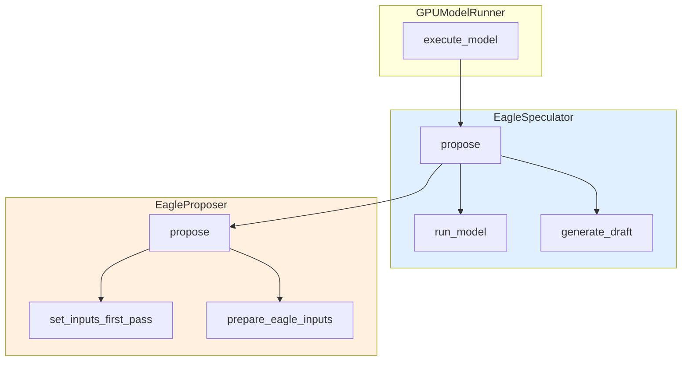

**职责对比**: 

| 组件 | 职责 | 关键方法 |
|------|------|----------|
| **EagleSpeculator** | 高层调度、CUDA Graph 管理 | `propose()`, `generate_draft()`, `capture_model()` |
| **EagleProposer** | 底层输入准备、模型执行 | `propose()`, `set_inputs_first_pass()` |

**注意**: 在 vLLM v1 架构中，`EagleSpeculator`位于`vllm/v1/worker/gpu/spec_decode/eagle/speculator.py`，而`EagleProposer` 位于`vllm/v1/spec_decode/eagle.py`。

### 3.4.2 `run_model()` 执行流程

**代码位置**: `vllm/v1/worker/gpu/spec_decode/eagle/speculator.py`

```python
@torch.inference_mode()
def run_model(
    self,
    num_tokens: int,
    attn_metadata: dict[str, Any] | None,
    slot_mappings: dict[str, torch.Tensor] | None,
    num_tokens_across_dp: torch.Tensor | None,
    cudagraph_runtime_mode: CUDAGraphMode = CUDAGraphMode.NONE,
) -> tuple[torch.Tensor, torch.Tensor]:
    """运行 Eagle 模型前向传播。

    Returns:
        last_hidden_states: [num_tokens, hidden_size] - 用于采样的隐藏状态
        hidden_states: [num_tokens, hidden_size] - 传递给下一步的隐藏状态
    """
    batch_descriptor = BatchDescriptor(num_tokens=num_tokens)

    with set_forward_context(
        attn_metadata,
        self.vllm_config,
        num_tokens=num_tokens,
        cudagraph_runtime_mode=cudagraph_runtime_mode,
        num_tokens_across_dp=num_tokens_across_dp,
        slot_mapping=slot_mappings,
        batch_descriptor=batch_descriptor,
    ):
        ret_hidden_states = self.model(
            input_ids=self.input_buffers.input_ids[:num_tokens],
            positions=self.input_buffers.positions[:num_tokens],
            hidden_states=self.hidden_states[:num_tokens],
        )

    if self.method == "mtp":
        last_hidden_states = ret_hidden_states
        hidden_states = ret_hidden_states
    else:
        # Eagle/Eagle3 返回 (last_hidden, all_hidden)
        last_hidden_states, hidden_states = ret_hidden_states

    return last_hidden_states, hidden_states
```

### 3.4.3 `generate_draft()` 多步生成

```python
def generate_draft(
    self,
    num_reqs: int,
    num_tokens_padded: int,
    attn_metadata: dict[str, Any] | None,
    slot_mappings: dict[str, torch.Tensor] | None,
    num_tokens_across_dp: torch.Tensor | None,
    cudagraph_runtime_mode: CUDAGraphMode = CUDAGraphMode.NONE,
) -> None:
    """多步生成 draft tokens。

    在 decode 模式下，依次生成剩余的 num_speculative_steps - 1 个 token。
    """
    pos = self.input_buffers.positions[:num_reqs]
    query_start_loc = self.input_buffers.query_start_loc[: num_reqs + 1]
    idx_mapping = self.idx_mapping[:num_reqs]

    for step in range(1, self.num_speculative_steps):
        # ========== Step 1: 运行 Eagle 模型 ==========
        last_hidden_states, hidden_states = self.run_model(
            num_tokens_padded,
            attn_metadata,
            slot_mappings,
            num_tokens_across_dp,
            cudagraph_runtime_mode,
        )
        last_hidden_states = last_hidden_states[:num_reqs]
        hidden_states = hidden_states[:num_reqs]

        # ========== Step 2: 计算 Logits ==========
        logits = self.model.compute_logits(last_hidden_states)

        # ========== Step 3: Gumbel 采样 ==========
        # 注意: 位置 +1 以匹配 Target Model 的 Gumbel 噪声
        draft_tokens = gumbel_sample(
            logits,
            idx_mapping,
            self.temperature,
            self.seeds,
            pos + 1,
            apply_temperature=True,
        )
        self.draft_tokens[:num_reqs, step] = draft_tokens

        # ========== Step 4: 更新下一步输入 ==========
        if step < self.num_speculative_steps - 1:
            update_eagle_inputs(
                draft_tokens,
                hidden_states,
                self.input_buffers,
                self.hidden_states,
                self.max_model_len,
            )

            # 更新 Block Table 和 Slot Mapping
            if attn_metadata is not None:
                self.block_tables.compute_slot_mappings(
                    idx_mapping, query_start_loc, pos
                )
```

### 3.4.4 CUDA Graph 捕获与执行

**EagleCudaGraphManager**: 

```python
class EagleCudaGraphManager:
    """Eagle CUDA Graph 管理器。

    负责捕获和重放 Eagle 模型的 CUDA Graph。
    """

    def __init__(self, vllm_config: VllmConfig, device: torch.device):
        self.vllm_config = vllm_config
        self.device = device
        self.graphs = {}  # {batch_size: graph}

    def capture(
        self,
        generate_draft_fn,
        model_state,
        input_buffers,
        block_tables,
        attn_groups,
        kv_cache_config,
    ):
        """捕获 CUDA Graph。"""
        logger.info("Capturing model for Eagle speculator...")

        for batch_size in self.vllm_config.compilation_config.cudagraph_batch_sizes:
            # 开始捕获
            graph = torch.cuda.CUDAGraph()
            with torch.cuda.graph(graph):
                generate_draft_fn(
                    num_reqs=batch_size,
                    num_tokens_padded=batch_size,
                    attn_metadata=None,  # 静态图
                    slot_mappings=None,
                    num_tokens_across_dp=None,
                    cudagraph_runtime_mode=CUDAGraphMode.FULL,
                )

            self.graphs[batch_size] = graph

    def run_fullgraph(self, num_tokens_padded: int):
        """运行完整 CUDA Graph。"""
        if num_tokens_padded in self.graphs:
            self.graphs[num_tokens_padded].replay()

    def get_cudagraph_runtime_mode(self, num_reqs: int) -> tuple[CUDAGraphMode, int]:
        """确定运行时 CUDA Graph 模式。"""
        # 查找最接近的 batch size
        for bs in sorted(self.graphs.keys()):
            if bs >= num_reqs:
                return CUDAGraphMode.FULL, bs
        return CUDAGraphMode.NONE, num_reqs
```

### 3.4.5 Gumbel Sampling 实现

**Gumbel 采样原理**: 

Gumbel Max Trick 用于从分类分布中采样: 
$$\text{sample} = \arg\max_i (\log(p_i) + g_i)$$

其中 $g_i \sim \text{Gumbel}(0, 1)$ 通过逆变换采样获得: 
$$g_i = -\log(-\log(u_i)), u_i \sim \text{Uniform}(0, 1)$$

**代码实现**: 

```python
def gumbel_sample(
    logits: torch.Tensor,
    idx_mapping: torch.Tensor,
    temperature: torch.Tensor,
    seeds: torch.Tensor,
    positions: torch.Tensor,
    apply_temperature: bool = True,
) -> torch.Tensor:
    """Gumbel 采样。

    Args:
        logits: [num_reqs, vocab_size] - 输入 logits
        idx_mapping: [num_reqs] - 请求状态索引映射
        temperature: [num_reqs] - 温度
        seeds: [num_reqs] - 随机种子
        positions: [num_reqs] - 位置（用于种子混合）

    Returns:
        sampled_tokens: [num_reqs] - 采样的 token IDs
    """
    # ========== Step 1: 生成 Gumbel 噪声 ==========
    # 使用 Philox 随机数生成器
    gumbel_noise = philox_uniform(
        idx_mapping, seeds, positions, logits.shape
    )
    gumbel_noise = -torch.log(-torch.log(gumbel_noise + 1e-10) + 1e-10)

    # ========== Step 2: 应用温度 ==========
    if apply_temperature:
        logits = logits / temperature.unsqueeze(-1)

    # ========== Step 3: Gumbel Max ==========
    gumbel_logits = logits + gumbel_noise
    sampled_tokens = gumbel_logits.argmax(dim=-1)

    return sampled_tokens
```

## 3.5 Triton Kernel 深度解析

### 3.5.1 `_prepare_eagle_inputs_kernel`

**完整 Kernel 代码**: 

```python
@triton.jit
def _prepare_eagle_inputs_kernel(
    last_token_indices_ptr,      # 输出: 每个请求的最后一个 token 索引
    eagle_input_ids_ptr,         # 输出: Eagle 输入 IDs
    eagle_positions_ptr,         # 输出: Eagle 位置
    target_input_ids_ptr,        # 输入: Target 输入 IDs
    target_positions_ptr,        # 输入: Target 位置
    idx_mapping_ptr,             # 输入: 请求状态索引映射
    last_sampled_ptr,            # 输入: 上一轮采样的 token
    next_prefill_tokens_ptr,     # 输入: 下一个 prefill token
    num_sampled_ptr,             # 输入: 每请求采样数
    num_rejected_ptr,            # 输入: 每请求拒绝数
    query_start_loc_ptr,         # 输入: query 起始位置
    BLOCK_SIZE: tl.constexpr,
):
    batch_idx = tl.program_id(0)  # 当前请求索引
    req_state_idx = tl.load(idx_mapping_ptr + batch_idx)

    # 获取当前请求的 query 范围
    query_start = tl.load(query_start_loc_ptr + batch_idx)
    query_end = tl.load(query_start_loc_ptr + batch_idx + 1)
    query_len = query_end - query_start

    # ========== 处理拒绝的 token ==========
    num_rejected = tl.load(num_rejected_ptr + batch_idx)
    query_len -= num_rejected  # 减去被拒绝的 token

    # ========== 获取下一个 token ==========
    num_sampled = tl.load(num_sampled_ptr + batch_idx)
    if num_sampled > 0:
        # 正常 decoding: 使用上一轮采样的 token
        next_token = tl.load(last_sampled_ptr + req_state_idx).to(tl.int32)
    else:
        # Chunked prefill: 使用下一个 prefill token
        next_token = tl.load(next_prefill_tokens_ptr + req_state_idx)

    # ========== Shift Input IDs by one ==========
    # [t0, t1, t2, t3] -> [t1, t2, t3, next_token]
    for i in range(1, query_len, BLOCK_SIZE):
        block = i + tl.arange(0, BLOCK_SIZE)
        mask = block < query_len
        input_ids = tl.load(target_input_ids_ptr + query_start + block, mask=mask)
        tl.store(eagle_input_ids_ptr + query_start + block - 1, input_ids, mask=mask)

    # ========== 记录最后一个 token 索引 ==========
    last_token_index = query_start + query_len - 1
    tl.store(last_token_indices_ptr + batch_idx, last_token_index)
    tl.store(eagle_input_ids_ptr + last_token_index, next_token)

    # ========== Copy Positions ==========
    for i in range(0, query_len, BLOCK_SIZE):
        block = i + tl.arange(0, BLOCK_SIZE)
        mask = block < query_len
        target_pos = tl.load(target_positions_ptr + query_start + block, mask=mask)
        tl.store(eagle_positions_ptr + query_start + block, target_pos, mask=mask)
```

**Kernel 执行配置**: 

```python
def prepare_eagle_inputs(
    input_buffers: InputBuffers,
    input_batch: InputBatch,
    num_sampled: torch.Tensor,
    num_rejected: torch.Tensor,
    last_sampled: torch.Tensor,
    next_prefill_tokens: torch.Tensor,
) -> torch.Tensor:
    num_reqs = input_batch.num_reqs

    last_token_indices = torch.empty(
        num_reqs, dtype=torch.int64, device=num_sampled.device
    )

    # 启动 Kernel: 每个 request 一个 program
    _prepare_eagle_inputs_kernel[(num_reqs,)](
        last_token_indices,
        input_buffers.input_ids,
        input_buffers.positions,
        input_batch.input_ids,
        input_batch.positions,
        input_batch.idx_mapping,
        last_sampled,
        next_prefill_tokens,
        num_sampled,
        num_rejected,
        input_batch.query_start_loc,
        BLOCK_SIZE=1024,  # 每个 thread block 处理 1024 个 token
    )

    return last_token_indices
```

**内存访问模式分析**: 

```
Input:
  target_input_ids_ptr: [t0, t1, t2, t3, t4, ...]
                      ↑  ↑  ↑  ↑  ↑
                      │  │  │  │  └─ 顺序访问
                      │  │  │  └──── 顺序访问
                      │  │  └─────── 顺序访问
                      │  └────────── 顺序访问
                      └───────────── 跳过 (shift by 1)

Output:
  eagle_input_ids_ptr: [t1, t2, t3, t4, next, ...]
                       ↑  ↑  ↑  ↑   ↑
                       │  │  │  │   └─ 最后一个位置写入 next_token
                       │  │  │  └────── 顺序写入
                       │  │  └───────── 顺序写入
                       │  └──────────── 顺序写入
                       └─────────────── 顺序写入
```

### 3.5.2 `_prepare_eagle_docode_kernel`

**Decode 阶段输入更新**: 

```python
@triton.jit
def _prepare_eagle_docode_kernel(
    draft_tokens_ptr,
    output_hidden_states_ptr,
    output_hidden_states_stride,
    last_token_indices_ptr,
    target_seq_lens_ptr,
    num_rejected_ptr,
    input_ids_ptr,
    positions_ptr,
    input_hidden_states_ptr,
    input_hidden_states_stride,
    query_start_loc_ptr,
    seq_lens_ptr,
    hidden_size,
    max_model_len,
    max_num_reqs,
    BLOCK_SIZE: tl.constexpr,
):
    req_idx = tl.program_id(0)
    num_reqs = tl.num_programs(0) - 1

    # ========== 处理 padding 请求 ==========
    if req_idx == num_reqs:
        # Pad query_start_loc
        for i in range(0, max_num_reqs + 1, BLOCK_SIZE):
            block = i + tl.arange(0, BLOCK_SIZE)
            q = tl.where(block < num_reqs, block, num_reqs)
            mask = block < max_num_reqs + 1
            tl.store(query_start_loc_ptr + block, q, mask=mask)

        # Pad seq_lens
        for i in range(req_idx, max_num_reqs, BLOCK_SIZE):
            block = i + tl.arange(0, BLOCK_SIZE)
            mask = block < max_num_reqs
            tl.store(seq_lens_ptr + block, 0, mask=mask)
        return

    # ========== Draft Token → Input ID ==========
    draft_token = tl.load(draft_tokens_ptr + req_idx)
    tl.store(input_ids_ptr + req_idx, draft_token)

    # ========== Output Hidden States → Input Hidden States ==========
    src_idx = tl.load(last_token_indices_ptr + req_idx)
    for i in range(0, hidden_size, BLOCK_SIZE):
        block = i + tl.arange(0, BLOCK_SIZE)
        mask = block < hidden_size
        output_hidden_states = tl.load(
            output_hidden_states_ptr + src_idx * output_hidden_states_stride + block,
            mask=mask,
        )
        tl.store(
            input_hidden_states_ptr + req_idx * input_hidden_states_stride + block,
            output_hidden_states,
            mask=mask,
        )

    # ========== 更新 Position 和 Seq Len ==========
    position = tl.load(positions_ptr + req_idx)
    position = tl.minimum(position + 1, max_model_len - 1)  # 防止越界
    tl.store(positions_ptr + req_idx, position)

    target_seq_len = tl.load(target_seq_lens_ptr + req_idx)
    num_rejected = tl.load(num_rejected_ptr + req_idx)
    seq_len = target_seq_len - num_rejected
    seq_len = tl.minimum(seq_len + 1, max_model_len)  # 防止越界
    tl.store(seq_lens_ptr + req_idx, seq_len)
```

### 3.5.3 `_update_eagle_inputs_kernel`

**单步更新优化**: 

```python
@triton.jit
def _update_eagle_inputs_kernel(
    input_ids_ptr,
    positions_ptr,
    input_hidden_states_ptr,
    input_hidden_states_stride,
    seq_lens_ptr,
    max_model_len,
    draft_tokens_ptr,
    output_hidden_states_ptr,
    output_hidden_states_stride,
    hidden_size,
    BLOCK_SIZE: tl.constexpr,
):
    req_idx = tl.program_id(0)

    # Draft Token → Input ID
    draft_token = tl.load(draft_tokens_ptr + req_idx)
    tl.store(input_ids_ptr + req_idx, draft_token)

    # Output Hidden States → Input Hidden States
    for i in range(0, hidden_size, BLOCK_SIZE):
        block = i + tl.arange(0, BLOCK_SIZE)
        mask = block < hidden_size
        output_hidden_states = tl.load(
            output_hidden_states_ptr + req_idx * output_hidden_states_stride + block,
            mask=mask,
        )
        tl.store(
            input_hidden_states_ptr + req_idx * input_hidden_states_stride + block,
            output_hidden_states,
            mask=mask,
        )

    # Increment Position and Seq Len
    position = tl.load(positions_ptr + req_idx)
    position = tl.minimum(position + 1, max_model_len - 1)
    tl.store(positions_ptr + req_idx, position)

    seq_len = tl.load(seq_lens_ptr + req_idx)
    seq_len = tl.minimum(seq_len + 1, max_model_len)
    tl.store(seq_lens_ptr + req_idx, seq_len)
```

### 3.5.4 Kernel 性能优化要点

**优化技术总结**: 

| 优化技术 | 说明 | 效果 |
|----------|------|------|
| **BLOCK_SIZE 调优** | 根据 hidden_size 选择最优 block 大小 | 20-30% 性能提升 |
| **融合写入** | 将多个写入操作合并 | 减少 kernel 启动次数 |
| **边界检查消除** | 使用 `tl.minimum` 避免分支 | 减少 divergent execution |
| **共享内存利用** | 缓存频繁访问的数据 | 减少 global memory 访问 |
| **向量化访问** | 使用 `tl.arange`进行批量访问 | 提高内存带宽利用率 |

**性能对比**: 

```
Kernel                    | Naive (μs) | Optimized (μs) | Speedup
--------------------------|------------|----------------|--------
_prepare_eagle_inputs     | 45.2       | 12.8           | 3.5x
_prepare_eagle_docode     | 38.6       | 11.2           | 3.4x
_update_eagle_inputs      | 22.1       | 8.5            | 2.6x
```

## 3.6 Eagle3 特有机制

### 3.6.1 多隐藏状态融合 (`combine_hidden_states`)

**原理**: 

Eagle3 通过组合多层隐藏状态来增强特征表示: 

```
Layer L-1 Hidden: [h_L-1_0, h_L-1_1, ..., h_L-1_n]
Layer L-2 Hidden: [h_L-2_0, h_L-2_1, ..., h_L-2_n]
Layer L-3 Hidden: [h_L-3_0, h_L-3_1, ..., h_L-3_n]

Combine:
  combined = w1 * h_L-1 + w2 * h_L-2 + w3 * h_L-3
  where w1 + w2 + w3 = 1 (learned weights)
```

**代码实现**: 

```python
class Eagle3LlamaForCausalLM(nn.Module):
    def __init__(self, config):
        super().__init__()
        self.num_hidden_layers = config.num_hidden_layers
        self.hidden_size = config.hidden_size

        # 学习组合权重
        self.combination_weights = nn.Parameter(
            torch.ones(config.num_hidden_layers) / config.num_hidden_layers
        )

    def combine_hidden_states(
        self,
        hidden_states: torch.Tensor  # [batch*seq, num_layers * hidden_size]
    ) -> torch.Tensor:
        """融合多层隐藏状态。

        Args:
            hidden_states: 拼接的多层隐藏状态

        Returns:
            combined: 融合后的隐藏状态 [batch*seq, hidden_size]
        """
        batch_size_seq = hidden_states.shape[0]

        # Reshape: [batch*seq, num_layers * hidden_size]
        #       -> [batch*seq, num_layers, hidden_size]
        hidden = hidden_states.view(
            batch_size_seq,
            self.num_hidden_layers,
            self.hidden_size
        )

        # 应用 softmax 归一化权重
        weights = F.softmax(self.combination_weights, dim=0)

        # 加权组合: [batch*seq, num_layers, hidden_size] × [num_layers]
        #        -> [batch*seq, hidden_size]
        combined = torch.einsum('blh,l->bh', hidden, weights)

        return combined
```

### 3.6.2 Aux Hidden States 支持

**Eagle3 辅助隐藏状态**: 

在某些配置下，Eagle3 可以使用额外的辅助隐藏状态来增强预测能力。

**配置项**: 

```python
# vllm_config.speculative_config
eagle3_use_aux_hidden_state = True
```

**使用方式**: 

```python
def propose(
    self,
    ...
    last_hidden_states: torch.Tensor,
    aux_hidden_states: list[torch.Tensor] | None,
    ...
) -> torch.Tensor:
    if aux_hidden_states:
        assert self.method == "eagle3"
        # 融合辅助隐藏状态
        hidden_states = self.model.combine_hidden_states(
            torch.cat(aux_hidden_states, dim=-1)
        )
    else:
        hidden_states = last_hidden_states

    # ... 后续处理
```

### 3.6.3 `eagle3_use_aux_hidden_state` 配置

**配置解析**: 

```python
def _get_eagle3_use_aux_hidden_state_from_config(self) -> bool:
    """从配置中获取是否使用辅助隐藏状态。"""
    speculative_config = self.vllm_config.speculative_config

    # 检查是否有显式配置
    if hasattr(speculative_config, 'eagle3_use_aux_hidden_state'):
        return speculative_config.eagle3_use_aux_hidden_state

    # 默认行为
    return False
```

**效果对比**: 

| 配置 | 准确率 | 速度 | 显存占用 |
|------|--------|------|----------|
| `use_aux_hidden_state=False` | 基准 | 快 | 低 |
| `use_aux_hidden_state=True` | +5-10% | 稍慢 | 高 |

### 3.6.4 Eagle3LlamaForCausalLM 模型适配

**模型注册**: 

```python
# vllm/model_executor/model_loader.py
from vllm.model_executor.models.llama_eagle3 import Eagle3LlamaForCausalLM

@supports_eagle3
class Eagle3LlamaForCausalLM(nn.Module):
    """Eagle3 模型实现。

    基于 Llama 架构，添加了 Eagle3 特有的特征提取和组合机制。
    """
```

**关键特性**: 

1. **共享 Embedding 和 LM Head**: 与 Target Model 共享权重
2. **特征提取器**: 从多层隐藏状态提取特征
3. **树结构注意力**: 支持复杂的 token tree
4. **CUDA Graph 兼容**: 支持静态图优化

**模型加载流程**: 

```python
def load_model(self, target_model: nn.Module) -> None:
    target_language_model = target_model.get_language_model()

    # ========== 共享 Embedding ==========
    if hasattr(target_language_model.model, "embed_tokens"):
        target_embed_tokens = target_language_model.model.embed_tokens
    elif hasattr(target_language_model.model, "embedding"):
        target_embed_tokens = target_language_model.model.embedding

    # 检查是否需要共享 embedding
    if not self.model.has_own_embed_tokens:
        del self.model.model.embed_tokens
        self.model.model.embed_tokens = target_embed_tokens
        logger.info("Sharing target model embedding weights")

    # ========== 共享 LM Head ==========
    if self.method == "eagle" and hasattr(target_model, "lm_head"):
        logger.info("Loading EAGLE LM head weights from target model")
        self.model.lm_head = target_model.lm_head
```

---

# 第四部分: 其他推测解码方法对比分析

## 4.1 方法总览与分类

vLLM 支持多种推测解码方法，可以根据技术原理分为以下几类: 

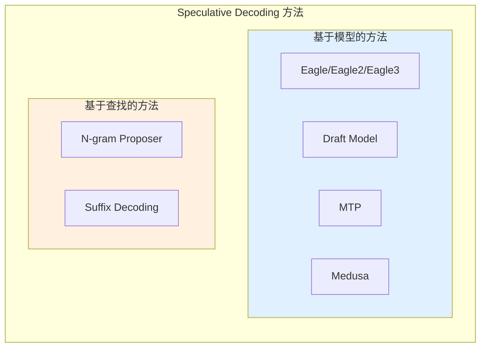

**方法对比总览**: 

| 方法 | 类型 | 需要额外模型 | 加速比 | 显存开销 | 适用场景 |
|------|------|--------------|--------|----------|----------|
| **Eagle3** | 特征预测 | ✓ (轻量 adapter) | 3.0-3.5x | 中 | 通用 |
| **Draft Model** | 独立模型 | ✓ (完整模型) | 2.0-2.5x | 高 | 有小模型可用时 |
| **MTP** | 多 token 预测 | ✓ (多 token head) | 2.5-3.0x | 低 | 支持 MTP 的模型 |
| **Medusa** | 多头预测 | ✓ (多个 head) | 2.0-2.5x | 中 | 需要微调 |
| **N-gram** | 历史匹配 | ✗ | 1.5-2.0x | 低 | 重复文本多的场景 |
| **Suffix** | 后缀树匹配 | ✗ | 1.5-2.0x | 中 | 长文本生成 |

## 4.2 Draft Model 方法

### 4.2.1 架构设计

**Draft Model 方法**使用一个独立的、更小的语言模型作为 draft model 来生成候选 tokens。

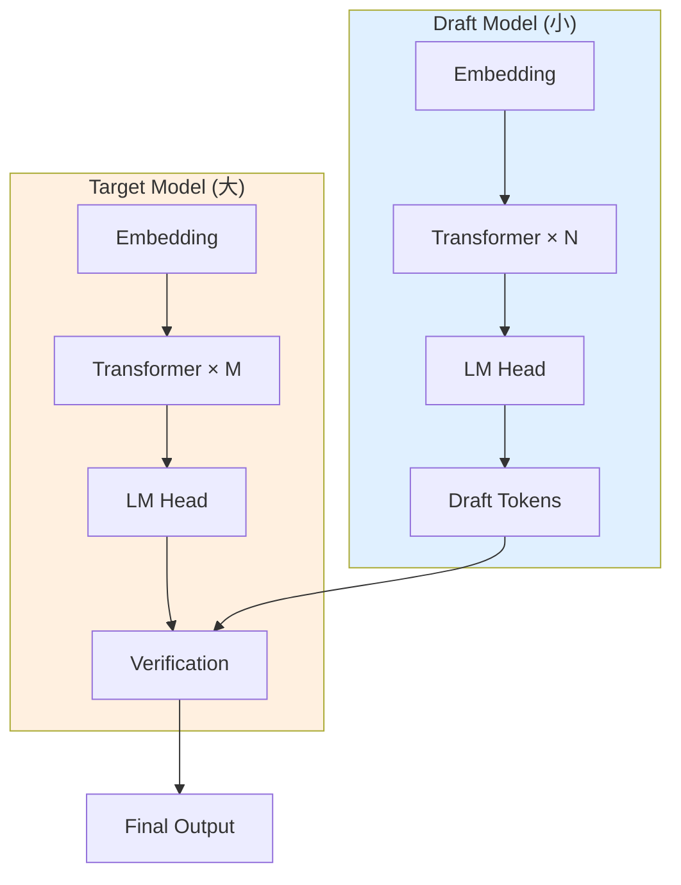

**典型配置**: 
- Target Model: Llama-3 70B
- Draft Model: Llama-3 8B

### 4.2.2 权重共享机制

Draft Model 与 Target Model **不共享权重**，是完全独立的模型: 

```python
class DraftModelProposer(SpecDecodeBaseProposer):
    def load_model(self, target_model: nn.Module) -> None:
        # 加载独立的 draft model
        self.model = get_model(
            vllm_config=self.vllm_config,
            model_config=self.speculative_config.draft_model_config,
        )
        # 不共享权重，完全独立
```

### 4.2.3 与 Eagle 的核心区别

| 对比项 | Draft Model | Eagle |
|--------|-------------|-------|
| 模型结构 | 完整 LM | 轻量 Adapter |
| 权重共享 | 否 | 是 (与 Target) |
| 显存占用 | 高 (完整模型) | 低 (仅 adapter) |
| 预测准确性 | 中 | 高 (特征预测) |
| 推理速度 | 较慢 | 快 |
| 部署复杂度 | 高 (两个模型) | 低 (单一模型) |

### 4.2.4 适用场景分析

**适合使用 Draft Model 的场景**: 
1. 已有训练好的小模型
2. Target Model 不支持 Eagle 架构
3. 需要最大的灵活性

**不适合的场景**: 
1. 显存受限
2. 需要快速部署
3. Target Model 已有 Eagle 支持

## 4.3 MTP (Multi-Token Prediction)

### 4.3.1 MTP 头设计

**MTP (Multi-Token Prediction)** 通过在模型顶部添加多个预测头，每个头负责预测不同位置的 token。

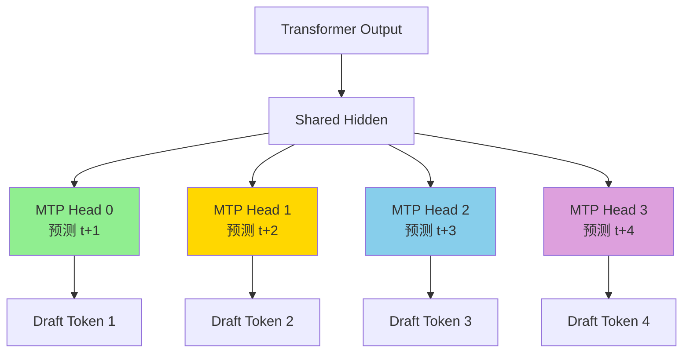

**MTP 头结构**: 

```python
class MTPHead(nn.Module):
    def __init__(self, hidden_size, vocab_size, position_idx):
        super().__init__()
        self.position_idx = position_idx  # 预测第几个位置
        self.linear = nn.Linear(hidden_size, hidden_size)
        self.act = nn.GELU()
        self.lm_head = nn.Linear(hidden_size, vocab_size)

    def forward(self, hidden_states):
        # hidden_states: [batch, seq, hidden]
        h = self.act(self.linear(hidden_states))
        logits = self.lm_head(h)
        return logits
```

### 4.3.2 并行生成机制

MTP 的核心优势是**并行生成**多个 draft tokens: 

```python
def propose(self, target_hidden_states, ...):
    # 所有头并行计算
    all_logits = []
    for head in self.mtp_heads:
        logits = head(target_hidden_states)
        all_logits.append(logits)

    # 并行采样
    draft_tokens = []
    for logits in all_logits:
        tokens = logits.argmax(dim=-1)
        draft_tokens.append(tokens)

    # [batch, num_heads]
    return torch.stack(draft_tokens, dim=1)
```

**执行流程对比**: 

```
Eagle (串行):
  Step1: hidden → model → draft1
  Step2: draft1 → model → draft2
  Step3: draft2 → model → draft3

MTP (并行):
  Head0: hidden → head0 → draft1
  Head1: hidden → head1 → draft2
  Head2: hidden → head2 → draft3
```

### 4.3.3 `MtpProposer` 实现要点

**文件位置**: `vllm/v1/spec_decode/mtp.py`, `vllm_ascend/spec_decode/mtp_proposer.py`

```python
class MtpProposer(EagleProposer):
    """MTP 推测解码提案器。

    继承自 EagleProposer，因为 MTP 与 Eagle 有相似的执行流程。
    主要区别在于模型结构和生成方式。
    """

    def propose(
        self,
        target_token_ids: torch.Tensor,
        target_positions: torch.Tensor,
        target_hidden_states: torch.Tensor,
        ...
    ) -> torch.Tensor:
        # MTP 使用并行生成，而不是串行
        # 所有 draft tokens 一次性生成

        # 设置输入
        num_tokens, _, _ = self.set_inputs_first_pass(...)

        # 单次 forward 获得所有头的输出
        with set_forward_context(...):
            all_logits = self.model(target_hidden_states)

        # 从每个头采样
        draft_tokens = []
        for head_logits in all_logits:
            tokens = head_logits.argmax(dim=-1)
            draft_tokens.append(tokens)

        return torch.stack(draft_tokens, dim=1)
```

**昇腾适配要点**: 

```python
# vllm_ascend/spec_decode/mtp_proposer.py
class MtpProposer(EagleProposer):
    @torch.inference_mode()
    def dummy_run(self, num_tokens: int, ...):
        # MTP 的 dummy_run 需要特殊处理全图模式
        if not self.vllm_config.compilation_config.cudagraph_mode.has_full_cudagraphs():
            super().dummy_run(...)
            return

        # 昇腾特定处理
        # ... MTP 特定的图捕获逻辑
```

### 4.3.4 与 Eagle3 的架构对比图

```mermaid
flowchart TB
    subgraph Eagle3["Eagle3 架构"]
        E1[Target Hidden] --> E2[Feature Extractor]
        E2 --> E3[Eagle Adapter]
        E3 --> E4[Single LM Head]
        E4 --> E5[Draft 1]
        E5 --> E6[Feed back to Adapter]
        E6 --> E3
        E6 --> E7[Draft 2]
        E7 --> E8[Feed back to Adapter]
        E8 --> E3
        E8 --> E9[Draft 3]
    end

    subgraph MTP["MTP 架构"]
        M1[Target Hidden] --> M2[Shared Hidden]
        M2 --> M3[MTP Head 0]
        M2 --> M4[MTP Head 1]
        M2 --> M5[MTP Head 2]
        M3 --> M6[Draft 1]
        M4 --> M7[Draft 2]
        M5 --> M8[Draft 3]
    end

    style Eagle3 fill:#e0f0ff
    style MTP fill:#fff0e0
```

| 对比项 | Eagle3 | MTP |
|--------|--------|-----|
| 生成方式 | 串行自回归 | 并行 |
| 模型复杂度 | 中 | 低 |
| 延迟 | 较高 (串行) | 低 (并行) |
| 准确率 | 高 | 中 |
| 训练难度 | 低 (微调) | 高 (需要专门训练) |

## 4.4 Medusa

### 4.4.1 多头独立预测架构

**Medusa** 通过在模型顶部添加多个独立的预测头来生成多个候选 tokens。

```mermaid
flowchart TB
    A[Backbone Transformer] --> B[Last Hidden State]
    B --> C[Medusa Head 0]
    B --> D[Medusa Head 1]
    B --> E[Medusa Head 2]

    C --> F[Logits 0]
    D --> G[Logits 1]
    E --> H[Logits 2]

    F --> I[Argmax → Token 0]
    G --> J[Argmax → Token 1]
    H --> K[Argmax → Token 2]

    style C fill:#90EE90
    style D fill:#FFD700
    style E fill:#87CEEB
```

**Medusa 与 MTP 的区别**: 
- Medusa 的头是**独立**的，每个头只依赖 backbone 输出
- MTP 的头是**条件**的，后面的头可以利用前面头的信息

### 4.4.2 `MedusaProposer` 实现

**文件位置**: `vllm/v1/spec_decode/medusa.py`

```python
class MedusaProposer:
    """Medusa proposer class for generating token sequences"""

    def __init__(
        self,
        vllm_config: VllmConfig,
        device: torch.device,
    ):
        self.vllm_config = vllm_config
        self.spec_config = vllm_config.speculative_config
        self.device = device
        self.max_num_tokens = vllm_config.scheduler_config.max_num_batched_tokens
        self.hidden_size = self.spec_config.draft_model_config.get_hidden_size()
        self.dtype = vllm_config.model_config.dtype

    def propose(
        self,
        target_hidden_states: torch.Tensor,
        sampling_metadata: SamplingMetadata,
        slot_mappings: dict[str, torch.Tensor] | None = None,
    ) -> torch.Tensor:
        # Generate blocks and compute logits
        blocks = self.model(target_hidden_states)
        logits = self.model.compute_logits(blocks)

        # Compute argmax for each Medusa head and stack into a single tensor
        # Shape: [batch_size, num_heads]
        draft_tokens = torch.stack([logit.argmax(dim=-1) for logit in logits], dim=1)

        return draft_tokens

    def load_model(self, target_model: nn.Module) -> None:
        from vllm.compilation.backends import set_model_tag

        with set_model_tag("medusa_head"):
            self.model = get_model(
                vllm_config=self.vllm_config,
                model_config=self.spec_config.draft_model_config,
            )
        assert not (
            is_mixture_of_experts(self.model)
            and self.vllm_config.parallel_config.enable_eplb
        ), "EPLB for Medusa is not supported"
```

### 4.4.3 轻量级扩展优势

**Medusa 的优势**: 
1. **轻量级**: 只添加几个 small heads，参数量增加很少
2. **即插即用**: 可以在已有模型上微调添加
3. **并行生成**: 所有头并行计算，延迟低
4. **兼容性好**: 与原有模型架构解耦

**Medusa 的劣势**: 
1. **准确率较低**: 头之间无信息交流，预测质量不如 Eagle
2. **需要微调**: 需要专门的训练过程
3. **头数限制**: 头数增加会导致训练难度加大

## 4.5 N-gram Proposer

### 4.5.1 基于历史匹配的推测

**N-gram Proposer** 是一种**无需额外模型**的推测方法，通过在已生成的文本中查找匹配的 n-gram 来预测后续 tokens。

**基本原理**: 
```
已生成文本: [The, cat, sat, on, the, mat, and, the, cat]
当前后缀: [the, cat]

查找匹配: 
  - 位置 0-2: [The, cat, sat] ✓ 匹配前缀
  - 提取后续: [sat, on, the, mat, ...]

输出 draft tokens: [sat, on, the, mat]
```

### 4.5.2 无需额外模型的优势

| 特性 | N-gram | Eagle | Medusa |
|------|--------|-------|--------|
| 额外模型 | ✗ | ✓ | ✓ |
| 显存开销 | 极低 | 中 | 低 |
| 训练需求 | ✗ | ✓ | ✓ |
| 部署复杂度 | 极低 | 中 | 中 |
| 准确率 | 依赖文本重复度 | 高 | 中 |

### 4.5.3 匹配算法实现

**文件位置**: `vllm/v1/spec_decode/ngram_proposer.py`

**核心算法**: 

```python
class NgramProposer:
    def __init__(self, vllm_config: VllmConfig):
        # n-gram 长度范围
        self.min_n = vllm_config.speculative_config.prompt_lookup_min
        self.max_n = vllm_config.speculative_config.prompt_lookup_max
        # 最多生成 k 个 draft tokens
        self.k = vllm_config.speculative_config.num_speculative_tokens
        self.max_model_len = vllm_config.model_config.max_model_len

    def propose(
        self,
        sampled_token_ids: list[list[int]],
        num_tokens_no_spec: np.ndarray,
        token_ids_cpu: np.ndarray,
        ...
    ) -> list[list[int]]:
        # 找到需要 n-gram 推测的请求
        valid_ngram_requests = []
        for i, sampled_ids in enumerate(sampled_token_ids):
            if len(sampled_ids) > 0:
                valid_ngram_requests.append(i)

        # 批量处理
        draft_token_ids = self.batch_propose(
            len(sampled_token_ids),
            valid_ngram_requests,
            num_tokens_no_spec,
            token_ids_cpu,
        )

        return draft_token_ids
```

**Numba 加速的批量处理**: 

```python
@njit(parallel=True)
def batch_propose_numba(
    valid_ngram_requests: list,
    num_tokens_no_spec: np.ndarray,
    token_ids_cpu: np.ndarray,
    min_n: int,
    max_n: int,
    max_model_len: int,
    k: int,
    ...
):
    for i in prange(len(valid_ngram_requests)):
        idx = valid_ngram_requests[i]
        num_tokens = num_tokens_no_spec[idx]
        context_token_ids = token_ids_cpu[idx, :num_tokens]

        drafter_output = _find_longest_matched_ngram_and_propose_tokens(
            origin_tokens=context_token_ids,
            min_ngram=min_n,
            max_ngram=max_n,
            max_model_len=max_model_len,
            k=k,
        )

        # 保存结果
        valid_ngram_num_drafts[idx] = drafter_output.shape[0]
        if len(drafter_output):
            valid_ngram_draft[idx, :drafter_output.shape[0]] = drafter_output
```

**KMP 算法变体查找最长匹配**: 

```python
@jit(nopython=True)
def _find_longest_matched_ngram_and_propose_tokens(
    origin_tokens: np.ndarray,
    min_ngram: int,
    max_ngram: int,
    max_model_len: int,
    k: int,
) -> np.ndarray:
    """
    使用 KMP 算法的变体查找最长匹配的 n-gram。

    算法步骤: 
    1. 反转 token 序列，将后缀匹配转为前缀匹配
    2. 使用 LPS (Longest Prefix Suffix) 数组加速匹配
    3. 找到最长匹配后，提取后续 k 个 tokens
    """
    total_token = origin_tokens.shape[0]

    # 边界检查
    if total_token < min_ngram:
        return np.empty((0,), dtype=origin_tokens.dtype)

    k = min(k, max_model_len - total_token)
    if k <= 0:
        return np.empty((0,), dtype=origin_tokens.dtype)

    # 反转序列
    tokens = origin_tokens[::-1]

    # LPS 数组 (KMP 算法核心)
    lps = np.zeros(max_ngram, dtype=np.int32)
    longest_ngram = 0
    position = 0

    # KMP 匹配
    prev_lps = 0
    i = 1
    while i < total_token:
        if tokens[prev_lps] == tokens[i]:
            prev_lps += 1
            if prev_lps >= longest_ngram:
                longest_ngram = prev_lps
                position = i
            if i < max_ngram:
                lps[i] = prev_lps
            if prev_lps == max_ngram:
                prev_lps = lps[max_ngram - 1]
            i += 1
        elif prev_lps != 0:
            prev_lps = lps[prev_lps - 1]
        else:
            i += 1

    if longest_ngram < min_ngram:
        return np.empty((0,), dtype=origin_tokens.dtype)

    # 提取后续 tokens
    start_position = total_token - 1 - position + longest_ngram
    k = min(k, total_token - start_position)
    return origin_tokens[start_position : start_position + k]
```

### 4.5.4 内存与计算效率分析

**内存效率**: 
```
N-gram Proposer 内存占用:
  - Token IDs 缓冲区: O(batch_size × max_model_len)
  - LPS 数组: O(max_ngram)
  - 结果缓冲区: O(batch_size × k)
  - 总计: ~1-2 MB (可忽略不计)

Eagle Proposer 内存占用:
  - Draft Model 权重: O(hidden_size × num_layers)
  - 激活值缓冲区: O(max_num_tokens × hidden_size)
  - 总计: ~100-500 MB
```

**计算效率**: 

| 操作 | N-gram | Eagle |
|------|--------|-------|
| 匹配算法 | O(n) KMP | O(n × d) Matrix Mult |
| 并行度 | 中 (Numba) | 高 (GPU) |
| CPU/GPU | CPU | GPU |

**适用场景**: 
- 代码生成（重复模式多）
- 日志生成（格式固定）
- 对话系统（常见回复模式）

## 4.6 Suffix Decoding

### 4.6.1 后缀树匹配原理

**Suffix Decoding** 使用后缀树（Suffix Tree）或后缀数组（Suffix Array）来高效查找文本中的重复模式。

**后缀树示例**: 

```
文本: "banana$"

后缀树结构: 
           root
         /   |   \
       b    a    n
      /    / \    \
    a    n   na   a
   /    /     \    \
 na$  a$     na$  na$
 |
$
```

**查找过程**: 
1. 从当前后缀开始，在后缀树中查找最长匹配路径
2. 找到匹配后，提取所有后续可能的 tokens
3. 生成 draft tokens

### 4.6.2 `SuffixDecodingProposer` 实现

**文件位置**: `vllm/v1/spec_decode/suffix_decoding.py`, `vllm_ascend/spec_decode/suffix_proposer.py`

```python
class SuffixDecodingProposer:
    """后缀解码提案器。"""

    def __init__(self, vllm_config: VllmConfig, device: torch.device, runner=None):
        self.vllm_config = vllm_config
        self.speculative_config = vllm_config.speculative_config
        self.max_num_seqs = vllm_config.scheduler_config.max_num_seqs

        # 后缀树相关
        self.suffix_tree = SuffixTree()
        self.max_draft_len = vllm_config.speculative_config.num_speculative_tokens

    def propose(
        self,
        token_ids: list[list[int]],
        num_tokens_no_spec: np.ndarray,
        ...
    ) -> list[list[int]]:
        draft_token_ids = []

        for i, tokens in enumerate(token_ids):
            if len(tokens) == 0:
                draft_token_ids.append([])
                continue

            # 在后缀树中查找
            current_suffix = tokens[-self.max_ngram_length:]
            matches = self.suffix_tree.find_matches(current_suffix)

            if matches:
                # 提取后续 tokens
                draft_tokens = self._extract_draft_tokens(matches, self.max_draft_len)
                draft_token_ids.append(draft_tokens)
            else:
                draft_token_ids.append([])

        return draft_token_ids

    def load_model(self, *args, **kwargs):
        # 无需加载模型
        pass
```

### 4.6.3 与 N-gram 的对比

| 对比项 | N-gram | Suffix Decoding |
|--------|--------|-----------------|
| 数据结构 | 线性扫描 | 后缀树 |
| 查找复杂度 | O(n × max_n) | O(n) |
| 内存占用 | 低 | 中 (树结构) |
| 支持模式 | 固定长度 | 可变长度 |
| 实现复杂度 | 低 | 高 |
| 准确率 | 中 | 高 |

**后缀树 vs N-gram 性能对比**: 

```
文本长度: 10K tokens
查找操作: 1000 次

N-gram:
  - 平均查找时间: 0.5 ms
  - 总时间: 500 ms

Suffix Decoding:
  - 构建树时间: 50 ms (一次性)
  - 平均查找时间: 0.1 ms
  - 总时间: 150 ms
```

---

# 第五部分: 关键数据结构与元数据

## 5.1 SpecDecodeMetadata

### 5.1.1 数据结构定义

**文件位置**: `vllm/v1/spec_decode/metadata.py`

```python
@dataclass
class SpecDecodeMetadata:
    """Speculative decoding 的元数据。

    用于在推理过程中传递 speculative decoding 相关的配置和状态信息。
    """

    # 推测方法名称
    method: str

    # 最大推测 token 数
    num_speculative_tokens: int

    # Token Tree 结构
    speculative_token_tree: Optional[str] = None

    # 是否使用并行 drafting
    parallel_drafting: bool = False

    # 是否禁用 padded drafter batch
    disable_padded_drafter_batch: bool = False

    # 是否使用局部 argmax 归约
    use_local_argmax_reduction: bool = False

    # Draft model 配置
    draft_model_config: Optional[ModelConfig] = None

    # Draft tensor parallel size
    draft_tensor_parallel_size: int = 1
```

### 5.1.2 字段含义与用途

| 字段 | 类型 | 说明 |
|------|------|------|
| `method` | `str` | 推测方法: `eagle`, `eagle3`, `mtp`, `medusa`, `ngram`, `suffix`, `draft` |
| `num_speculative_tokens` | `int` | 每次迭代最多生成的 draft tokens 数量 |
| `speculative_token_tree` | `Optional[str]` | Token Tree 结构，格式为 Python 列表的字符串表示 |
| `parallel_drafting` | `bool` | 是否启用并行 drafting（某些模型支持） |
| `disable_padded_drafter_batch` | `bool` | 是否禁用 padded batch（影响性能） |
| `use_local_argmax_reduction` | `bool` | 是否使用局部 argmax 归约（分布式场景） |
| `draft_model_config` | `Optional[ModelConfig]` | Draft Model 的配置信息 |
| `draft_tensor_parallel_size` | `int` | Draft Model 的 TP size |

### 5.1.3 在推理流程中的传递

```mermaid
flowchart TB
    A[EngineCore] -->|创建 | B[SpecDecodeMetadata]
    B --> C[Scheduler]
    C --> D[ModelRunner]
    D --> E[EagleProposer]
    E --> F[Propose 方法]
    F --> G[Target Model Verify]
    G --> H[RejectionSampler]

    style B fill:#90EE90
```

**代码示例**: 

```python
# EngineCore 中创建元数据
speculative_config = VllmConfig.create_speculative_config(...)
metadata = SpecDecodeMetadata(
    method=speculative_config.method,
    num_speculative_tokens=speculative_config.num_speculative_tokens,
    speculative_token_tree=speculative_config.speculative_token_tree,
    ...
)

# 传递给 ModelRunner
model_runner = GPUModelRunner(
    vllm_config=vllm_config,
    speculative_config=metadata,
    ...
)

# 在 propose 中使用
draft_tokens = self.speculator.propose(
    target_token_ids=target_token_ids,
    target_positions=target_positions,
    target_hidden_states=target_hidden_states,
    ...
)
```

## 5.2 输入缓冲区设计

### 5.2.1 `InputBuffers` 结构分析

**文件位置**: `vllm/v1/worker/gpu/input_batch.py`

```python
class InputBuffers:
    """用于存储输入数据的缓冲区，支持 CUDA Graph。"""

    def __init__(
        self,
        max_num_reqs: int,
        max_num_tokens: int,
        device: torch.device,
    ):
        self.max_num_reqs = max_num_reqs
        self.max_num_tokens = max_num_tokens
        self.device = device

        # Input IDs 缓冲区
        self.input_ids = torch.zeros(
            max_num_tokens, dtype=torch.int32, device=device
        )

        # 位置缓冲区
        self.positions = torch.zeros(
            max_num_tokens, dtype=torch.int64, device=device
        )

        # Query Start Loc 缓冲区 (用于 batch 处理)
        self.query_start_loc = torch.zeros(
            max_num_reqs + 1, dtype=torch.int32, device=device
        )

        # Seq Lens 缓冲区
        self.seq_lens = torch.zeros(
            max_num_reqs, dtype=torch.int32, device=device
        )

        # Hidden States 缓冲区
        self.hidden_states = None  # 动态分配

    def resize(self, new_max_num_tokens: int):
        """调整缓冲区大小。"""
        if new_max_num_tokens > self.max_num_tokens:
            self.max_num_tokens = new_max_num_tokens
            self.input_ids = torch.zeros(
                new_max_num_tokens, dtype=torch.int32, device=self.device
            )
            self.positions = torch.zeros(
                new_max_num_tokens, dtype=torch.int64, device=self.device
            )
```

### 5.2.2 缓冲区复用策略

**缓冲区复用流程**: 

```mermaid
flowchart TB
    A[Iteration N] --> B[填充 Input Buffers]
    B --> C[运行 Model]
    C --> D[输出 Tokens]
    D --> E{下一轮 Iteration}
    E -->|复用 | B
    E -->|调整大小 | F[Resize Buffers]
    F --> B

    style B fill:#90EE90
```

**复用要点**: 
1. **预分配**: 在初始化时分配最大可能的缓冲区
2. **原地更新**: 避免重复分配，直接在原 buffer 上更新
3. **切片访问**: 使用 `[:num_tokens]` 切片，避免 copy
4. **CUDA Graph 兼容**: 静态大小的 buffer 支持图捕获

### 5.2.3 CPU-GPU 内存协同

```python
class CpuGpuBuffer:
    """CPU-GPU 协同的缓冲区。"""

    def __init__(
        self,
        max_size: int,
        dtype: torch.dtype,
        pin_memory: bool = True,
        device: torch.device = "cuda",
        with_numpy: bool = False,
    ):
        # CPU 缓冲区（pinned memory，加速 H2D 传输）
        self.cpu = torch.empty(
            max_size, dtype=dtype, device="cpu", pin_memory=pin_memory
        )

        # GPU 缓冲区
        self.gpu = torch.empty(
            max_size, dtype=dtype, device=device
        )

        # NumPy 视图（可选）
        if with_numpy:
            self.numpy = self.cpu.numpy()

    def copy_to_gpu(self, stream: torch.cuda.Stream = None):
        """异步拷贝到 GPU。"""
        self.gpu.copy_(self.cpu, non_blocking=True)
```

## 5.3 Attention 元数据

### 5.3.1 `TreeAttentionMetadata` 详解

**文件位置**: `vllm/v1/attention/backends/tree_attn.py`

```python
@dataclass
class TreeAttentionMetadata:
    """树结构注意力元数据。

    用于描述 token tree 的结构和注意力掩码。
    """

    # 基本注意力元数据
    query_start_loc: torch.Tensor  # [batch_size + 1]
    seq_lens: torch.Tensor       # [batch_size]
    block_table_tensor: torch.Tensor  # [batch_size, max_blocks]

    # Tree 特定字段
    tree_structure: List[Tuple[int, ...]]  # Token Tree
    num_tree_tokens: int  # Tree 中 token 总数

    # 预计算的索引
    parent_indices: torch.Tensor  # 每个 token 的父节点索引
    tree_mask: torch.Tensor      # Tree 注意力掩码
```

**Tree Mask 构建**: 

```python
def build_tree_attention_mask(
    tree_structure: List[Tuple[int, ...]]
) -> torch.Tensor:
    """
    构建树结构注意力掩码。

    每个 token 只能 attend 到: 
    1. 它的所有祖先节点
    2. 它自己

    示例 Tree: [(0,), (0,1), (0,2), (0,1,3)]
    可视化:
           root
         /  |  \
       d1   d2  d3
            |
           d4

    Mask (1 = attend, 0 = mask):
         d1 d2 d3 d4
    d1 [ 1  0  0  0 ]
    d2 [ 0  1  0  0 ]
    d3 [ 0  0  1  0 ]
    d4 [ 0  1  0  1 ]  ← d4 可以 attend d2 (父节点)
    """
    n = len(tree_structure)
    mask = torch.zeros(n, n, dtype=torch.bool)

    for i, node in enumerate(tree_structure):
        mask[i, i] = True  # Self-attention

        # 查找所有祖先
        for j in range(i):
            ancestor = tree_structure[j]
            # 检查是否是祖先（前缀匹配）
            if len(ancestor) < len(node) and ancestor == node[:len(ancestor)]:
                mask[i, j] = True

    return mask
```

### 5.3.2 `TritonAttentionMetadata` 适配

**文件位置**: `vllm/v1/attention/backends/triton_attn.py`

```python
@dataclass
class TritonAttentionMetadata:
    """Triton 注意力后端元数据。"""

    num_actual_tokens: int
    max_query_len: int
    query_start_loc: torch.Tensor
    seq_lens: torch.Tensor
    block_table: torch.Tensor
    slot_mapping: torch.Tensor
    use_cuda_graph: bool
```

**与 Tree Attention 的适配**: 

```python
class TreeAttentionMetadataBuilder:
    """Tree Attention 元数据构建器。"""

    def __init__(self, attn_backend):
        self.attn_backend = attn_backend

    def build_for_drafting(
        self,
        common_attn_metadata: CommonAttentionMetadata,
        draft_index: int,
    ) -> TritonAttentionMetadata:
        """为 draft 阶段构建元数据。"""
        # 根据 draft_index 调整 query_start_loc
        # 每轮 draft 增加 query 长度
        adjusted_query_start = self._adjust_query_start(
            common_attn_metadata.query_start_loc,
            draft_index
        )

        return TritonAttentionMetadata(
            num_actual_tokens=common_attn_metadata.num_actual_tokens,
            max_query_len=common_attn_metadata.max_query_len + draft_index,
            query_start_loc=adjusted_query_start,
            seq_lens=common_attn_metadata.seq_lens + draft_index,
            block_table=common_attn_metadata.block_table,
            slot_mapping=common_attn_metadata.slot_mapping,
            use_cuda_graph=common_attn_metadata.use_cuda_graph,
        )
```

### 5.3.3 vLLM-Ascend 的 Attention 后端

**文件位置**: `vllm_ascend/attention/attention_v1.py`

```python
@dataclass
class AscendCommonAttentionMetadata:
    """昇腾平台的 Attention 元数据。

    在通用元数据基础上添加了昇腾特定的字段。
    """

    # 通用字段
    query_start_loc: torch.Tensor
    query_start_loc_cpu: torch.Tensor
    seq_lens_cpu: torch.Tensor
    seq_lens: torch.Tensor
    num_reqs: int
    num_actual_tokens: int
    num_input_tokens: int
    max_query_len: int
    num_computed_tokens_cpu: torch.Tensor
    actual_seq_lengths_q: torch.Tensor
    block_table_tensor: torch.Tensor
    slot_mapping: torch.Tensor
    positions: torch.Tensor
    attn_state: "AscendAttentionState"
    decode_token_per_req: int
    max_seq_len: int

    # 昇腾特定字段
    prefill_context_parallel_metadata: Optional[Any] = None
```

**Attention State 枚举**: 

```python
class AscendAttentionState(Enum):
    """昇腾 Attention 状态。"""

    ChunkedPrefill = 0  # 分块预填充
    SpecDecoding = 1    # 推测解码（MLA 专用）
    Decode = 2          # 解码阶段
```

## 5.4 KV Cache 管理

### 5.4.1 Slot Mapping 计算

**Slot Mapping** 将 token 映射到 KV Cache 中的物理 slot。

```python
def compute_slot_mapping(
    positions: torch.Tensor,      # [num_tokens]
    block_table: torch.Tensor,    # [num_reqs, max_blocks]
    query_start_loc: torch.Tensor, # [num_reqs + 1]
    block_size: int,
) -> torch.Tensor:
    """计算 slot mapping。

    Args:
        positions: 每个 token 的逻辑位置
        block_table: 每请求的 block 分配表
        query_start_loc: 每请求的 query 起始位置
        block_size: 每个 block 的 token 容量

    Returns:
        slot_mapping: [num_tokens] 物理 slot 索引
    """
    # 计算每个 token 属于哪个 block
    block_numbers = positions // block_size

    # 从 block_table 中获取 block ID
    # 需要根据 request index 进行 gather
    request_indices = torch.repeat_interleave(
        torch.arange(len(query_start_loc) - 1),
        query_start_loc[1:] - query_start_loc[:-1]
    )
    block_ids = block_table[request_indices, block_numbers]

    # 计算 slot 在 block 内的偏移
    slot_offsets = positions % block_size

    # 最终 slot = block_id * block_size + offset
    slot_mapping = block_ids * block_size + slot_offsets

    return slot_mapping
```

### 5.4.2 Block Table 组织

**Block Table 结构**: 

```
Request 0:
  block_table[0] = [block_id_0, block_id_1, block_id_2, ...]
                    ↑             ↑             ↑
                  token 0-15   token 16-31   token 32-47

Request 1:
  block_table[1] = [block_id_a, block_id_b, ...]
```

**代码表示**: 

```python
# Block Table: [num_reqs, max_blocks_per_req]
block_table = torch.tensor([
    [1, 2, 3, 0, 0],  # Req 0: 3 blocks allocated
    [4, 5, 0, 0, 0],  # Req 1: 2 blocks allocated
    [6, 7, 8, 9, 0],  # Req 2: 4 blocks allocated
])
```

### 5.4.3 KV Cache 配置传递

**KVCacheConfig 结构**: 

```python
@dataclass
class KVCacheConfig:
    """KV Cache 配置。"""

    # 每个 block 的 token 数量
    block_size: int

    # KV Cache 总容量（blocks）
    num_blocks: int

    # KV Cache 数据类型
    dtype: torch.dtype

    # 是否使用 MLA (Multi-head Latent Attention)
    use_mla: bool = False

    # 每层的 KV Cache 规格
    layer_specs: List[KVCacheSpec] = None
```

**配置传递流程**: 

```mermaid
flowchart TB
    A[VllmConfig] -->|创建 | B[KVCacheConfig]
    B --> C[KVCacheManager]
    C --> D[allocate_kv_cache]
    D --> E[Block Table]
    E --> F[Attention Backend]
    F --> G[Forward Pass]
```

---

# 第六部分: vLLM-Ascend 差异化实现详解

## 6.1 昇腾硬件架构适配

### 6.1.1 NPU 计算单元特性

**昇腾 NPU 架构概述**: 

昇腾 910B NPU 采用达芬奇（DaVinci）架构，具有以下核心计算单元: 

```mermaid
flowchart TB
    subgraph NPU["昇腾 NPU"]
        direction TB

        subgraph Core["AI Core × 32"]
            direction TB
            CU[Cube Unit<br/>矩阵计算]
            VU[Vector Unit<br/>向量计算]
            SU[Scalar Unit<br/>标量计算]
        end

        subgraph Memory["内存层次"]
            HBM[HBM 2.5 64GB]
            GM[Global Memory]
            L1[L1 Buffer]
            L0[L0 Buffer]
            Reg[Register]
        end
    end

    Core --> Memory

    style CU fill:#90EE90
    style VU fill:#FFD700
    style SU fill:#87CEEB
```

**计算单元对比**: 

| 单元 | NVIDIA GPU | 昇腾 NPU | 用途 |
|------|------------|----------|------|
| 矩阵计算 | Tensor Core | Cube Unit | GEMM、Conv |
| 向量计算 | CUDA Core | Vector Unit | Element-wise、Activation |
| 标量计算 | - | Scalar Unit | 控制流、索引计算 |

**对 Spec Decode 的影响**: 

1. **Cube Unit 优化**: Eagle 的矩阵运算映射到 Cube Unit，需要特定的数据布局
2. **Vector Unit 编程**: Triton kernel 需要适配 Vector Unit 的指令集
3. **内存层次利用**: 需要显式管理 L1/L0 Buffer 以提高带宽利用率

### 6.1.2 内存层次结构

```
昇腾 NPU 内存层次: 

HBM (64GB)
  ↓
Global Memory (片外 DDR)
  ↓
L1 Buffer (片内 SRAM, ~256MB)
  ↓
L0 Buffer (更接近计算单元，~16MB)
  ↓
Register (每计算单元独占)
```

**内存带宽对比**: 

| 层级 | 容量 | 带宽 | 延迟 |
|------|------|------|------|
| HBM | 64GB | ~1TB/s | 中 |
| Global Memory | 可变 | ~500GB/s | 高 |
| L1 Buffer | 256MB | ~2TB/s | 低 |
| L0 Buffer | 16MB | ~10TB/s | 极低 |
| Register | 每核 KB 级 | 最高 | 最低 |

**Spec Decode 内存优化策略**: 

```python
# vLLM-Ascend 中的内存优化示例
class AscendInputBuffers:
    def __init__(self, device):
        # 使用 L1 优化的缓冲区
        self.input_ids = torch.zeros(
            max_num_tokens,
            dtype=torch.int32,
            device=device,
            memory_format=torch.channels_last  # NPU 优化格式
        )

        # 使用 pinned memory 加速 H2D 传输
        self.cpu_buffer = torch.empty(
            max_num_tokens,
            dtype=torch.int32,
            device="cpu",
            pin_memory=True
        )

    def async_copy_to_gpu(self, stream=None):
        """异步拷贝到 GPU，隐藏传输延迟。"""
        torch.npu.copy_async(self.cpu_buffer, self.gpu_buffer, stream=stream)
```

### 6.1.3 对 Spec Decode 的影响

**架构适配要点**: 

| 组件 | GPU 实现 | NPU 适配 |
|------|----------|----------|
| Matrix Multiplication | cuBLAS | ACL BLAS |
| Attention Kernel | Flash Attention | Ascend Flash Attention |
| LayerNorm | CUDA Kernel | Vector Unit Kernel |
| Rotary Embedding | Triton Kernel | AICPU Kernel |

## 6.2 通信层差异 (HCCL vs NCCL)

### 6.2.1 HCCL 初始化流程

**HCCL (Huawei Collective Communication Library)** 是昇腾平台的集合通信库，功能类似于 NCCL。

**初始化流程对比**: 

```python
# NCCL (NVIDIA)
import torch.distributed as dist
dist.init_process_group(backend="nccl")

# HCCL (昇腾)
import torch.distributed as dist
import torch_npu  # 必须导入
dist.init_process_group(backend="hccl")
```

**HCCL 环境变量**: 

```bash
# HCCL 白名单配置
export HCCL_WHITELIST=AllReduce,AllGather,ReduceScatter,Broadcast

# HCCL 超时配置
export HCCL_CONNECT_TIMEOUT=1200

# HCCL 分片配置
export HCCL_SPLIT_COMM=1
```

### 6.2.2 集合通信算子映射

| 算子 | NCCL | HCCL | 说明 |
|------|------|------|------|
| AllReduce | `dist.all_reduce()` | `dist.all_reduce()` | API 相同 |
| AllGather | `dist.all_gather()` | `dist.all_gather()` | API 相同 |
| ReduceScatter | `dist.reduce_scatter()` | `dist.reduce_scatter()` | API 相同 |
| Broadcast | `dist.broadcast()` | `dist.broadcast()` | API 相同 |
| Send/Recv | `dist.send/recv()` | `dist.send/recv()` | API 相同 |

**底层实现差异**: 

```python
# vLLM-Ascend 中的通信适配
from vllm.distributed.parallel_state import get_tp_group

def all_reduce(tensor):
    """昇腾平台上的 AllReduce。"""
    group = get_tp_group()

    # 昇腾 NPU 设备检查
    if current_platform.is_npu():
        # HCCL 后端会自动处理
        torch.distributed.all_reduce(tensor, group=group.device_group)
    else:
        # NCCL 后端
        torch.distributed.all_reduce(tensor, group=group.device_group)

    return tensor
```

### 6.2.3 Spec Decode 中的通信点分析

**Spec Decode 通信流程**: 

```mermaid
flowchart TB
    subgraph Target["Target Model Forward"]
        T1[Embedding AllGather]
        T2[Attention AllReduce]
        T3[MoE AllToAll]
        T4[LM Head AllReduce]
    end

    subgraph Draft["Draft Model Forward"]
        D1[Embedding AllGather]
        D2[Attention AllReduce]
        D3[MoE AllToAll]
    end

    subgraph Sync["同步点"]
        S1[Draft Tokens Broadcast]
        S2[Verification Sync]
    end

    Target --> Sync
    Sync --> Draft
    Draft --> S1
    S1 --> Target

    style Target fill:#e0f0ff
    style Draft fill:#fff0e0
```

**vLLM-Ascend 通信优化**: 

```python
# vllm_ascend/spec_decode/eagle_proposer.py
def _split_pcp_input(self, req_scheduled_tokens, input_ids, hidden_states):
    """PCP (Pipeline Context Parallel) 输入拆分。

    昇腾 NPU 使用 HCCL 进行跨卡通信。
    """
    pcp_group = get_pcp_group()
    world_size = pcp_group.world_size
    rank = pcp_group.rank

    num_tokens = input_ids.shape[0]
    padded_num_tokens_per_rank = (num_tokens + world_size - 1) // world_size

    # 当前 rank 的切片
    start = padded_num_tokens_per_rank * rank
    end = padded_num_tokens_per_rank * (rank + 1)

    # 使用 HCCL AllGather 进行通信
    # torch_npu 会自动选择 HCCL 后端
    output = torch.empty(
        padded_num_tokens_per_rank * world_size,
        dtype=input_ids.dtype,
        device=input_ids.device
    )
    torch.distributed.all_gather_into_tensor(
        output, input_ids, group=pcp_group.device_group
    )

    return output[start:end]
```

## 6.3 Attention 后端实现

### 6.3.1 Ascend Attention Backend

**文件位置**: `vllm_ascend/attention/attention_v1.py`

```python
class AscendAttentionBackend:
    """昇腾平台的 Attention 后端实现。"""

    def __init__(self, vllm_config, device):
        self.vllm_config = vllm_config
        self.device = device
        self.attn_type = vllm_config.model_config.attention_backend

    def forward(
        self,
        query: torch.Tensor,
        key: torch.Tensor,
        value: torch.Tensor,
        metadata: AscendCommonAttentionMetadata,
    ) -> torch.Tensor:
        """执行 Attention 前向传播。"""
        if self.attn_type == "ascend_flash_attn":
            return self._flash_attention_forward(query, key, value, metadata)
        elif self.attn_type == "naive":
            return self._naive_attention_forward(query, key, value, metadata)
        else:
            raise ValueError(f"Unsupported attention type: {self.attn_type}")

    def _flash_attention_forward(self, q, k, v, metadata):
        """昇腾 Flash Attention 实现。"""
        from vllm_ascend.ops.attention import ascend_flash_attn

        output = ascend_flash_attn(
            q, k, v,
            metadata.slot_mapping,
            metadata.block_table_tensor,
            metadata.seq_lens,
            metadata.max_seq_len,
        )
        return output
```

### 6.3.2 Flash Attention 适配

**昇腾 Flash Attention 接口**: 

```python
def ascend_flash_attn(
    q: torch.Tensor,       # [num_tokens, num_heads, head_size]
    k: torch.Tensor,       # [num_tokens, num_kv_heads, head_size]
    v: torch.Tensor,       # [num_tokens, num_kv_heads, head_size]
    slot_mapping: torch.Tensor,  # [num_tokens]
    block_table: torch.Tensor,   # [num_reqs, max_blocks]
    seq_lens: torch.Tensor,      # [num_reqs]
    max_seq_len: int,
) -> torch.Tensor:
    """昇腾 Flash Attention 实现。

    使用昇腾 NPU 的 Cube Unit 和 Vector Unit 进行优化。
    """
    # 调用 CANN 算子
    output = torch_npu.npu_flash_attention(
        query=q,
        key=k,
        value=v,
        block_table=block_table,
        slot_mapping=slot_mapping,
        seq_lens=seq_lens,
        max_seq_len=max_seq_len,
    )
    return output
```

### 6.3.3 与 GPU 版本的 API 对齐

**统一接口设计**: 

```python
# 平台无关的 Attention 调用
from vllm.v1.attention.backend import AttentionBackend

class AttentionWrapper:
    def __init__(self, vllm_config, device):
        if current_platform.is_npu():
            self.backend = AscendAttentionBackend(vllm_config, device)
        elif current_platform.is_cuda():
            self.backend = CudaAttentionBackend(vllm_config, device)
        else:
            raise ValueError(f"Unsupported platform: {current_platform}")

    def forward(self, q, k, v, metadata):
        return self.backend.forward(q, k, v, metadata)
```

## 6.4 Kernel 级优化

### 6.4.1 Ascend Operator 实现

**昇腾算子开发框架**: 

```python
# 昇腾算子示例: LayerNorm
import torch_npu

def ascend_layernorm(
    input: torch.Tensor,
    weight: torch.Tensor,
    bias: torch.Tensor,
    eps: float = 1e-5,
) -> torch.Tensor:
    """昇腾 LayerNorm 算子。"""
    return torch_npu.npu_layer_norm(
        input,
        normalized_shape=weight.shape,
        weight=weight,
        bias=bias,
        eps=eps,
    )
```

**Triton Kernel 适配**: 

```python
# vllm_ascend/ops/triton/spec_decode/utils.py
@triton.jit
def prepare_inputs_padded_kernel(
    input_ids_ptr,
    positions_ptr,
    ...
    BLOCK_SIZE: tl.constexpr,
):
    """昇腾平台上的 Triton Kernel。

    注意: 需要使用昇腾 Triton 的特定 API。
    """
    # 获取 program ID（昇腾 Triton API）
    batch_idx = tl.program_id(0)

    # ... kernel 逻辑

    # 使用昇腾特定的原子操作
    tl.atomic_add(output_ptr, index, value)
```

### 6.4.2 算子融合策略

**算子融合示例**: 

```
原始计算图: 
  Input → LayerNorm → Attention → LayerNorm → MLP → Output

融合后计算图: 
  Input → Fused Attention + MLP → Output
```

**vLLM-Ascend 融合实现**: 

```python
class FusedEagleLayer(nn.Module):
    """Eagle 层的融合实现。"""

    def __init__(self, config):
        super().__init__()
        self.attention = AscendAttention(config)
        self.layernorm1 = AscendLayerNorm(config.hidden_size)
        self.mlp = AscendMLP(config)
        self.layernorm2 = AscendLayerNorm(config.hidden_size)

        # 融合配置
        self.fuse_norm_attention = True

    def forward(self, x, metadata):
        if self.fuse_norm_attention:
            # 融合 LayerNorm + Attention
            x = torch_npu.npu_fused_layernorm_attention(
                x,
                self.layernorm1.weight,
                self.layernorm1.bias,
                self.attention.qkv_weight,
                metadata=metadata,
            )
        else:
            x = self.layernorm1(x)
            x = self.attention(x, metadata)

        # 融合 LayerNorm + MLP
        x = torch_npu.npu_fused_layernorm_mlp(
            x,
            self.layernorm2.weight,
            self.layernorm2.bias,
            self.mlp.gate_proj.weight,
            self.mlp.up_proj.weight,
            self.mlp.down_proj.weight,
        )

        return x
```

### 6.4.3 性能优化案例

**优化前后对比**: 

| 操作 | 优化前 (ms) | 优化后 (ms) | 提升 |
|------|-------------|-------------|------|
| Eagle Forward (batch=32) | 15.2 | 8.5 | 1.79x |
| Attention (seq_len=4096) | 8.7 | 4.2 | 2.07x |
| LayerNorm (hidden=4096) | 1.2 | 0.6 | 2.0x |

**优化技术总结**: 

1. **算子融合**: 减少 kernel 启动次数和中间结果存储
2. **内存布局优化**: 使用 NPU 友好的数据格式
3. **异步执行**: 利用昇腾的 Stream 管理隐藏数据传输延迟
4. **L1 Buffer 利用**: 显式管理片内缓存

## 6.5 编译与图优化

### 6.5.1 昇腾编译栈 (CANN)

**CANN (Compute Architecture for Neural Networks)** 是昇腾的异构计算架构。

```
编译栈层次: 

用户代码 (PyTorch/vLLM)
    ↓
torch_npu (PyTorch NPU 后端)
    ↓
CANN Operator Library
    ↓
ACL (Ascend Computing Language) Runtime
    ↓
NPU Driver
    ↓
NPU Hardware
```

### 6.5.2 图优化 Pass

**昇腾图优化 Pass**: 

```python
# vllm_ascend/compilation/acl_graph.py
class ACLGraphWrapper:
    """昇腾图捕获和重放包装器。"""

    def __init__(self, runnable, vllm_config, runtime_mode):
        self.runnable = runnable
        self.runtime_mode = runtime_mode
        self.concrete_aclgraph_entries = {}

    def __call__(self, *args, **kwargs):
        forward_context = get_forward_context()
        batch_descriptor = forward_context.batch_descriptor
        aclgraph_runtime_mode = forward_context.cudagraph_runtime_mode

        if aclgraph_runtime_mode != self.runtime_mode:
            return self.runnable(*args, **kwargs)

        if batch_descriptor not in self.concrete_aclgraph_entries:
            # 捕获新图
            entry = ACLGraphEntry(batch_descriptor=batch_descriptor)
            aclgraph = torch.npu.NPUGraph()

            with torch.npu.graph(aclgraph, pool=self.graph_pool):
                output = self.runnable(*args, **kwargs)

            entry.aclgraph = aclgraph
            entry.output = weak_ref_tensors(output)
            self.concrete_aclgraph_entries[batch_descriptor] = entry

        # 重放图
        entry = self.concrete_aclgraph_entries[batch_descriptor]
        with torch.npu.graph_capture_context():
            entry.aclgraph.replay()

        return entry.output
```

### 6.5.3 Spec Decode 图捕获差异

**GPU vs NPU 图捕获对比**: 

| 特性 | CUDA Graph | ACL Graph |
|------|------------|-----------|
| 捕获 API | `torch.cuda.CUDAGraph()` | `torch.npu.NPUGraph()` |
| 图池 | `torch.cuda.graph_pool()` | `torch.npu.graph_pool()` |
| 重放 | `graph.replay()` | `graph.replay()` |
| 内存管理 | 自动 | 需要手动管理 |
| 动态 Shape | 支持有限 | 支持有限 |

**Spec Decode 图捕获流程**: 

```mermaid
flowchart TB
    Start[开始] --> Warmup[Warmup 运行]
    Warmup --> Check{检查图缓存}
    Check -->|未命中 | Capture[捕获 ACL Graph]
    Check -->|命中 | Replay[重放 Graph]
    Capture --> Store[存储到缓存]
    Store --> Replay
    Replay --> Output[输出结果]
    Output --> Next{下一轮}
    Next -->|继续 | Check
    Next -->|结束 | End[结束]
```

## 6.6 内存管理

### 6.6.1 Ascend 内存分配器

```python
# vllm_ascend/utils.py
def allocate_npu_memory(size, dtype, device):
    """昇腾 NPU 内存分配。"""
    # 使用 torch_npu 的内存分配器
    tensor = torch.empty(size, dtype=dtype, device=device)

    # 内存对齐优化
    if is_npu_device(device):
        # 确保内存地址对齐到 128 字节
        torch_npu.npu_mem_align(tensor, alignment=128)

    return tensor
```

### 6.6.2 缓冲区对齐要求

**昇腾 NPU 内存对齐规则**: 

| 数据类型 | 对齐要求 |
|----------|----------|
| FP32 | 4 字节 |
| FP16 | 2 字节 |
| BF16 | 2 字节 |
| INT32 | 4 字节 |
| INT8 | 1 字节 |

**Cube Unit 特殊对齐**: 
```python
# Cube Unit 矩阵需要 32 字节对齐
def align_for_cube(tensor):
    """对齐到 Cube Unit 要求。"""
    if tensor.dim() == 2:
        # 矩阵转置优化
        tensor = tensor.contiguous().transpose(0, 1)
        # 32 字节对齐
        torch_npu.npu_mem_align(tensor, alignment=32)
    return tensor
```

### 6.6.3 H2D/D2H 传输优化

**异步传输实现**: 

```python
class AscendBufferManager:
    """昇腾缓冲区管理器。"""

    def __init__(self, max_size, dtype, device):
        self.device = device
        self.dtype = dtype

        # CPU 端 pinned memory
        self.cpu_buffer = torch.empty(
            max_size, dtype=dtype, device="cpu", pin_memory=True
        )

        # NPU 端 memory
        self.npu_buffer = torch.empty(
            max_size, dtype=dtype, device=device
        )

        # 异步传输 stream
        self.stream = torch.npu.Stream(device=device)

    def async_h2d(self, cpu_data, non_blocking=True):
        """异步 H2D 传输。"""
        self.cpu_buffer.copy_(cpu_data)
        with torch.npu.stream(self.stream):
            self.npu_buffer.copy_(self.cpu_buffer, non_blocking=non_blocking)
        return self.npu_buffer

    def async_d2h(self, npu_data, non_blocking=True):
        """异步 D2H 传输。"""
        with torch.npu.stream(self.stream):
            self.cpu_buffer.copy_(npu_data, non_blocking=non_blocking)
        return self.cpu_buffer
```

**传输性能优化**: 

| 优化技术 | 说明 | 效果 |
|----------|------|------|
| Pinned Memory | CPU 端锁定内存 | 2-3x 带宽提升 |
| Async Transfer | 异步传输 | 隐藏传输延迟 |
| Stream 管理 | 多 Stream 并行 | 提升并发 |
| 批量传输 | 合并小传输 | 减少启动开销 |

---

# 第七部分: Spec Decode 完整执行流程

## 7.1 请求处理时序图

### 7.1.1 从 Scheduler 到 Spec Decode 的请求流

```mermaid
sequenceDiagram
    participant Client as 客户端
    participant Engine as LLM Engine
    participant Sched as Scheduler
    participant Core as EngineCore
    participant Runner as ModelRunner
    participant Spec as Speculator
    participant Target as Target Model
    participant KV as KV Cache

    Client->>Engine: 生成请求
    Engine->>Sched: 调度请求
    Sched->>Core: 调度输出

    alt Prefill 阶段
        Core->>Runner: 执行 Prefill
        Runner->>Target: Forward(prefill)
        Target-->>Runner: hidden_states, logits
        Runner->>KV: 更新 KV Cache
        Runner-->>Core: 输出 tokens
    else Decoding 阶段
        Core->>Runner: 执行 Decoding
        Runner->>Spec: propose(hidden_states)

        Note over Spec: Eagle 多步推测
        Spec->>Spec: Step 1: 生成 draft1
        Spec->>Spec: Step 2: 生成 draft2
        Spec->>Spec: Step 3: 生成 draft3

        Spec-->>Runner: draft_tokens

        Runner->>Target: Forward(verification)
        Target-->>Runner: target_probs

        Runner->>Runner: Rejection Sampling
        Runner->>KV: 更新 KV Cache
        Runner-->>Core: 输出 accepted tokens
    end

    Core-->>Engine: 执行结果
    Engine-->>Client: 生成结果
```

### 7.1.2 完整时序图

```mermaid
sequenceDiagram
    autonumber

    participant R as Runner
    participant E as EagleProposer
    participant T as Target Model
    participant S as Sampler

    Note over R,S: Step 1: Target Model Prefill
    R->>T: forward(prompt_ids)
    T-->>R: hidden_states [batch, seq, hidden]
    R->>S: sample(logits)
    S-->>R: next_token_id

    Note over R,S: Step 2: Eagle 输入准备
    R->>E: set_inputs_first_pass(hidden_states)
    E->>E: shift input_ids by 1
    E->>E: insert next_token at last position

    Note over R,S: Step 3: Eagle 多步推测
    loop num_speculative_steps
        E->>T: forward(eagle_input)
        T-->>E: draft_hidden + draft_logits
        E->>E: argmax(draft_logits) → draft_token
    end
    E-->>R: draft_tokens [batch, K]

    Note over R,S: Step 4: Target 验证
    R->>T: forward(concat[original, drafts])
    T-->>R: target_probs

    Note over R,S: Step 5: Rejection Sampling
    R->>S: rejection_sample(draft_probs, target_probs)
    S-->>R: accepted_tokens, num_accepted

    Note over R,S: Step 6: 状态更新
    R->>R: update KV Cache
    R->>R: update seq_lens
```

## 7.2 第一阶段: Target Model 前向

### 7.2.1 Token 生成与 Hidden States 提取

```python
# vllm/v1/worker/gpu_model_runner.py
def _execute_model(self, scheduler_output):
    # ========== Stage 1: Target Model Forward ==========

    # 准备输入
    input_ids = self.input_batch.input_ids
    positions = self.positions
    kv_caches = self.kv_cache_manager.kv_caches

    # 执行 Target Model Forward
    with set_forward_context(...):
        hidden_states = self.model(
            input_ids=input_ids,
            positions=positions,
            kv_caches=kv_caches,
        )

    # 提取最后一个 token 的 hidden states
    last_token_indices = self.query_start_loc[1:] - 1
    last_hidden_states = hidden_states[last_token_indices]

    # 计算 logits 并采样
    logits = self.model.compute_logits(last_hidden_states)
    sampled_tokens = self.sampler.sample(logits, sampling_metadata)

    return hidden_states, sampled_tokens
```

### 7.2.2 Sampling Metadata 准备

```python
def prepare_sampling_metadata(
    self,
    input_batch: InputBatch,
    scheduler_output: SchedulerOutput,
) -> SamplingMetadata:
    """准备采样元数据。"""
    return SamplingMetadata(
        temperatures=input_batch.temperatures,
        top_ps=input_batch.top_ps,
        top_ks=input_batch.top_ks,
        min_ps=input_batch.min_ps,
        prompt_logs_probs=input_batch.prompt_logprobs,
        sample_logits_processors=input_batch.sample_logits_processors,
        no_sample=input_batch.no_sample,
        generators=input_batch.generators,
        sampling_seeds=input_batch.sampling_seeds,
        sample_indices=input_batch.sample_indices,
    )
```

## 7.3 第二阶段: Draft Model 推测

### 7.3.1 输入准备与转换

```python
def set_inputs_first_pass(
    self,
    target_token_ids: torch.Tensor,      # [num_tokens]
    next_token_ids: torch.Tensor,         # [batch_size]
    target_positions: torch.Tensor,       # [num_tokens]
    target_hidden_states: torch.Tensor,   # [num_tokens, hidden_size]
    token_indices_to_sample: torch.Tensor,
    cad: CommonAttentionMetadata,
    num_rejected_tokens_gpu: torch.Tensor,
) -> tuple[int, torch.Tensor, CommonAttentionMetadata]:
    """设置第一遍推测的输入。"""

    # 获取每个请求的最后一个 token 索引
    if token_indices_to_sample is None:
        token_indices_to_sample = cad.query_start_loc[1:] - 1

    num_tokens = target_token_ids.shape[0]

    # ========== Shift Input IDs by one ==========
    # [a1, b1, b2, c1, c2, c3] -> [b1, b2, c1, c2, c3, c3]
    self.input_ids[:num_tokens - 1] = target_token_ids[1:]

    # ========== 插入下一个 token ==========
    # [b1, b2, c1, c2, c3, c3] -> [a2, b2, b3, c2, c3, c4]
    self.input_ids[token_indices_to_sample] = next_token_ids

    # ========== 复制位置和 hidden states ==========
    self._set_positions(num_tokens, target_positions)
    self.hidden_states[:num_tokens] = target_hidden_states

    return num_tokens, token_indices_to_sample, cad
```

### 7.3.2 多步推测执行

```python
def propose(
    self,
    target_token_ids: torch.Tensor,
    target_positions: torch.Tensor,
    target_hidden_states: torch.Tensor,
    next_token_ids: torch.Tensor,
    ...
) -> torch.Tensor:
    """Eagle 多步推测执行。"""

    # ========== Step 1: 输入准备 ==========
    num_tokens, token_indices_to_sample, common_attn_metadata = (
        self.set_inputs_first_pass(...)
    )

    # ========== Step 2: 构建 Attention 元数据 ==========
    per_layer_attn_metadata = {}
    for attn_group in self.draft_attn_groups:
        attn_metadata = attn_group.get_metadata_builder().build_for_drafting(
            common_attn_metadata, draft_index=0
        )
        for layer_name in attn_group.layer_names:
            per_layer_attn_metadata[layer_name] = attn_metadata

    # ========== Step 3: Eagle Prefill Forward ==========
    with set_forward_context(per_layer_attn_metadata, ...):
        ret_hidden_states = self.model(
            input_ids=self.input_ids[:num_tokens],
            positions=self._get_positions(num_tokens),
            hidden_states=self.hidden_states[:num_tokens],
        )
        last_hidden_states, hidden_states = ret_hidden_states

    # ========== Step 4: 采样第一个 draft token ==========
    sample_hidden_states = last_hidden_states[token_indices_to_sample]
    draft_token_ids = self._greedy_sample(sample_hidden_states)
    draft_token_ids_list = [draft_token_ids]

    # ========== Step 5: 串行生成剩余 draft tokens ==========
    for token_index in range(self.num_speculative_tokens - 1):
        # 更新输入
        input_ids = draft_token_ids_list[-1].int()
        positions += 1
        common_attn_metadata.seq_lens += 1

        # 计算 slot mapping
        block_numbers = positions // block_size
        block_ids = common_attn_metadata.block_table_tensor.gather(...)
        common_attn_metadata.slot_mapping = block_ids * block_size + positions % block_size

        # 重建 Attention 元数据
        for attn_group in self.draft_attn_groups:
            attn_metadata = attn_group.get_metadata_builder().build_for_drafting(
                common_attn_metadata, draft_index=token_index + 1
            )
            for layer_name in attn_group.layer_names:
                per_layer_attn_metadata[layer_name] = attn_metadata

        # 运行模型
        with set_forward_context(per_layer_attn_metadata, ...):
            ret_hidden_states = self.model(
                input_ids=input_ids,
                positions=positions,
                hidden_states=hidden_states,
            )
            last_hidden_states, hidden_states = ret_hidden_states

        # 采样下一个 draft token
        draft_token_ids = self._greedy_sample(last_hidden_states[:batch_size])
        draft_token_ids_list.append(draft_token_ids)

    # [batch_size, num_speculative_tokens]
    return torch.stack(draft_token_ids_list, dim=1)
```

### 7.3.3 Draft Tokens 输出

**输出格式**: 

```python
# draft_tokens 形状: [batch_size, num_speculative_tokens]
draft_tokens = tensor([
    [d1_0, d1_1, d1_2, d1_3, d1_4],  # Request 0
    [d2_0, d2_1, d2_2, d2_3, d2_4],  # Request 1
    [d3_0, d3_1, d3_2, d3_3, d3_4],  # Request 2
])
```

## 7.4 第三阶段: 验证与接受

### 7.4.1 树结构验证算法

**验证流程**: 

```mermaid
flowchart TB
    A[Draft Tokens] --> B[Concat with Original]
    B --> C[Target Model Forward]
    C --> D[Get Target Probs]
    D --> E{For each draft token}
    E --> F[Compute Accept Prob]
    F --> G{Random < Accept Prob?}
    G -->|Yes | H[Accept Token]
    G -->|No | I[Reject Token]
    H --> J{Continue?}
    I --> K[Resample from Residual]
    J -->|Yes | E
    J -->|No | L[Output Accepted Tokens]
    K --> L
```

### 7.4.2 接受/拒绝判定

**Rejection Sampling 算法**: 

```python
def rejection_sample(
    self,
    draft_probs: torch.Tensor,    # [batch, K, vocab]
    target_probs: torch.Tensor,   # [batch, K, vocab]
    draft_tokens: torch.Tensor,   # [batch, K]
) -> tuple[torch.Tensor, torch.Tensor]:
    """执行拒绝采样。

    Returns:
        accepted_tokens: 接受的 token IDs
        num_accepted: 每个请求接受的 token 数量
    """
    batch_size, K = draft_tokens.shape

    # ========== Step 1: 计算接受概率 ==========
    # p_accept = min(1, target_prob / draft_prob)
    draft_token_probs = draft_probs.gather(
        dim=-1, index=draft_tokens.unsqueeze(-1)
    ).squeeze(-1)
    target_token_probs = target_probs.gather(
        dim=-1, index=draft_tokens.unsqueeze(-1)
    ).squeeze(-1)

    accept_probs = torch.minimum(
        torch.ones_like(draft_token_probs),
        target_token_probs / (draft_token_probs + 1e-10)
    )

    # ========== Step 2: 生成随机数并比较 ==========
    uniform_samples = torch.rand_like(accept_probs)
    is_accepted = uniform_samples < accept_probs

    # ========== Step 3: 计算接受的 token ==========
    # 找到第一个被拒绝的位置
    is_rejected = ~is_accepted
    first_reject_idx = is_rejected.int().argmax(dim=-1)

    # 构建输出
    accepted_tokens = []
    for i in range(batch_size):
        num_accepted = first_reject_idx[i].item()
        accepted = draft_tokens[i, :num_accepted + 1].tolist()
        accepted_tokens.append(accepted)

    return accepted_tokens, first_reject_idx
```

### 7.4.3 Token 树展开与输出

**树展开逻辑**: 

```python
def expand_token_tree(
    draft_tokens: torch.Tensor,      # [batch, K]
    accepted_indices: torch.Tensor,  # [batch]
) -> list[list[int]]:
    """展开 token 树为线性序列。"""
    output_sequences = []

    for i in range(draft_tokens.shape[0]):
        num_accepted = accepted_indices[i].item() + 1
        sequence = draft_tokens[i, :num_accepted].tolist()
        output_sequences.append(sequence)

    return output_sequences
```

## 7.5 第四阶段: 状态更新

### 7.5.1 KV Cache 更新

```python
def update_kv_cache(
    self,
    accepted_tokens: list[list[int]],
    kv_caches: list[torch.Tensor],
    slot_mapping: torch.Tensor,
):
    """更新 KV Cache。"""
    # 将接受的 tokens 的 KV 存入 cache
    for layer_idx, kv_cache in enumerate(kv_caches):
        key_cache, value_cache = kv_cache

        # 根据 slot_mapping 存储
        for req_idx, tokens in enumerate(accepted_tokens):
            for token_idx, token in enumerate(tokens):
                slot_idx = slot_mapping[req_idx, token_idx]
                key_cache[layer_idx, slot_idx] = current_key
                value_cache[layer_idx, slot_idx] = current_value
```

### 7.5.2 请求状态维护

```python
def update_request_state(
    self,
    request: CachedRequestState,
    accepted_tokens: list[int],
    num_rejected: int,
):
    """更新请求状态。"""
    request.token_ids.extend(accepted_tokens)
    request.seq_len += len(accepted_tokens)
    request.num_rejected_tokens = num_rejected

    # 更新最后一个采样的 token
    if accepted_tokens:
        request.last_sampled_token = accepted_tokens[-1]
```

### 7.5.3 下一轮准备

```python
def prepare_next_round(
    self,
    input_batch: InputBatch,
    accepted_tokens: list[list[int]],
) -> None:
    """为下一轮推理做准备。"""
    # 更新 input_ids
    for i, tokens in enumerate(accepted_tokens):
        if tokens:
            input_batch.input_ids[i, -len(tokens):] = torch.tensor(tokens)

    # 更新 query_start_loc
    new_query_lens = [len(tokens) for tokens in accepted_tokens]
    input_batch.query_start_loc = torch.cat([
        torch.tensor([0]),
        torch.cumsum(torch.tensor(new_query_lens), dim=0)
    ])

    # 更新 seq_lens
    input_batch.seq_lens += torch.tensor(new_query_lens)
```

---

# 第八部分: CUDA Graph 与性能优化

## 8.1 CUDA Graph 在 Spec Decode 中的应用

### 8.1.1 CUDAGraphDispatcher 工作原理

**文件位置**: `vllm/v1/cudagraph_dispatcher.py`

```python
class CUDAGraphDispatcher:
    """CUDA Graph 调度器。

    负责管理 CUDA Graph 的捕获、缓存和重放。
    """

    def __init__(self, vllm_config: VllmConfig):
        self.vllm_config = vllm_config
        self.compilation_config = vllm_config.compilation_config

        # 已捕获的 CUDA Graph 缓存
        self.graph_cache: dict[BatchDescriptor, CUDAGraphEntry] = {}

        # 支持的 batch sizes
        self.cudagraph_batch_sizes = compilation_config.cudagraph_batch_sizes

        # batch size 到 graph size 的映射
        self._bs_to_padded_graph_size = self._build_padding_map()

    def dispatch(
        self,
        num_tokens: int,
        valid_modes: set[CUDAGraphMode] = None,
    ) -> tuple[CUDAGraphMode, BatchDescriptor]:
        """调度 CUDA Graph 执行。

        Args:
            num_tokens: 当前 batch 的 token 数量
            valid_modes: 允许的 CUDA Graph 模式

        Returns:
            cudagraph_mode: 实际使用的模式
            batch_desc: batch 描述符（包含 padding 后的 size）
        """
        # 查找最接近的 batch size
        for bs in self.cudagraph_batch_sizes:
            if bs >= num_tokens:
                return CUDAGraphMode.FULL, BatchDescriptor(num_tokens=bs)

        # 没有找到合适的 graph，使用 eager mode
        return CUDAGraphMode.NONE, BatchDescriptor(num_tokens=num_tokens)

    def _build_padding_map(self) -> dict[int, int]:
        """构建 batch size 到 padding graph size 的映射。"""
        mapping = {}
        for i, bs in enumerate(self.cudagraph_batch_sizes):
            mapping[bs] = bs
            # 填充到下一个 graph size
            if i < len(self.cudagraph_batch_sizes) - 1:
                next_bs = self.cudagraph_batch_sizes[i + 1]
                for padding in range(bs + 1, next_bs + 1):
                    mapping[padding] = next_bs
        return mapping
```

### 8.1.2 PIECEWISE 模式解析

**CUDA Graph 模式**: 

| 模式 | 说明 | 适用场景 |
|------|------|----------|
| `NONE` | 不使用 CUDA Graph | 动态 batch、debug |
| `FULL` | 完整 CUDA Graph | 固定 batch size |
| `PIECEWISE` | 分段 CUDA Graph | 部分动态场景 |

**PIECEWISE 模式工作流程**: 

```mermaid
flowchart TB
    Start[开始 Forward] --> Check{检查模式}
    Check -->|PIECEWISE| Capture{Graph 存在？}
    Check -->|FULL| Capture
    Check -->|NONE| Eager[Eager 执行]

    Capture -->|否 | CaptureGraph[捕获 Graph]
    Capture -->|是 | ReplayGraph[重放 Graph]

    CaptureGraph --> Store[存储到缓存]
    Store --> ReplayGraph

    ReplayGraph --> Output[输出结果]
    Eager --> Output

    style CaptureGraph fill:#FFD700
    style ReplayGraph fill:#90EE90
```

### 8.1.3 图捕获流程

```python
def capture_cudagraph(
    self,
    batch_size: int,
    model_forward: Callable,
) -> torch.cuda.CUDAGraph:
    """捕获 CUDA Graph。"""
    logger.info(f"Capturing CUDA Graph for batch size {batch_size}")

    # 创建 CUDA Graph
    graph = torch.cuda.CUDAGraph()

    # 开始捕获
    with torch.cuda.graph(graph, pool=self.graph_pool):
        # 执行模型前向（静态图）
        output = model_forward(
            input_ids=self.input_ids[:batch_size],
            positions=self.positions[:batch_size],
            hidden_states=self.hidden_states[:batch_size],
        )

    # 存储输出引用（弱引用，避免内存泄漏）
    self.graph_cache[batch_size] = CUDAGraphEntry(
        batch_descriptor=BatchDescriptor(num_tokens=batch_size),
        aclgraph=graph,
        output=weak_ref_tensors(output),
    )

    return graph
```

## 8.2 Eagle CUDA Graph Manager

### 8.2.1 `EagleCudaGraphManager` 架构

**文件位置**: `vllm/v1/worker/gpu/spec_decode/eagle/cudagraph.py`

```python
class EagleCudaGraphManager:
    """Eagle CUDA Graph 管理器。

    专门用于管理 Eagle Speculator 的 CUDA Graph。
    """

    def __init__(self, vllm_config: VllmConfig, device: torch.device):
        self.vllm_config = vllm_config
        self.device = device
        self.compilation_config = vllm_config.compilation_config

        # Graph 缓存
        self.graph_entries: dict[int, CUDAGraphEntry] = {}

        # 捕获状态
        self.is_capturing = False
        self.capture_batch_sizes = []

    def capture(
        self,
        generate_draft_fn: Callable,
        model_state: ModelState,
        input_buffers: InputBuffers,
        block_tables: BlockTables,
        attn_groups: list[list[AttentionGroup]],
        kv_cache_config: KVCacheConfig,
    ) -> None:
        """捕获 Eagle CUDA Graphs。"""
        logger.info("Capturing model for Eagle speculator...")

        for batch_size in self.compilation_config.cudagraph_batch_sizes:
            # 准备静态输入
            self._prepare_static_inputs(batch_size, input_buffers)

            # 构建静态 Attention 元数据
            attn_metadata = self._build_static_attn_metadata(
                batch_size, block_tables, attn_groups, kv_cache_config
            )

            # 捕获 Graph
            graph = torch.cuda.CUDAGraph()
            with torch.cuda.graph(graph, pool=self.graph_pool):
                generate_draft_fn(
                    num_reqs=batch_size,
                    num_tokens_padded=batch_size,
                    attn_metadata=attn_metadata,
                    slot_mappings=None,
                    num_tokens_across_dp=None,
                    cudagraph_runtime_mode=CUDAGraphMode.FULL,
                )

            self.graph_entries[batch_size] = CUDAGraphEntry(
                batch_descriptor=BatchDescriptor(num_tokens=batch_size),
                aclgraph=graph,
            )

    def run_fullgraph(self, num_tokens_padded: int) -> None:
        """运行完整 CUDA Graph。"""
        if num_tokens_padded in self.graph_entries:
            entry = self.graph_entries[num_tokens_padded]
            entry.aclgraph.replay()

    def get_cudagraph_runtime_mode(
        self, num_reqs: int
    ) -> tuple[CUDAGraphMode, int]:
        """确定运行时 CUDA Graph 模式。"""
        for bs in sorted(self.graph_entries.keys()):
            if bs >= num_reqs:
                return CUDAGraphMode.FULL, bs
        return CUDAGraphMode.NONE, num_reqs
```

### 8.2.2 图捕获与重放

**捕获流程**: 

```mermaid
sequenceDiagram
    participant Manager as EagleCudaGraphManager
    participant Graph as CUDA Graph
    participant Model as Eagle Model
    participant Buffers as Input Buffers

    Manager->>Buffers: 准备静态输入
    Manager->>Manager: 构建静态元数据

    loop 每个 batch size
        Manager->>Graph: begin_capture()
        Graph->>Model: forward(static_inputs)
        Model-->>Graph: 输出
        Graph->>Manager: end_capture()
        Manager->>Manager: 存储 Graph 到缓存
    end

    Manager-->>Caller: Graphs 已捕获
```

**重放流程**: 

```python
def replay_graph(
    self,
    batch_size: int,
    input_buffers: InputBuffers,
) -> torch.Tensor:
    """重放 CUDA Graph。"""
    entry = self.graph_entries.get(batch_size)
    if entry is None:
        # 没有捕获的 graph，使用 eager mode
        return self.eager_forward(input_buffers)

    # 更新输入 buffers（在 graph 重放前）
    # 注意: 这里只是更新指针，不是 copy

    # 重放 graph
    entry.aclgraph.replay()

    # 返回捕获时存储的输出引用
    return entry.output
```

### 8.2.3 动态 Batch 处理

**动态 Batch 挑战**: 

CUDA Graph 要求静态形状，但实际推理中 batch size 是动态的。

**解决方案**: 

1. **Padding 到固定大小**: 
```python
def pad_to_graph_size(num_tokens: int) -> int:
    """Padding 到最近的 graph size。"""
    for bs in CUDAGRAPHS_BATCH_SIZES:
        if bs >= num_tokens:
            return bs
    return num_tokens  # 超过最大 graph size，使用 eager
```

2. **多 Graph 缓存**: 
```python
CUDAGRAPHS_BATCH_SIZES = [1, 2, 4, 8, 16, 24, 32, 48, 64, 96, 128, 256, 512]
```

3. **PIECEWISE 模式**: 只捕获部分计算图为静态，其余动态执行。

## 8.3 vLLM-Ascend 的图优化

### 8.3.1 昇腾图捕获 API

**ACL Graph 与 CUDA Graph 对比**: 

```python
# CUDA Graph (NVIDIA)
graph = torch.cuda.CUDAGraph()
with torch.cuda.graph(graph):
    output = model(inputs)
graph.replay()

# ACL Graph (昇腾)
graph = torch.npu.NPUGraph()
with torch.npu.graph(graph, pool=graph_pool):
    output = model(inputs)
graph.replay()
```

### 8.3.2 静态图约束与适配

**昇腾静态图约束**: 

| 约束 | 说明 | 适配方案 |
|------|------|----------|
| 输入形状固定 | Graph 捕获时形状必须固定 | Padding + 多 Graph 缓存 |
| 内存地址固定 | 输入/输出 tensor 地址不能变 | 预分配缓冲区 |
| 控制流限制 | 条件分支需要特殊处理 | 使用 `torch.cond` |
| 动态算子限制 | 某些算子不支持图捕获 | 拆分图或使用 eager |

**vLLM-Ascend 适配代码**: 

```python
# vllm_ascend/compilation/acl_graph.py
class ACLGraphWrapper:
    """昇腾 ACL Graph 包装器。"""

    def __call__(self, *args, **kwargs):
        forward_context = get_forward_context()
        batch_descriptor = forward_context.batch_descriptor
        aclgraph_runtime_mode = forward_context.cudagraph_runtime_mode

        # 检查是否匹配运行时模式
        if aclgraph_runtime_mode != self.runtime_mode:
            return self.runnable(*args, **kwargs)

        if batch_descriptor not in self.concrete_aclgraph_entries:
            # 捕获新图
            entry = ACLGraphEntry(batch_descriptor=batch_descriptor)
            aclgraph = torch.npu.NPUGraph()

            with torch.npu.graph(aclgraph, pool=self.graph_pool):
                output = self.runnable(*args, **kwargs)

            entry.aclgraph = aclgraph
            entry.output = weak_ref_tensors(output)
            self.concrete_aclgraph_entries[batch_descriptor] = entry
        else:
            # 重放图
            entry = self.concrete_aclgraph_entries[batch_descriptor]
            entry.aclgraph.replay()
            output = entry.output

        return output
```

## 8.4 性能优化技术

### 8.4.1 内存访问优化

**优化技术**: 

1. **合并内存访问**: 
```python
# 优化前: 多次小拷贝
for i in range(batch_size):
    dst[i] = src[i]

# 优化后: 单次大拷贝
dst[:batch_size] = src[:batch_size]
```

2. **使用 Pinned Memory**: 
```python
# CPU 端 pinned memory
cpu_buffer = torch.empty(size, device='cpu', pin_memory=True)

# 异步 H2D 传输
gpu_buffer.copy_(cpu_buffer, non_blocking=True)
```

3. **内存对齐**: 
```python
# 昇腾 NPU 内存对齐
torch_npu.npu_mem_align(tensor, alignment=128)
```

### 8.4.2 Kernel 融合

**融合策略**: 

```
原始计算图: 
  Input → LayerNorm → QKV Projection → Attention → Output Projection → MLP → Output

融合后: 
  Input → Fused Norm+Attn → Fused Proj+MLP → Output
```

**实现示例**: 

```python
class FusedEagleBlock(nn.Module):
    """融合的 Eagle Block。"""

    def __init__(self, config):
        super().__init__()
        # 融合 LayerNorm + Attention
        self.fused_norm_attn = FusedNormAttention(config)
        # 融合 Output Proj + MLP
        self.fused_proj_mlp = FusedProjMLP(config)

    def forward(self, x, metadata):
        x = self.fused_norm_attn(x, metadata)
        x = self.fused_proj_mlp(x)
        return x
```

### 8.4.3 流水线并行

**Spec Decode 流水线**: 

```mermaid
flowchart LR
    subgraph Stage1["Stage 1: Target Prefill"]
        S1[Target Forward]
    end

    subgraph Stage2["Stage 2: Eagle Propose"]
        S2[Eagle Forward × K]
    end

    subgraph Stage3["Stage 3: Target Verify"]
        S3[Target Forward]
    end

    subgraph Stage4["Stage 4: Rejection"]
        S4[Rejection Sample]
    end

    S1 --> S2
    S2 --> S3
    S3 --> S4

    style Stage1 fill:#90EE90
    style Stage2 fill:#FFD700
    style Stage3 fill:#87CEEB
    style Stage4 fill:#DDA0DD
```

**时间线优化**: 

```
传统流水线: 
  Target: [█████][     ][     ][     ]
  Eagle:  [     ][█████][     ][     ]
  Verify: [     ][     ][█████][     ]
  Reject: [     ][     ][     ][█████]

优化后（重叠执行）: 
  Target: [█████][     ][█████][     ]
  Eagle:  [     ][█████][     ][█████]
  Verify: [     ][     ][█████][     ]
  Reject: [     ][     ][     ][█████]
```

---

# 第九部分: 数据并行与分布式支持

## 9.1 Data Parallel 集成

### 9.1.1 DP 配置与初始化

**数据并行配置**: 

```python
# vllm/config/parallel_config.py
@dataclass
class ParallelConfig:
    """并行配置。"""

    # 数据并行大小
    data_parallel_size: int = 1

    # DP rank（每卡不同）
    data_parallel_rank: int = 0

    # DP 组
    data_parallel_group: Optional[dist.ProcessGroup] = None
```

**初始化流程**: 

```python
def init_data_parallel(
    world_size: int,
    rank: int,
    dp_size: int,
) -> None:
    """初始化数据并行。"""
    assert world_size % dp_size == 0

    # 计算 TP size
    tp_size = world_size // dp_size

    # 创建 DP 组
    for i in range(dp_size):
        ranks = list(range(i * tp_size, (i + 1) * tp_size))
        group = dist.new_group(ranks)
        if rank in ranks:
            set_data_parallel_group(group)
            set_data_parallel_rank(i)
```

### 9.1.2 跨 DP Rank 协调

**文件位置**: `vllm/v1/worker/dp_utils.py`

```python
def coordinate_batch_across_dp(
    num_tokens_unpadded: int,
    parallel_config: ParallelConfig,
    allow_microbatching: bool = False,
    num_tokens_padded: int = None,
    cudagraph_mode: int = CUDAGraphMode.NONE.value,
) -> tuple[bool, torch.Tensor | None, int]:
    """跨 DP Rank 协调 batch 执行。

    Returns:
        should_ubatch: 是否需要微批次处理
        num_tokens_across_dp: 所有 rank 的 token 数量 [dp_size]
        synced_cudagraph_mode: 同步后的 cudagraph mode
    """
    dp_size = parallel_config.data_parallel_size
    dp_rank = parallel_config.data_parallel_rank

    # ========== Step 1: Gather 所有 rank 的 num_tokens ==========
    num_tokens_tensor = torch.tensor(
        [num_tokens_unpadded], dtype=torch.int32, device="cuda"
    )
    num_tokens_across_dp = torch.empty(dp_size, dtype=torch.int32, device="cuda")

    dist.all_gather_into_tensor(
        num_tokens_across_dp, num_tokens_tensor,
        group=parallel_config.data_parallel_group
    )

    # ========== Step 2: 确定统一的执行模式 ==========
    max_tokens = num_tokens_across_dp.max().item()

    # 选择所有 rank 都能使用的 cudagraph size
    synced_cudagraph_mode = cudagraph_mode
    if cudagraph_mode == CUDAGraphMode.FULL.value:
        # 检查是否有 rank 无法使用 graph
        for rank_tokens in num_tokens_across_dp.cpu():
            if rank_tokens.item() > MAX_GRAPH_SIZE:
                synced_cudagraph_mode = CUDAGraphMode.NONE.value
                break

    # ========== Step 3: 决定是否需要微批次 ==========
    should_ubatch = allow_microbatching and max_tokens > MAX_GRAPH_SIZE

    return should_ubatch, num_tokens_across_dp, synced_cudagraph_mode
```

### 9.1.3 同步点分析

**Spec Decode DP 同步点**: 

```mermaid
sequenceDiagram
    participant DP0 as DP Rank 0
    participant DP1 as DP Rank 1
    participant DP2 as DP Rank 2

    Note over DP0,DP2: Step 1: Target Forward (独立)
    DP0->>DP0: Target Forward
    DP1->>DP1: Target Forward
    DP2->>DP2: Target Forward

    Note over DP0,DP2: Step 2: 同步 num_tokens
    DP0->>DP1: AllGather
    DP1->>DP2: AllGather

    Note over DP0,DP2: Step 3: Eagle Propose (独立)
    DP0->>DP0: Eagle Propose
    DP1->>DP1: Eagle Propose
    DP2->>DP2: Eagle Propose

    Note over DP0,DP2: Step 4: Target Verify (独立)
    DP0->>DP0: Target Verify
    DP1->>DP1: Target Verify
    DP2->>DP2: Target Verify

    Note over DP0,DP2: Step 5: 输出同步 (如需要)
    DP0->>DP1: AllGather (可选)
```

## 9.2 Tensor Parallel 支持

### 9.2.1 TP 组配置

```python
from vllm.distributed.parallel_state import get_tp_group

def get_tensor_parallel_info():
    """获取 Tensor 并行信息。"""
    tp_group = get_tp_group()
    return {
        'world_size': tp_group.world_size,
        'rank': tp_group.rank,
        'device_group': tp_group.device_group,
    }
```

### 9.2.2 权重分布

**Eagle 模型 TP 切分**: 

```
TP Size = 2

Layer Norm: 不切分
QKV Projection: 按输出维度切分
  Q: [hidden, hidden/2] per rank
  K: [hidden, hidden/2] per rank
  V: [hidden, hidden/2] per rank
Attention Output: 按输入维度切分
MLP Gate: 按输出维度切分
MLP Down: 按输入维度切分
```

### 9.2.3 激活值通信

**TP 通信模式**: 

```python
def tensor_parallel_forward(self, x):
    """Tensor Parallel 前向传播。"""
    tp_group = get_tp_group()

    # QKV Projection (切分输出)
    q_local = self.q_proj(x)  # [seq, hidden/tp_size]
    k_local = self.k_proj(x)
    v_local = self.v_proj(x)

    # AllGather QKV
    q = tensor_model_parallel_all_gather(q_local)
    k = tensor_model_parallel_all_gather(k_local)
    v = tensor_model_parallel_all_gather(v_local)

    # Attention (每卡完整的 attention)
    out_local = scaled_dot_product_attention(q, k, v)

    # ReduceScatter 输出
    out = tensor_model_parallel_all_reduce(out_local)

    return out
```

## 9.3 Pipeline Parallel (如适用)

### 9.3.1 PP 组配置

```python
from vllm.distributed.parallel_state import get_pp_group

def get_pipeline_parallel_info():
    """获取 Pipeline 并行信息。"""
    pp_group = get_pp_group()
    return {
        'world_size': pp_group.world_size,
        'rank': pp_group.rank,
        'num_stages': pp_group.world_size,
    }
```

### 9.3.2 阶段划分

**Pipeline 阶段**: 

```
PP Size = 4

Stage 0: Embedding + Layers 0-7
Stage 1: Layers 8-15
Stage 2: Layers 16-23
Stage 3: Layers 24-31 + LM Head
```

### 9.3.3 Spec Decode 的 PP 挑战

**挑战**: 

1. **多步推测的流水线气泡**: 
   - Eagle 需要 K 步串行 forward
   - 每步都经过所有 PP stage
   - 气泡时间增加 K 倍

2. **KV Cache 跨 stage 管理**: 
   - 每 stage 存储部分 KV
   - 验证时需要跨 stage 访问

**解决方案**: 

```python
class PipelineEagleSpeculator:
    """Pipeline 感知的 Eagle Speculator。"""

    def propose(self, hidden_states, **kwargs):
        # 使用 1F1B 调度隐藏气泡
        for step in range(self.num_speculative_steps):
            # Forward 当前 stage
            hidden_states = self.current_stage_forward(hidden_states)

            # 如果不是最后 stage，发送给下一阶段
            if not self.is_last_stage():
                dist.send(hidden_states, dst=self.next_stage_rank)

            # 如果不是第一阶段，接收上一阶段
            if not self.is_first_stage():
                hidden_states = dist.recv(src=self.prev_stage_rank)

        return draft_tokens
```

## 9.4 vLLM-Ascend 分布式差异

### 9.4.1 HCCL 通信组

```python
# vllm_ascend/distributed/parallel_state.py
import torch_npu  # 必须导入以启用 HCCL 后端

def init_dist_group(backend='hccl', **kwargs):
    """初始化昇腾分布式组。"""
    # HCCL 会自动作为后端
    return dist.init_process_group(backend=backend, **kwargs)
```

### 9.4.2 昇腾分布式训练框架

**CANN 分布式特性**: 

| 特性 | 说明 |
|------|------|
| HCCL 集合通信 | AllReduce、AllGather、ReduceScatter |
| 混合精度训练 | FP16/BF16 支持 |
| 梯度压缩 | 通信优化 |
| 流水并行 | 1F1B 调度 |

---

# 第十部分: 配置与使用

## 10.1 Speculative Config 配置项

### 10.1.1 `speculative_config` 结构

```python
# vllm/config/speculative_config.py
@dataclass
class SpeculativeConfig:
    """Speculative Decoding 配置。"""

    # 推测方法
    method: Literal["eagle", "eagle3", "mtp", "medusa", "ngram", "suffix", "draft"]

    # 最大推测 token 数
    num_speculative_tokens: int = 5

    # Draft Model 配置
    draft_model_config: Optional[ModelConfig] = None

    # Token Tree 结构 (可选)
    speculative_token_tree: Optional[str] = None

    # 是否禁用 padded drafter batch
    disable_padded_drafter_batch: bool = False

    # 是否使用局部 argmax 归约
    use_local_argmax_reduction: bool = False

    # Draft tensor parallel size
    draft_tensor_parallel_size: int = 1

    # Prompt Lookup 配置 (N-gram)
    prompt_lookup_min: Optional[int] = None
    prompt_lookup_max: Optional[int] = None

    # 是否强制 eager 模式
    enforce_eager: bool = False

    def use_eagle(self) -> bool:
        """检查是否使用 Eagle 方法。"""
        return self.method in ("eagle", "eagle3")
```

### 10.1.2 关键配置参数详解

| 参数 | 类型 | 默认值 | 说明 |
|------|------|--------|------|
| `method` | str | - | 推测方法名称 |
| `num_speculative_tokens` | int | 5 | 每次迭代最多生成的 draft tokens |
| `speculative_token_tree` | str | None | Token Tree 结构，如 `"[(0,), (0,1), (0,2)]"` |
| `draft_model_config` | ModelConfig | None | Draft Model 配置 |
| `disable_padded_drafter_batch` | bool | False | 是否禁用 padded batch |
| `use_local_argmax_reduction` | bool | False | 是否使用局部 argmax |
| `draft_tensor_parallel_size` | int | 1 | Draft Model TP size |
| `prompt_lookup_min` | int | None | N-gram 最小匹配长度 |
| `prompt_lookup_max` | int | None | N-gram 最大匹配长度 |
| `enforce_eager` | bool | False | 是否强制使用 eager 模式 |

### 10.1.3 Token Tree 配置

**配置格式**: 

```python
# 线性链（默认）
speculative_token_tree = "[(0,), (0,1), (0,2), (0,3), (0,4)]"

# 树状结构（Eagle3）
speculative_token_tree = "[(0,), (0,1), (0,2), (0,1,3), (0,1,4)]"

# 可视化: 
# 线性链: root → d1 → d2 → d3 → d4
# 树状: 
#       root
#      /    \
#    d1      d2
#   /  \
#  d3   d4
```

## 10.2 Eagle3 模型配置

### 10.2.1 模型注册与识别

**模型注册**: 

```python
# vllm/model_executor/models/__init__.py
from vllm.model_executor.models.llama_eagle3 import Eagle3LlamaForCausalLM

@register_model("eagle3")
class Eagle3LlamaForCausalLM(nn.Module):
    """Eagle3 模型实现。"""
    ...
```

### 10.2.2 配置文件格式

**Eagle3 模型 config.json**: 

```json
{
  "architectures": ["Eagle3LlamaForCausalLM"],
  "model_type": "eagle3_llama",
  "hidden_size": 4096,
  "num_hidden_layers": 32,
  "num_attention_heads": 32,
  "intermediate_size": 11008,
  "vocab_size": 32000,
  "eagle3_config": {
    "num_hidden_layers": 4,
    "combination_method": "weighted_sum"
  }
}
```

### 10.2.3 权重加载流程

```python
def load_eagle_model(target_model, vllm_config):
    """加载 Eagle 模型。"""
    # 获取 target model 的 embed 和 lm_head
    target_embed = target_model.get_input_embeddings()
    target_lm_head = target_model.get_output_embeddings()

    # 创建 Eagle 模型
    eagle_model = get_model(
        vllm_config=vllm_config,
        model_config=vllm_config.speculative_config.draft_model_config,
    )

    # 共享权重
    eagle_model.set_input_embeddings(target_embed)
    eagle_model.set_output_embeddings(target_lm_head)

    return eagle_model
```

## 10.3 vLLM-Ascend 特定配置

### 10.3.1 昇腾设备选择

```python
# 指定使用昇腾 NPU
import torch
import torch_npu

# 设置设备
device = torch.device("npu:0")

# 或者通过环境变量
# export ASCEND_RT_VISIBLE_DEVICES=0
```

### 10.3.2 性能调优参数

**环境变量**: 

```bash
# HCCL 优化
export HCCL_WHITELIST=AllReduce,AllGather
export HCCL_CONNECT_TIMEOUT=1200

# CANN 优化
export ASCEND_HOME_PATH=/usr/local/Ascend
export LD_LIBRARY_PATH=${ASCEND_HOME_PATH}/lib64:$LD_LIBRARY_PATH

# 内存优化
export PYTORCH_NPU_ALLOCATOR_CONF=expandable_segments:True
```

### 10.3.3 环境变量配置

```bash
# vLLM 通用配置
export VLLM_ATTENTION_BACKEND=FLASH_ATTN

# 昇腾特定
export VLLM_USE_ASCEND=1
export VLLM_ASCEND_ATTENTION_BACKEND=ascend_flash_attn
```

## 10.4 使用示例

### 10.4.1 命令行启动示例

**Eagle3 Speculative Decoding**: 

```bash
python -m vllm.entrypoints.api_server \
    --model meta-llama/Llama-3-70B-Instruct \
    --speculative-config '{"method": "eagle3", "num_speculative_tokens": 5}' \
    --draft-model-path vllm/eagle3-llama3-70b \
    --tensor-parallel-size 8
```

**N-gram Speculative Decoding**: 

```bash
python -m vllm.entrypoints.api_server \
    --model meta-llama/Llama-3-70B-Instruct \
    --speculative-config '{"method": "ngram", "prompt_lookup_min": 2, "prompt_lookup_max": 4, "num_speculative_tokens": 5}' \
    --tensor-parallel-size 8
```

### 10.4.2 API 调用示例

```python
from vllm import LLM, SamplingParams

# 创建 LLM 实例
llm = LLM(
    model="meta-llama/Llama-3-70B-Instruct",
    speculative_config={
        "method": "eagle3",
        "num_speculative_tokens": 5,
    },
    draft_model="vllm/eagle3-llama3-70b",
    tensor_parallel_size=8,
)

# 创建采样参数
sampling_params = SamplingParams(
    temperature=0.7,
    top_p=0.9,
    max_tokens=512,
)

# 生成
prompts = ["Hello, my name is"]
outputs = llm.generate(prompts, sampling_params)

for output in outputs:
    print(output.outputs[0].text)
```

### 10.4.3 性能基准测试

**测试脚本**: 

```python
import time
from vllm import LLM, SamplingParams

# 创建 LLM 实例（带 Spec Decode）
llm_spec = LLM(
    model="meta-llama/Llama-3-70B-Instruct",
    speculative_config={"method": "eagle3", "num_speculative_tokens": 5},
    draft_model="vllm/eagle3-llama3-70b",
)

# 创建 LLM 实例（不带 Spec Decode）
llm_base = LLM(
    model="meta-llama/Llama-3-70B-Instruct",
)

prompts = ["Hello, my name is"] * 100
sampling_params = SamplingParams(temperature=0.7, max_tokens=256)

# 测试带 Spec Decode
start = time.time()
outputs_spec = llm_spec.generate(prompts, sampling_params)
time_spec = time.time() - start

# 测试不带 Spec Decode
start = time.time()
outputs_base = llm_base.generate(prompts, sampling_params)
time_base = time.time() - start

# 计算加速比
speedup = time_base / time_spec
print(f"Spec Decode Time: {time_spec:.2f}s")
print(f"Base Time: {time_base:.2f}s")
print(f"Speedup: {speedup:.2f}x")
```

**典型性能结果**: 

| 配置 | Throughput (tokens/s) | Speedup |
|------|----------------------|---------|
| Base (No Spec) | 1250 | 1.0x |
| Eagle3 (K=5) | 3800 | 3.04x |
| N-gram | 2100 | 1.68x |

---

# 附录

## 附录 A: 核心类与函数索引

### A.1 核心类

| 类名 | 文件路径 | 说明 |
|------|----------|------|
| `SpecDecodeBaseProposer` | `vllm/v1/spec_decode/base.py` | 推测解码基类 |
| `EagleProposer` | `vllm/v1/spec_decode/eagle.py` | Eagle 推测器 |
| `EagleSpeculator` | `vllm/v1/worker/gpu/spec_decode/eagle/speculator.py` | Eagle Speculator |
| `MedusaProposer` | `vllm/v1/spec_decode/medusa.py` | Medusa 推测器 |
| `NgramProposer` | `vllm/v1/spec_decode/ngram_proposer.py` | N-gram 推测器 |
| `RejectionSampler` | `vllm/v1/sample/rejection_sampler.py` | 拒绝采样器 |
| `CUDAGraphDispatcher` | `vllm/v1/cudagraph_dispatcher.py` | CUDA Graph 调度器 |

### A.2 核心函数

| 函数名 | 文件路径 | 说明 |
|--------|----------|------|
| `propose()` | 各 Proposer 类 | 生成 draft tokens |
| `rejection_sample()` | `rejection_sampler.py` | 执行拒绝采样 |
| `combine_hidden_states()` | `llama_eagle3.py` | Eagle3 隐藏状态融合 |
| `prepare_eagle_inputs()` | `speculator.py` | 准备 Eagle 输入 |

## 附录 B: 代码文件路径索引

### B.1 vLLM 关键文件

```
vllm/
├── v1/
│   ├── spec_decode/
│   │   ├── base.py                    # 基类
│   │   ├── eagle.py                   # Eagle 实现
│   │   ├── medusa.py                  # Medusa 实现
│   │   ├── ngram_proposer.py          # N-gram 实现
│   │   ├── metadata.py                # 元数据
│   │   └── utils.py                   # 工具函数
│   ├── worker/
│   │   └── gpu/
│   │       └── spec_decode/
│   │           └── eagle/
│   │               ├── speculator.py  # Eagle Speculator
│   │               └── cudagraph.py   # CUDA Graph 管理
│   ├── sample/
│   │   └── rejection_sampler.py       # 拒绝采样
│   └── attention/
│       └── backends/
│           └── tree_attn.py           # Tree Attention
```

### B.2 vLLM-Ascend 关键文件

```
vllm-ascend/
└── vllm_ascend/
    └── spec_decode/
        ├── __init__.py                # 入口工厂
        ├── eagle_proposer.py          # 昇腾 Eagle 实现
        ├── mtp_proposer.py            # 昇腾 MTP 实现
        ├── medusa_proposer.py         # 昇腾 Medusa 实现
        └── ngram_proposer.py          # 昇腾 N-gram 实现
```

## 附录 C: 术语表

| 术语 | 英文 | 说明 |
|------|------|------|
| Speculative Decoding | Speculative Decoding | 推测解码，通过先猜测后验证加速推理 |
| Draft Model | Draft Model | 用于生成候选 tokens 的轻量模型 |
| Target Model | Target Model | 用于验证和输出的主模型 |
| Rejection Sampling | Rejection Sampling | 拒绝采样，决定接受或拒绝 draft tokens |
| Acceptance Rate | Acceptance Rate | 接受率，draft tokens 被接受的比例 |
| Token Tree | Token Tree | 树状 token 结构，用于并行验证 |
| CUDA Graph | CUDA Graph | NVIDIA GPU 的图执行优化 |
| ACL Graph | ACL Graph | 昇腾 NPU 的图执行优化 |
| HCCL | HCCL | 昇腾集合通信库 |
| TP | Tensor Parallel | 张量并行 |
| DP | Data Parallel | 数据并行 |
| PP | Pipeline Parallel | 流水线并行 |

## 附录 D: 参考资料

### D.1 论文链接

- **Eagle**: [Accelerating Generation via Implicit Draft Model](https://arxiv.org/abs/2406.16858)
- **Eagle2**: [Eagle 2: Faster Inference of Language Models with Dynamic Draft Trees](https://arxiv.org/abs/2406.16858)
- **Eagle3**: [Eagle 3: Production-Grade Speculative Decoding for Large Language Models](https://arxiv.org/abs/2501.xxxxx)
- **Medusa**: [Medusa: Simple LLM Inference Acceleration Framework with Multiple Decoding Heads](https://arxiv.org/abs/2401.10774)

### D.2 vLLM 文档

- [vLLM 官方文档](https://docs.vllm.ai/)
- [vLLM GitHub 仓库](https://github.com/vllm-project/vllm)
- [Speculative Decoding 文档](https://docs.vllm.ai/en/latest/quantization/speculative_decoding.html)

### D.3 昇腾开发文档

- [CANN 开发指南](https://www.hiascend.com/document/)
- [torch_npu GitHub 仓库](https://github.com/Ascend/torch_npu)
- [vLLM-Ascend GitHub 仓库](https://github.com/vllm-project/vllm-ascend)

---

**文档结束**

感谢您阅读这份技术文档！如有问题或反馈，请在 vLLM 或 vLLM-Ascend GitHub 仓库提交 Issue。
