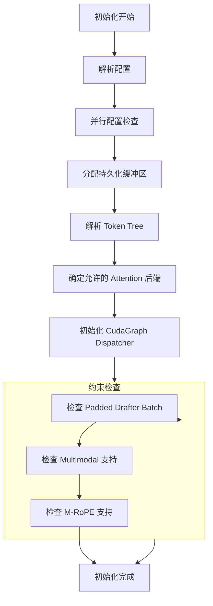
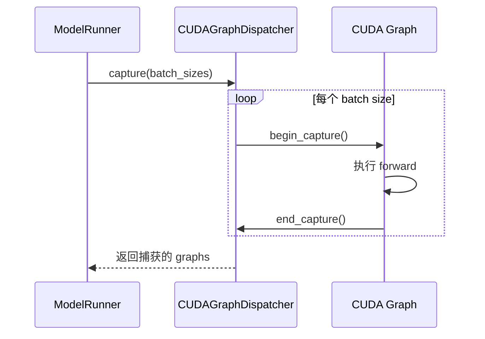
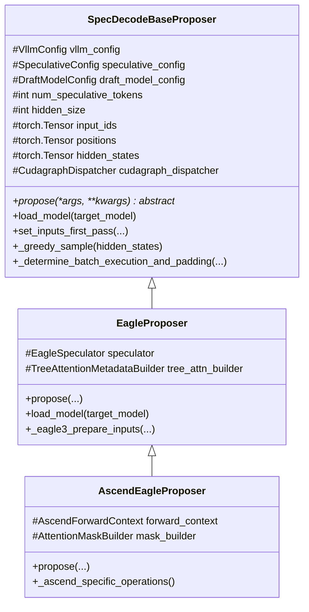

# 第二部分: Spec Decode 核心接口与基类分析

## 2.1 SpecDecodeBaseProposer 基类详解

### 2.1.1 类结构与核心属性

`SpecDecodeBaseProposer` 是所有推测解码方法的抽象基类，定义了统一的接口和共享的基础设施。

**类层次结构**: 
```
SpecDecodeBaseProposer (ABC)
├── EagleProposer (vllm/v1/spec_decode/eagle.py)
│   └── AscendEagleProposer (vllm_ascend/spec_decode/eagle_proposer.py)
├── DraftModelProposer
├── MtpProposer
├── MedusaProposer
├── NgramProposer
└── SuffixDecodingProposer
```

**核心属性**（`vllm/v1/spec_decode/base.py:39-270`）: 

```python
class SpecDecodeBaseProposer(ABC):
    def __init__(
        self,
        vllm_config: VllmConfig,
        device: torch.device,
        pass_hidden_states_to_model: bool = False,
        runner=None,
    ):
        # ========== 配置相关 ==========
        self.vllm_config = vllm_config
        self.speculative_config = vllm_config.speculative_config
        self.draft_model_config = self.speculative_config.draft_model_config
        self.method = self.speculative_config.method
        self.num_speculative_tokens = self.speculative_config.num_speculative_tokens

        # ========== 模型维度相关 ==========
        self.hidden_size = self.draft_model_config.get_hidden_size()
        self.inputs_embeds_size = self.draft_model_config.get_inputs_embeds_size()
        self.dtype = vllm_config.model_config.dtype
        self.max_model_len = vllm_config.model_config.max_model_len

        # ========== 并行配置 ==========
        self.dp_rank = vllm_config.parallel_config.data_parallel_rank
        self.parallel_drafting = self.speculative_config.parallel_drafting

        # ========== 缓冲区大小 ==========
        max_batch_size = vllm_config.scheduler_config.max_num_seqs
        self.max_num_tokens = vllm_config.scheduler_config.max_num_batched_tokens

        # ========== 持久化缓冲区 (CUDA Graph 兼容) ==========
        self.input_ids = torch.zeros(self.max_num_tokens, dtype=torch.int32, device=device)
        self.positions = torch.zeros(self.max_num_tokens, dtype=torch.int64, device=device)
        self.hidden_states = torch.zeros((self.max_num_tokens, self.hidden_size), dtype=self.dtype, device=device)
        self.inputs_embeds = torch.zeros((self.max_num_tokens, self.inputs_embeds_size), dtype=self.dtype, device=device)

        # ========== Tree Attention 相关 ==========
        self.tree_choices = ast.literal_eval(spec_token_tree)
        self.cu_drafts_per_level = [...]
        self.child_drafts_per_level = [...]
        self.tree_draft_pos_offsets = torch.arange(...)
```

### 2.1.2 初始化流程分析

**初始化流程图**: 



### 2.1.3 关键缓冲区设计

#### input_ids 缓冲区

```python
self.input_ids = torch.zeros(
    self.max_num_tokens, dtype=torch.int32, device=device
)
```

**用途**: 
- 存储当前迭代的输入 token IDs
- 对于 Eagle: 包含 shifted input_ids + last sampled token
- 对于 Draft Model: 包含完整的输入序列

**内存布局**: 
```
Batch: [Req-0 tokens] [Req-1 tokens] ... [Req-N tokens] [PAD ...]
       ← query_start_loc[0] → ← query_start_loc[1] →
```

#### positions 缓冲区

```python
if self.uses_mrope:
    self.mrope_positions = torch.zeros(
        (3, self.max_num_tokens + 1), dtype=torch.int64, device=device
    )
else:
    self.positions = torch.zeros(
        self.max_num_tokens, dtype=torch.int64, device=device
    )
```

**M-RoPE vs 1D-RoPE**: 
- M-RoPE: 3D 位置编码（文本、图像、视频维度）
- 1D-RoPE: 标准位置编码

#### hidden_states 缓冲区

```python
self.hidden_states = torch.zeros(
    (self.max_num_tokens, self.hidden_size), dtype=self.dtype, device=device
)
```

**用途**: 
- 存储 Target Model 输出的 hidden states
- 作为 EagleProposer 的输入
- 在多步推测中传递中间隐藏状态

### 2.1.4 CUDA Graph 支持机制

**CUDAGraphDispatcher**: 
```python
self.cudagraph_dispatcher = CudagraphDispatcher(self.vllm_config)
```

**工作模式**: 
| 模式 | 说明 | 适用场景 |
|------|------|----------|
| `NONE` | 不使用 CUDA Graph | 动态 batch |
| `FULL` | 完整 CUDA Graph | 固定 batch size |
| `PIECEWISE` | 分段 CUDA Graph | 部分动态场景 |

**捕获流程**: 


### 2.1.5 类图



## 2.2 核心接口定义

### 2.2.1 `propose()` 接口规范

```python
@abstractmethod
def propose(self, *args, **kwargs):
    """Propose draft tokens for speculative decoding.

    Returns:
        Draft tokens tensor or list, depending on the proposer type.
    """
    raise NotImplementedError("Subclasses must implement propose()")
```

**EagleProposer 实现**（简化版）: 
```python
def propose(
    self,
    input_batch: InputBatch,
    attn_metadata: dict[str, Any],
    slot_mappings: dict[str, torch.Tensor],
    last_hidden_states: torch.Tensor,
    aux_hidden_states: list[torch.Tensor] | None,
    num_sampled: torch.Tensor,
    num_rejected: torch.Tensor,
    last_sampled: torch.Tensor,
    next_prefill_tokens: torch.Tensor,
    temperature: torch.Tensor,
    seeds: torch.Tensor,
) -> torch.Tensor:
    # 1. 准备 Eagle 输入
    last_token_indices = prepare_eagle_inputs(...)

    # 2. 运行 Eagle 模型 (prefill)
    last_hidden_states, hidden_states = self.run_model(...)

    # 3. 采样第一个 draft token
    draft_tokens[:, 0] = gumbel_sample(...)

    # 4. 多步 decode 生成剩余 draft tokens
    self.generate_draft(...)

    return draft_tokens
```

### 2.2.2 `load_model()` 接口规范

```python
def load_model(self, target_model: nn.Module) -> None:
    """Load the draft model or initialize the proposer."""
    pass
```

**EagleProposer 实现**: 
```python
def load_model(self, target_model: nn.Module) -> None:
    # 从 target model 构建 eagle 模型
    self.model = load_eagle_model(target_model, self.vllm_config)
```

### 2.2.3 `set_inputs_first_pass()` 接口规范

```python
def set_inputs_first_pass(
    self,
    target_token_ids: torch.Tensor,
    next_token_ids: torch.Tensor,
    target_positions: torch.Tensor,
    target_hidden_states: torch.Tensor,
    token_indices_to_sample: torch.Tensor | None,
    cad: CommonAttentionMetadata,
    num_rejected_tokens_gpu: torch.Tensor | None = None,
) -> tuple[int, torch.Tensor, CommonAttentionMetadata]:
    """Set inputs for the first pass of speculative decoding."""
    num_tokens = target_token_ids.shape[0]

    # 复制输入到缓冲区
    self.input_ids[:num_tokens] = target_token_ids
    self._set_positions(num_tokens, target_positions)
    self.hidden_states[:num_tokens] = target_hidden_states

    return num_tokens, token_indices_to_sample, cad
```

### 2.2.4 工具方法解析

#### `_greedy_sample()`

```python
def _greedy_sample(self, hidden_states: torch.Tensor) -> torch.Tensor:
    """Greedy-sample draft tokens from hidden states."""
    if self.use_local_argmax_reduction:
        return self.model.get_top_tokens(hidden_states)
    return self.model.compute_logits(hidden_states).argmax(dim=-1)
```

#### `_determine_batch_execution_and_padding()`

```python
def _determine_batch_execution_and_padding(
    self,
    num_tokens: int,
    use_cudagraphs: bool = True,
) -> tuple[CUDAGraphMode, int, torch.Tensor | None]:
    """Determine batch execution mode and padding for CUDA graphs."""
    cudagraph_mode, batch_desc = self.cudagraph_dispatcher.dispatch(
        num_tokens,
        valid_modes=({CUDAGraphMode.NONE} if not use_cudagraphs else None),
    )
    num_tokens_padded = batch_desc.num_tokens

    # DP coordination logic...

    return cudagraph_mode, num_tokens_padded, num_tokens_across_dp
```

## 2.3 vLLM-Ascend 的 Spec Decode 入口

### 2.3.1 `get_spec_decode_method()` 工厂函数分析

**代码位置**: `vllm_ascend/spec_decode/__init__.py`

```python
def get_spec_decode_method(method, vllm_config, device, runner):
    if method == "ngram":
        return NgramProposer(vllm_config, device, runner)
    elif method in ("eagle", "eagle3"):
        return EagleProposer(vllm_config, device, runner)
    elif method == "mtp":
        return MtpProposer(vllm_config, device, runner)
    elif method == "suffix":
        return SuffixDecodingProposer(vllm_config, device, runner)
    elif method == "medusa":
        return MedusaProposer(vllm_config, device, runner)
    else:
        raise ValueError(f"Unknown speculative decoding method: {method}")
```

### 2.3.2 五种推测方法的注册与分发

**支持的方法**: 

| 方法 | Proposer 类 | 文件路径 |
|------|-------------|----------|
| `ngram` | `NgramProposer` | `vllm_ascend/spec_decode/ngram_proposer.py` |
| `eagle`/`eagle3` | `EagleProposer` | `vllm_ascend/spec_decode/eagle_proposer.py` |
| `mtp` | `MtpProposer` | `vllm_ascend/spec_decode/mtp_proposer.py` |
| `suffix` | `SuffixDecodingProposer` | `vllm_ascend/spec_decode/suffix_proposer.py` |
| `medusa` | `MedusaProposer` | `vllm_ascend/spec_decode/medusa_proposer.py` |

### 2.3.3 代码位置

```
vllm-ascend/
└── vllm_ascend/
    └── spec_decode/
        ├── __init__.py              # get_spec_decode_method()
        ├── eagle_proposer.py        # EagleProposer (昇腾实现)
        ├── mtp_proposer.py          # MtpProposer
        ├── medusa_proposer.py       # MedusaProposer
        ├── ngram_proposer.py        # NgramProposer
        └── suffix_proposer.py       # SuffixDecodingProposer
```

---

---

