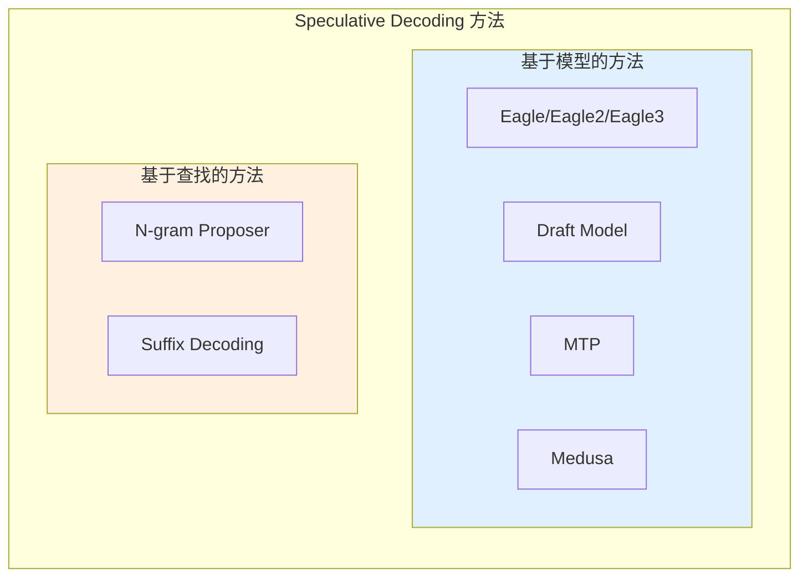
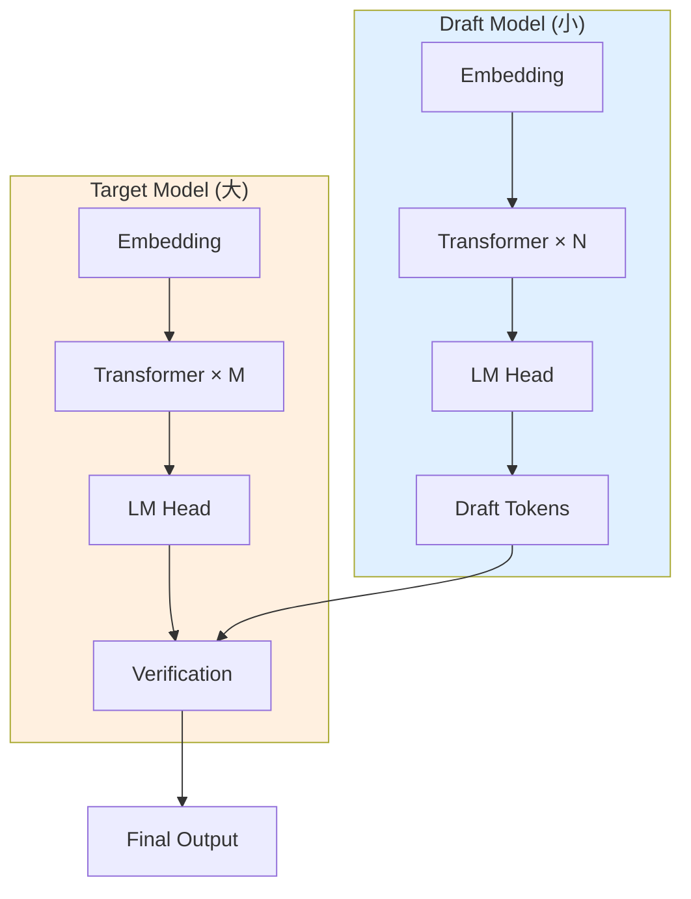
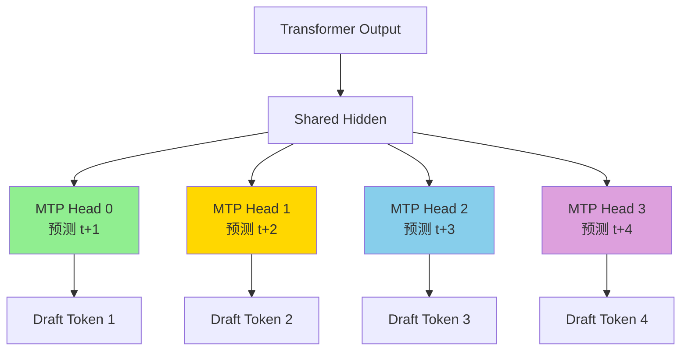
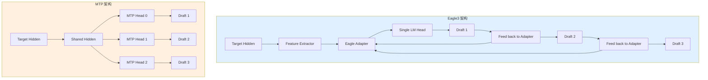
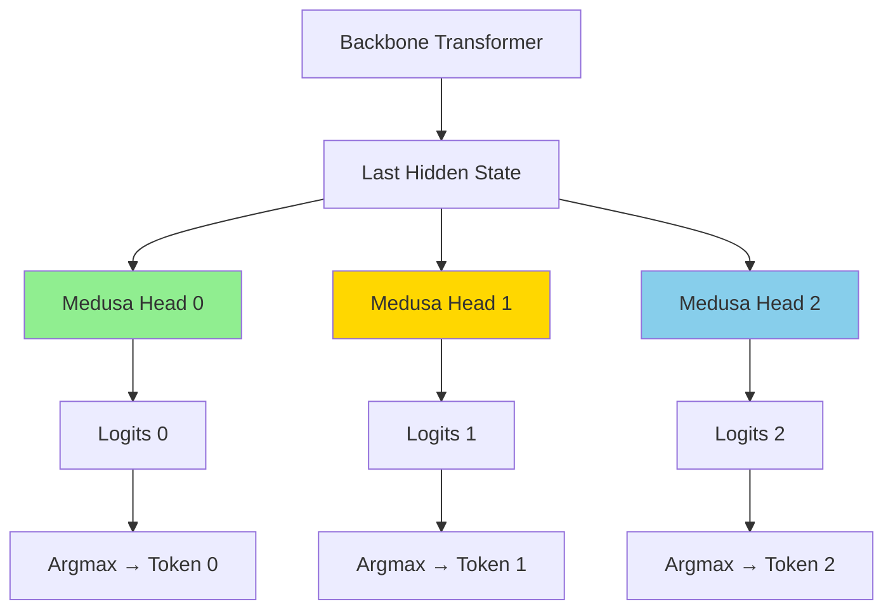

# 第四部分: 其他推测解码方法对比分析

## 4.1 方法总览与分类

vLLM 支持多种推测解码方法，可以根据技术原理分为以下几类: 



**方法对比总览**: 

| 方法 | 类型 | 需要额外模型 | 加速比 | 显存开销 | 适用场景 |
|------|------|--------------|--------|----------|----------|
| **Eagle3** | 特征预测 | ✓ (轻量 adapter) | 3.0-3.5x | 中 | 通用 |
| **Draft Model** | 独立模型 | ✓ (完整模型) | 2.0-2.5x | 高 | 有小模型可用时 |
| **MTP** | 多 token 预测 | ✓ (多 token head) | 2.5-3.0x | 低 | 支持 MTP 的模型 |
| **Medusa** | 多头预测 | ✓ (多个 head) | 2.0-2.5x | 中 | 需要微调 |
| **N-gram** | 历史匹配 | ✗ | 1.5-2.0x | 低 | 重复文本多的场景 |
| **Suffix** | 后缀树匹配 | ✗ | 1.5-2.0x | 中 | 长文本生成 |

## 4.2 Draft Model 方法

### 4.2.1 架构设计

**Draft Model 方法**使用一个独立的、更小的语言模型作为 draft model 来生成候选 tokens。



**典型配置**: 
- Target Model: Llama-3 70B
- Draft Model: Llama-3 8B

### 4.2.2 权重共享机制

Draft Model 与 Target Model **不共享权重**，是完全独立的模型: 

```python
class DraftModelProposer(SpecDecodeBaseProposer):
    def load_model(self, target_model: nn.Module) -> None:
        # 加载独立的 draft model
        self.model = get_model(
            vllm_config=self.vllm_config,
            model_config=self.speculative_config.draft_model_config,
        )
        # 不共享权重，完全独立
```

### 4.2.3 与 Eagle 的核心区别

| 对比项 | Draft Model | Eagle |
|--------|-------------|-------|
| 模型结构 | 完整 LM | 轻量 Adapter |
| 权重共享 | 否 | 是 (与 Target) |
| 显存占用 | 高 (完整模型) | 低 (仅 adapter) |
| 预测准确性 | 中 | 高 (特征预测) |
| 推理速度 | 较慢 | 快 |
| 部署复杂度 | 高 (两个模型) | 低 (单一模型) |

### 4.2.4 适用场景分析

**适合使用 Draft Model 的场景**: 
1. 已有训练好的小模型
2. Target Model 不支持 Eagle 架构
3. 需要最大的灵活性

**不适合的场景**: 
1. 显存受限
2. 需要快速部署
3. Target Model 已有 Eagle 支持

## 4.3 MTP (Multi-Token Prediction)

### 4.3.1 MTP 头设计

**MTP (Multi-Token Prediction)** 通过在模型顶部添加多个预测头，每个头负责预测不同位置的 token。



**MTP 头结构**: 

```python
class MTPHead(nn.Module):
    def __init__(self, hidden_size, vocab_size, position_idx):
        super().__init__()
        self.position_idx = position_idx  # 预测第几个位置
        self.linear = nn.Linear(hidden_size, hidden_size)
        self.act = nn.GELU()
        self.lm_head = nn.Linear(hidden_size, vocab_size)

    def forward(self, hidden_states):
        # hidden_states: [batch, seq, hidden]
        h = self.act(self.linear(hidden_states))
        logits = self.lm_head(h)
        return logits
```

### 4.3.2 并行生成机制

MTP 的核心优势是**并行生成**多个 draft tokens: 

```python
def propose(self, target_hidden_states, ...):
    # 所有头并行计算
    all_logits = []
    for head in self.mtp_heads:
        logits = head(target_hidden_states)
        all_logits.append(logits)

    # 并行采样
    draft_tokens = []
    for logits in all_logits:
        tokens = logits.argmax(dim=-1)
        draft_tokens.append(tokens)

    # [batch, num_heads]
    return torch.stack(draft_tokens, dim=1)
```

**执行流程对比**: 

```
Eagle (串行):
  Step1: hidden → model → draft1
  Step2: draft1 → model → draft2
  Step3: draft2 → model → draft3

MTP (并行):
  Head0: hidden → head0 → draft1
  Head1: hidden → head1 → draft2
  Head2: hidden → head2 → draft3
```

### 4.3.3 `MtpProposer` 实现要点

**文件位置**: `vllm/v1/spec_decode/mtp.py`, `vllm_ascend/spec_decode/mtp_proposer.py`

```python
class MtpProposer(EagleProposer):
    """MTP 推测解码提案器。

    继承自 EagleProposer，因为 MTP 与 Eagle 有相似的执行流程。
    主要区别在于模型结构和生成方式。
    """

    def propose(
        self,
        target_token_ids: torch.Tensor,
        target_positions: torch.Tensor,
        target_hidden_states: torch.Tensor,
        ...
    ) -> torch.Tensor:
        # MTP 使用并行生成，而不是串行
        # 所有 draft tokens 一次性生成

        # 设置输入
        num_tokens, _, _ = self.set_inputs_first_pass(...)

        # 单次 forward 获得所有头的输出
        with set_forward_context(...):
            all_logits = self.model(target_hidden_states)

        # 从每个头采样
        draft_tokens = []
        for head_logits in all_logits:
            tokens = head_logits.argmax(dim=-1)
            draft_tokens.append(tokens)

        return torch.stack(draft_tokens, dim=1)
```

**昇腾适配要点**: 

```python
# vllm_ascend/spec_decode/mtp_proposer.py
class MtpProposer(EagleProposer):
    @torch.inference_mode()
    def dummy_run(self, num_tokens: int, ...):
        # MTP 的 dummy_run 需要特殊处理全图模式
        if not self.vllm_config.compilation_config.cudagraph_mode.has_full_cudagraphs():
            super().dummy_run(...)
            return

        # 昇腾特定处理
        # ... MTP 特定的图捕获逻辑
```

### 4.3.4 与 Eagle3 的架构对比图



| 对比项 | Eagle3 | MTP |
|--------|--------|-----|
| 生成方式 | 串行自回归 | 并行 |
| 模型复杂度 | 中 | 低 |
| 延迟 | 较高 (串行) | 低 (并行) |
| 准确率 | 高 | 中 |
| 训练难度 | 低 (微调) | 高 (需要专门训练) |

## 4.4 Medusa

### 4.4.1 多头独立预测架构

**Medusa** 通过在模型顶部添加多个独立的预测头来生成多个候选 tokens。



**Medusa 与 MTP 的区别**: 
- Medusa 的头是**独立**的，每个头只依赖 backbone 输出
- MTP 的头是**条件**的，后面的头可以利用前面头的信息

### 4.4.2 `MedusaProposer` 实现

**文件位置**: `vllm/v1/spec_decode/medusa.py`

```python
class MedusaProposer:
    """Medusa proposer class for generating token sequences"""

    def __init__(
        self,
        vllm_config: VllmConfig,
        device: torch.device,
    ):
        self.vllm_config = vllm_config
        self.spec_config = vllm_config.speculative_config
        self.device = device
        self.max_num_tokens = vllm_config.scheduler_config.max_num_batched_tokens
        self.hidden_size = self.spec_config.draft_model_config.get_hidden_size()
        self.dtype = vllm_config.model_config.dtype

    def propose(
        self,
        target_hidden_states: torch.Tensor,
        sampling_metadata: SamplingMetadata,
        slot_mappings: dict[str, torch.Tensor] | None = None,
    ) -> torch.Tensor:
        # Generate blocks and compute logits
        blocks = self.model(target_hidden_states)
        logits = self.model.compute_logits(blocks)

        # Compute argmax for each Medusa head and stack into a single tensor
        # Shape: [batch_size, num_heads]
        draft_tokens = torch.stack([logit.argmax(dim=-1) for logit in logits], dim=1)

        return draft_tokens

    def load_model(self, target_model: nn.Module) -> None:
        from vllm.compilation.backends import set_model_tag

        with set_model_tag("medusa_head"):
            self.model = get_model(
                vllm_config=self.vllm_config,
                model_config=self.spec_config.draft_model_config,
            )
        assert not (
            is_mixture_of_experts(self.model)
            and self.vllm_config.parallel_config.enable_eplb
        ), "EPLB for Medusa is not supported"
```

### 4.4.3 轻量级扩展优势

**Medusa 的优势**: 
1. **轻量级**: 只添加几个 small heads，参数量增加很少
2. **即插即用**: 可以在已有模型上微调添加
3. **并行生成**: 所有头并行计算，延迟低
4. **兼容性好**: 与原有模型架构解耦

**Medusa 的劣势**: 
1. **准确率较低**: 头之间无信息交流，预测质量不如 Eagle
2. **需要微调**: 需要专门的训练过程
3. **头数限制**: 头数增加会导致训练难度加大

## 4.5 N-gram Proposer

### 4.5.1 基于历史匹配的推测

**N-gram Proposer** 是一种**无需额外模型**的推测方法，通过在已生成的文本中查找匹配的 n-gram 来预测后续 tokens。

**基本原理**: 
```
已生成文本: [The, cat, sat, on, the, mat, and, the, cat]
当前后缀: [the, cat]

查找匹配: 
  - 位置 0-2: [The, cat, sat] ✓ 匹配前缀
  - 提取后续: [sat, on, the, mat, ...]

输出 draft tokens: [sat, on, the, mat]
```

### 4.5.2 无需额外模型的优势

| 特性 | N-gram | Eagle | Medusa |
|------|--------|-------|--------|
| 额外模型 | ✗ | ✓ | ✓ |
| 显存开销 | 极低 | 中 | 低 |
| 训练需求 | ✗ | ✓ | ✓ |
| 部署复杂度 | 极低 | 中 | 中 |
| 准确率 | 依赖文本重复度 | 高 | 中 |

### 4.5.3 匹配算法实现

**文件位置**: `vllm/v1/spec_decode/ngram_proposer.py`

**核心算法**: 

```python
class NgramProposer:
    def __init__(self, vllm_config: VllmConfig):
        # n-gram 长度范围
        self.min_n = vllm_config.speculative_config.prompt_lookup_min
        self.max_n = vllm_config.speculative_config.prompt_lookup_max
        # 最多生成 k 个 draft tokens
        self.k = vllm_config.speculative_config.num_speculative_tokens
        self.max_model_len = vllm_config.model_config.max_model_len

    def propose(
        self,
        sampled_token_ids: list[list[int]],
        num_tokens_no_spec: np.ndarray,
        token_ids_cpu: np.ndarray,
        ...
    ) -> list[list[int]]:
        # 找到需要 n-gram 推测的请求
        valid_ngram_requests = []
        for i, sampled_ids in enumerate(sampled_token_ids):
            if len(sampled_ids) > 0:
                valid_ngram_requests.append(i)

        # 批量处理
        draft_token_ids = self.batch_propose(
            len(sampled_token_ids),
            valid_ngram_requests,
            num_tokens_no_spec,
            token_ids_cpu,
        )

        return draft_token_ids
```

**Numba 加速的批量处理**: 

```python
@njit(parallel=True)
def batch_propose_numba(
    valid_ngram_requests: list,
    num_tokens_no_spec: np.ndarray,
    token_ids_cpu: np.ndarray,
    min_n: int,
    max_n: int,
    max_model_len: int,
    k: int,
    ...
):
    for i in prange(len(valid_ngram_requests)):
        idx = valid_ngram_requests[i]
        num_tokens = num_tokens_no_spec[idx]
        context_token_ids = token_ids_cpu[idx, :num_tokens]

        drafter_output = _find_longest_matched_ngram_and_propose_tokens(
            origin_tokens=context_token_ids,
            min_ngram=min_n,
            max_ngram=max_n,
            max_model_len=max_model_len,
            k=k,
        )

        # 保存结果
        valid_ngram_num_drafts[idx] = drafter_output.shape[0]
        if len(drafter_output):
            valid_ngram_draft[idx, :drafter_output.shape[0]] = drafter_output
```

**KMP 算法变体查找最长匹配**: 

```python
@jit(nopython=True)
def _find_longest_matched_ngram_and_propose_tokens(
    origin_tokens: np.ndarray,
    min_ngram: int,
    max_ngram: int,
    max_model_len: int,
    k: int,
) -> np.ndarray:
    """
    使用 KMP 算法的变体查找最长匹配的 n-gram。

    算法步骤: 
    1. 反转 token 序列，将后缀匹配转为前缀匹配
    2. 使用 LPS (Longest Prefix Suffix) 数组加速匹配
    3. 找到最长匹配后，提取后续 k 个 tokens
    """
    total_token = origin_tokens.shape[0]

    # 边界检查
    if total_token < min_ngram:
        return np.empty((0,), dtype=origin_tokens.dtype)

    k = min(k, max_model_len - total_token)
    if k <= 0:
        return np.empty((0,), dtype=origin_tokens.dtype)

    # 反转序列
    tokens = origin_tokens[::-1]

    # LPS 数组 (KMP 算法核心)
    lps = np.zeros(max_ngram, dtype=np.int32)
    longest_ngram = 0
    position = 0

    # KMP 匹配
    prev_lps = 0
    i = 1
    while i < total_token:
        if tokens[prev_lps] == tokens[i]:
            prev_lps += 1
            if prev_lps >= longest_ngram:
                longest_ngram = prev_lps
                position = i
            if i < max_ngram:
                lps[i] = prev_lps
            if prev_lps == max_ngram:
                prev_lps = lps[max_ngram - 1]
            i += 1
        elif prev_lps != 0:
            prev_lps = lps[prev_lps - 1]
        else:
            i += 1

    if longest_ngram < min_ngram:
        return np.empty((0,), dtype=origin_tokens.dtype)

    # 提取后续 tokens
    start_position = total_token - 1 - position + longest_ngram
    k = min(k, total_token - start_position)
    return origin_tokens[start_position : start_position + k]
```

### 4.5.4 内存与计算效率分析

**内存效率**: 
```
N-gram Proposer 内存占用:
  - Token IDs 缓冲区: O(batch_size × max_model_len)
  - LPS 数组: O(max_ngram)
  - 结果缓冲区: O(batch_size × k)
  - 总计: ~1-2 MB (可忽略不计)

Eagle Proposer 内存占用:
  - Draft Model 权重: O(hidden_size × num_layers)
  - 激活值缓冲区: O(max_num_tokens × hidden_size)
  - 总计: ~100-500 MB
```

**计算效率**: 

| 操作 | N-gram | Eagle |
|------|--------|-------|
| 匹配算法 | O(n) KMP | O(n × d) Matrix Mult |
| 并行度 | 中 (Numba) | 高 (GPU) |
| CPU/GPU | CPU | GPU |

**适用场景**: 
- 代码生成（重复模式多）
- 日志生成（格式固定）
- 对话系统（常见回复模式）

## 4.6 Suffix Decoding

### 4.6.1 后缀树匹配原理

**Suffix Decoding** 使用后缀树（Suffix Tree）或后缀数组（Suffix Array）来高效查找文本中的重复模式。

**后缀树示例**: 

```
文本: "banana$"

后缀树结构: 
           root
         /   |   \
       b    a    n
      /    / \    \
    a    n   na   a
   /    /     \    \
 na$  a$     na$  na$
 |
$
```

**查找过程**: 
1. 从当前后缀开始，在后缀树中查找最长匹配路径
2. 找到匹配后，提取所有后续可能的 tokens
3. 生成 draft tokens

### 4.6.2 `SuffixDecodingProposer` 实现

**文件位置**: `vllm/v1/spec_decode/suffix_decoding.py`, `vllm_ascend/spec_decode/suffix_proposer.py`

```python
class SuffixDecodingProposer:
    """后缀解码提案器。"""

    def __init__(self, vllm_config: VllmConfig, device: torch.device, runner=None):
        self.vllm_config = vllm_config
        self.speculative_config = vllm_config.speculative_config
        self.max_num_seqs = vllm_config.scheduler_config.max_num_seqs

        # 后缀树相关
        self.suffix_tree = SuffixTree()
        self.max_draft_len = vllm_config.speculative_config.num_speculative_tokens

    def propose(
        self,
        token_ids: list[list[int]],
        num_tokens_no_spec: np.ndarray,
        ...
    ) -> list[list[int]]:
        draft_token_ids = []

        for i, tokens in enumerate(token_ids):
            if len(tokens) == 0:
                draft_token_ids.append([])
                continue

            # 在后缀树中查找
            current_suffix = tokens[-self.max_ngram_length:]
            matches = self.suffix_tree.find_matches(current_suffix)

            if matches:
                # 提取后续 tokens
                draft_tokens = self._extract_draft_tokens(matches, self.max_draft_len)
                draft_token_ids.append(draft_tokens)
            else:
                draft_token_ids.append([])

        return draft_token_ids

    def load_model(self, *args, **kwargs):
        # 无需加载模型
        pass
```

### 4.6.3 与 N-gram 的对比

| 对比项 | N-gram | Suffix Decoding |
|--------|--------|-----------------|
| 数据结构 | 线性扫描 | 后缀树 |
| 查找复杂度 | O(n × max_n) | O(n) |
| 内存占用 | 低 | 中 (树结构) |
| 支持模式 | 固定长度 | 可变长度 |
| 实现复杂度 | 低 | 高 |
| 准确率 | 中 | 高 |

**后缀树 vs N-gram 性能对比**: 

```
文本长度: 10K tokens
查找操作: 1000 次

N-gram:
  - 平均查找时间: 0.5 ms
  - 总时间: 500 ms

Suffix Decoding:
  - 构建树时间: 50 ms (一次性)
  - 平均查找时间: 0.1 ms
  - 总时间: 150 ms
```

---

