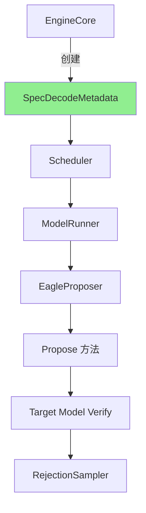
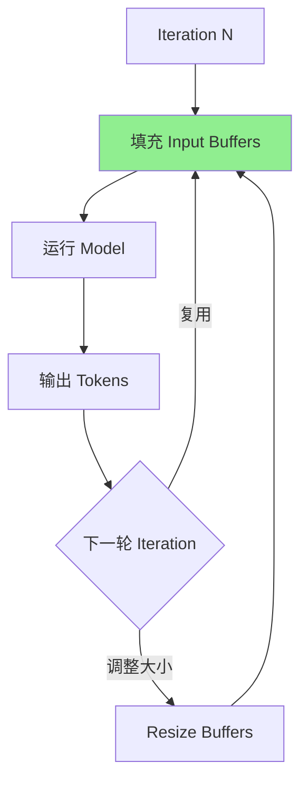
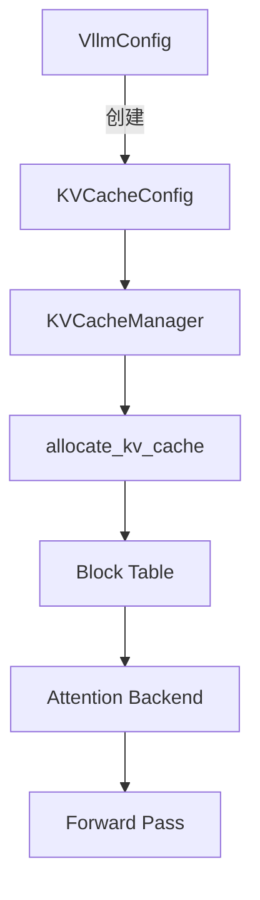

# 第五部分: 关键数据结构与元数据

## 5.1 SpecDecodeMetadata

### 5.1.1 数据结构定义

**文件位置**: `vllm/v1/spec_decode/metadata.py`

```python
@dataclass
class SpecDecodeMetadata:
    """Speculative decoding 的元数据。

    用于在推理过程中传递 speculative decoding 相关的配置和状态信息。
    """

    # 推测方法名称
    method: str

    # 最大推测 token 数
    num_speculative_tokens: int

    # Token Tree 结构
    speculative_token_tree: Optional[str] = None

    # 是否使用并行 drafting
    parallel_drafting: bool = False

    # 是否禁用 padded drafter batch
    disable_padded_drafter_batch: bool = False

    # 是否使用局部 argmax 归约
    use_local_argmax_reduction: bool = False

    # Draft model 配置
    draft_model_config: Optional[ModelConfig] = None

    # Draft tensor parallel size
    draft_tensor_parallel_size: int = 1
```

### 5.1.2 字段含义与用途

| 字段 | 类型 | 说明 |
|------|------|------|
| `method` | `str` | 推测方法: `eagle`, `eagle3`, `mtp`, `medusa`, `ngram`, `suffix`, `draft` |
| `num_speculative_tokens` | `int` | 每次迭代最多生成的 draft tokens 数量 |
| `speculative_token_tree` | `Optional[str]` | Token Tree 结构，格式为 Python 列表的字符串表示 |
| `parallel_drafting` | `bool` | 是否启用并行 drafting（某些模型支持） |
| `disable_padded_drafter_batch` | `bool` | 是否禁用 padded batch（影响性能） |
| `use_local_argmax_reduction` | `bool` | 是否使用局部 argmax 归约（分布式场景） |
| `draft_model_config` | `Optional[ModelConfig]` | Draft Model 的配置信息 |
| `draft_tensor_parallel_size` | `int` | Draft Model 的 TP size |

### 5.1.3 在推理流程中的传递



**代码示例**: 

```python
# EngineCore 中创建元数据
speculative_config = VllmConfig.create_speculative_config(...)
metadata = SpecDecodeMetadata(
    method=speculative_config.method,
    num_speculative_tokens=speculative_config.num_speculative_tokens,
    speculative_token_tree=speculative_config.speculative_token_tree,
    ...
)

# 传递给 ModelRunner
model_runner = GPUModelRunner(
    vllm_config=vllm_config,
    speculative_config=metadata,
    ...
)

# 在 propose 中使用
draft_tokens = self.speculator.propose(
    target_token_ids=target_token_ids,
    target_positions=target_positions,
    target_hidden_states=target_hidden_states,
    ...
)
```

## 5.2 输入缓冲区设计

### 5.2.1 `InputBuffers` 结构分析

**文件位置**: `vllm/v1/worker/gpu/input_batch.py`

```python
class InputBuffers:
    """用于存储输入数据的缓冲区，支持 CUDA Graph。"""

    def __init__(
        self,
        max_num_reqs: int,
        max_num_tokens: int,
        device: torch.device,
    ):
        self.max_num_reqs = max_num_reqs
        self.max_num_tokens = max_num_tokens
        self.device = device

        # Input IDs 缓冲区
        self.input_ids = torch.zeros(
            max_num_tokens, dtype=torch.int32, device=device
        )

        # 位置缓冲区
        self.positions = torch.zeros(
            max_num_tokens, dtype=torch.int64, device=device
        )

        # Query Start Loc 缓冲区 (用于 batch 处理)
        self.query_start_loc = torch.zeros(
            max_num_reqs + 1, dtype=torch.int32, device=device
        )

        # Seq Lens 缓冲区
        self.seq_lens = torch.zeros(
            max_num_reqs, dtype=torch.int32, device=device
        )

        # Hidden States 缓冲区
        self.hidden_states = None  # 动态分配

    def resize(self, new_max_num_tokens: int):
        """调整缓冲区大小。"""
        if new_max_num_tokens > self.max_num_tokens:
            self.max_num_tokens = new_max_num_tokens
            self.input_ids = torch.zeros(
                new_max_num_tokens, dtype=torch.int32, device=self.device
            )
            self.positions = torch.zeros(
                new_max_num_tokens, dtype=torch.int64, device=self.device
            )
```

### 5.2.2 缓冲区复用策略

**缓冲区复用流程**: 



**复用要点**: 
1. **预分配**: 在初始化时分配最大可能的缓冲区
2. **原地更新**: 避免重复分配，直接在原 buffer 上更新
3. **切片访问**: 使用 `[:num_tokens]` 切片，避免 copy
4. **CUDA Graph 兼容**: 静态大小的 buffer 支持图捕获

### 5.2.3 CPU-GPU 内存协同

```python
class CpuGpuBuffer:
    """CPU-GPU 协同的缓冲区。"""

    def __init__(
        self,
        max_size: int,
        dtype: torch.dtype,
        pin_memory: bool = True,
        device: torch.device = "cuda",
        with_numpy: bool = False,
    ):
        # CPU 缓冲区（pinned memory，加速 H2D 传输）
        self.cpu = torch.empty(
            max_size, dtype=dtype, device="cpu", pin_memory=pin_memory
        )

        # GPU 缓冲区
        self.gpu = torch.empty(
            max_size, dtype=dtype, device=device
        )

        # NumPy 视图（可选）
        if with_numpy:
            self.numpy = self.cpu.numpy()

    def copy_to_gpu(self, stream: torch.cuda.Stream = None):
        """异步拷贝到 GPU。"""
        self.gpu.copy_(self.cpu, non_blocking=True)
```

## 5.3 Attention 元数据

### 5.3.1 `TreeAttentionMetadata` 详解

**文件位置**: `vllm/v1/attention/backends/tree_attn.py`

```python
@dataclass
class TreeAttentionMetadata:
    """树结构注意力元数据。

    用于描述 token tree 的结构和注意力掩码。
    """

    # 基本注意力元数据
    query_start_loc: torch.Tensor  # [batch_size + 1]
    seq_lens: torch.Tensor       # [batch_size]
    block_table_tensor: torch.Tensor  # [batch_size, max_blocks]

    # Tree 特定字段
    tree_structure: List[Tuple[int, ...]]  # Token Tree
    num_tree_tokens: int  # Tree 中 token 总数

    # 预计算的索引
    parent_indices: torch.Tensor  # 每个 token 的父节点索引
    tree_mask: torch.Tensor      # Tree 注意力掩码
```

**Tree Mask 构建**: 

```python
def build_tree_attention_mask(
    tree_structure: List[Tuple[int, ...]]
) -> torch.Tensor:
    """
    构建树结构注意力掩码。

    每个 token 只能 attend 到: 
    1. 它的所有祖先节点
    2. 它自己

    示例 Tree: [(0,), (0,1), (0,2), (0,1,3)]
    可视化:
           root
         /  |  \
       d1   d2  d3
            |
           d4

    Mask (1 = attend, 0 = mask):
         d1 d2 d3 d4
    d1 [ 1  0  0  0 ]
    d2 [ 0  1  0  0 ]
    d3 [ 0  0  1  0 ]
    d4 [ 0  1  0  1 ]  ← d4 可以 attend d2 (父节点)
    """
    n = len(tree_structure)
    mask = torch.zeros(n, n, dtype=torch.bool)

    for i, node in enumerate(tree_structure):
        mask[i, i] = True  # Self-attention

        # 查找所有祖先
        for j in range(i):
            ancestor = tree_structure[j]
            # 检查是否是祖先（前缀匹配）
            if len(ancestor) < len(node) and ancestor == node[:len(ancestor)]:
                mask[i, j] = True

    return mask
```

### 5.3.2 `TritonAttentionMetadata` 适配

**文件位置**: `vllm/v1/attention/backends/triton_attn.py`

```python
@dataclass
class TritonAttentionMetadata:
    """Triton 注意力后端元数据。"""

    num_actual_tokens: int
    max_query_len: int
    query_start_loc: torch.Tensor
    seq_lens: torch.Tensor
    block_table: torch.Tensor
    slot_mapping: torch.Tensor
    use_cuda_graph: bool
```

**与 Tree Attention 的适配**: 

```python
class TreeAttentionMetadataBuilder:
    """Tree Attention 元数据构建器。"""

    def __init__(self, attn_backend):
        self.attn_backend = attn_backend

    def build_for_drafting(
        self,
        common_attn_metadata: CommonAttentionMetadata,
        draft_index: int,
    ) -> TritonAttentionMetadata:
        """为 draft 阶段构建元数据。"""
        # 根据 draft_index 调整 query_start_loc
        # 每轮 draft 增加 query 长度
        adjusted_query_start = self._adjust_query_start(
            common_attn_metadata.query_start_loc,
            draft_index
        )

        return TritonAttentionMetadata(
            num_actual_tokens=common_attn_metadata.num_actual_tokens,
            max_query_len=common_attn_metadata.max_query_len + draft_index,
            query_start_loc=adjusted_query_start,
            seq_lens=common_attn_metadata.seq_lens + draft_index,
            block_table=common_attn_metadata.block_table,
            slot_mapping=common_attn_metadata.slot_mapping,
            use_cuda_graph=common_attn_metadata.use_cuda_graph,
        )
```

### 5.3.3 vLLM-Ascend 的 Attention 后端

**文件位置**: `vllm_ascend/attention/attention_v1.py`

```python
@dataclass
class AscendCommonAttentionMetadata:
    """昇腾平台的 Attention 元数据。

    在通用元数据基础上添加了昇腾特定的字段。
    """

    # 通用字段
    query_start_loc: torch.Tensor
    query_start_loc_cpu: torch.Tensor
    seq_lens_cpu: torch.Tensor
    seq_lens: torch.Tensor
    num_reqs: int
    num_actual_tokens: int
    num_input_tokens: int
    max_query_len: int
    num_computed_tokens_cpu: torch.Tensor
    actual_seq_lengths_q: torch.Tensor
    block_table_tensor: torch.Tensor
    slot_mapping: torch.Tensor
    positions: torch.Tensor
    attn_state: "AscendAttentionState"
    decode_token_per_req: int
    max_seq_len: int

    # 昇腾特定字段
    prefill_context_parallel_metadata: Optional[Any] = None
```

**Attention State 枚举**: 

```python
class AscendAttentionState(Enum):
    """昇腾 Attention 状态。"""

    ChunkedPrefill = 0  # 分块预填充
    SpecDecoding = 1    # 推测解码（MLA 专用）
    Decode = 2          # 解码阶段
```

## 5.4 KV Cache 管理

### 5.4.1 Slot Mapping 计算

**Slot Mapping** 将 token 映射到 KV Cache 中的物理 slot。

```python
def compute_slot_mapping(
    positions: torch.Tensor,      # [num_tokens]
    block_table: torch.Tensor,    # [num_reqs, max_blocks]
    query_start_loc: torch.Tensor, # [num_reqs + 1]
    block_size: int,
) -> torch.Tensor:
    """计算 slot mapping。

    Args:
        positions: 每个 token 的逻辑位置
        block_table: 每请求的 block 分配表
        query_start_loc: 每请求的 query 起始位置
        block_size: 每个 block 的 token 容量

    Returns:
        slot_mapping: [num_tokens] 物理 slot 索引
    """
    # 计算每个 token 属于哪个 block
    block_numbers = positions // block_size

    # 从 block_table 中获取 block ID
    # 需要根据 request index 进行 gather
    request_indices = torch.repeat_interleave(
        torch.arange(len(query_start_loc) - 1),
        query_start_loc[1:] - query_start_loc[:-1]
    )
    block_ids = block_table[request_indices, block_numbers]

    # 计算 slot 在 block 内的偏移
    slot_offsets = positions % block_size

    # 最终 slot = block_id * block_size + offset
    slot_mapping = block_ids * block_size + slot_offsets

    return slot_mapping
```

### 5.4.2 Block Table 组织

**Block Table 结构**: 

```
Request 0:
  block_table[0] = [block_id_0, block_id_1, block_id_2, ...]
                    ↑             ↑             ↑
                  token 0-15   token 16-31   token 32-47

Request 1:
  block_table[1] = [block_id_a, block_id_b, ...]
```

**代码表示**: 

```python
# Block Table: [num_reqs, max_blocks_per_req]
block_table = torch.tensor([
    [1, 2, 3, 0, 0],  # Req 0: 3 blocks allocated
    [4, 5, 0, 0, 0],  # Req 1: 2 blocks allocated
    [6, 7, 8, 9, 0],  # Req 2: 4 blocks allocated
])
```

### 5.4.3 KV Cache 配置传递

**KVCacheConfig 结构**: 

```python
@dataclass
class KVCacheConfig:
    """KV Cache 配置。"""

    # 每个 block 的 token 数量
    block_size: int

    # KV Cache 总容量（blocks）
    num_blocks: int

    # KV Cache 数据类型
    dtype: torch.dtype

    # 是否使用 MLA (Multi-head Latent Attention)
    use_mla: bool = False

    # 每层的 KV Cache 规格
    layer_specs: List[KVCacheSpec] = None
```

**配置传递流程**: 



---

