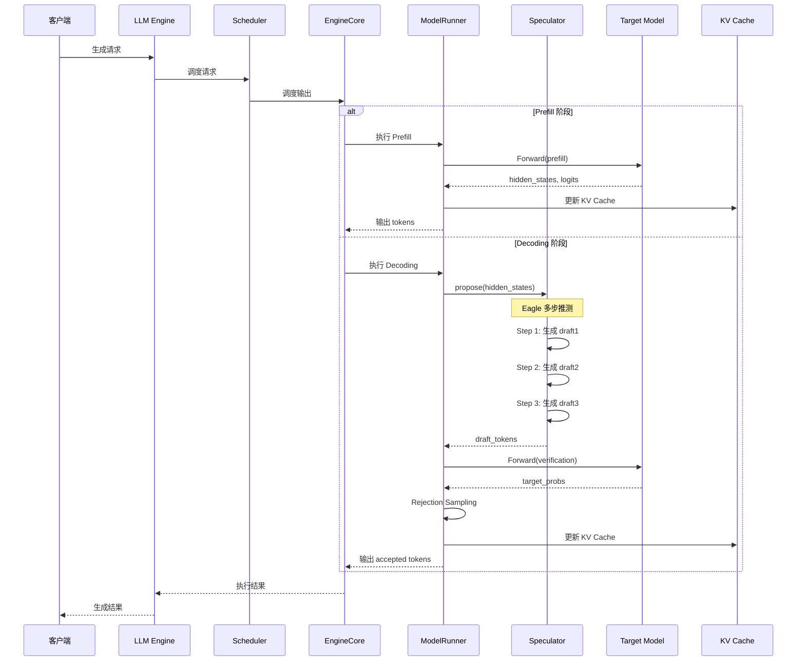
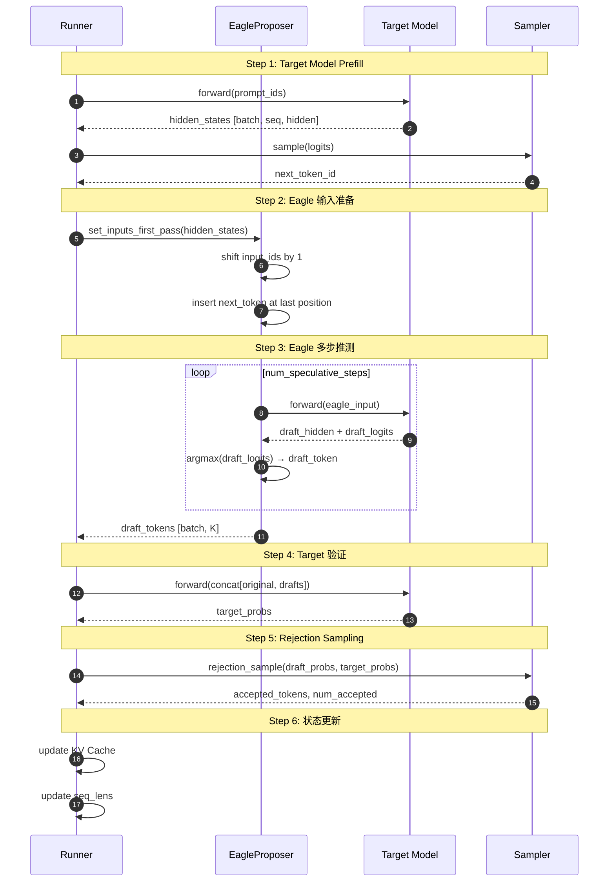
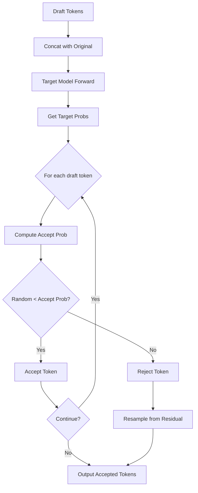

# 第七部分: Spec Decode 完整执行流程

## 7.1 请求处理时序图

### 7.1.1 从 Scheduler 到 Spec Decode 的请求流



### 7.1.2 完整时序图



## 7.2 第一阶段: Target Model 前向

### 7.2.1 Token 生成与 Hidden States 提取

```python
# vllm/v1/worker/gpu_model_runner.py
def _execute_model(self, scheduler_output):
    # ========== Stage 1: Target Model Forward ==========

    # 准备输入
    input_ids = self.input_batch.input_ids
    positions = self.positions
    kv_caches = self.kv_cache_manager.kv_caches

    # 执行 Target Model Forward
    with set_forward_context(...):
        hidden_states = self.model(
            input_ids=input_ids,
            positions=positions,
            kv_caches=kv_caches,
        )

    # 提取最后一个 token 的 hidden states
    last_token_indices = self.query_start_loc[1:] - 1
    last_hidden_states = hidden_states[last_token_indices]

    # 计算 logits 并采样
    logits = self.model.compute_logits(last_hidden_states)
    sampled_tokens = self.sampler.sample(logits, sampling_metadata)

    return hidden_states, sampled_tokens
```

### 7.2.2 Sampling Metadata 准备

```python
def prepare_sampling_metadata(
    self,
    input_batch: InputBatch,
    scheduler_output: SchedulerOutput,
) -> SamplingMetadata:
    """准备采样元数据。"""
    return SamplingMetadata(
        temperatures=input_batch.temperatures,
        top_ps=input_batch.top_ps,
        top_ks=input_batch.top_ks,
        min_ps=input_batch.min_ps,
        prompt_logs_probs=input_batch.prompt_logprobs,
        sample_logits_processors=input_batch.sample_logits_processors,
        no_sample=input_batch.no_sample,
        generators=input_batch.generators,
        sampling_seeds=input_batch.sampling_seeds,
        sample_indices=input_batch.sample_indices,
    )
```

## 7.3 第二阶段: Draft Model 推测

### 7.3.1 输入准备与转换

```python
def set_inputs_first_pass(
    self,
    target_token_ids: torch.Tensor,      # [num_tokens]
    next_token_ids: torch.Tensor,         # [batch_size]
    target_positions: torch.Tensor,       # [num_tokens]
    target_hidden_states: torch.Tensor,   # [num_tokens, hidden_size]
    token_indices_to_sample: torch.Tensor,
    cad: CommonAttentionMetadata,
    num_rejected_tokens_gpu: torch.Tensor,
) -> tuple[int, torch.Tensor, CommonAttentionMetadata]:
    """设置第一遍推测的输入。"""

    # 获取每个请求的最后一个 token 索引
    if token_indices_to_sample is None:
        token_indices_to_sample = cad.query_start_loc[1:] - 1

    num_tokens = target_token_ids.shape[0]

    # ========== Shift Input IDs by one ==========
    # [a1, b1, b2, c1, c2, c3] -> [b1, b2, c1, c2, c3, c3]
    self.input_ids[:num_tokens - 1] = target_token_ids[1:]

    # ========== 插入下一个 token ==========
    # [b1, b2, c1, c2, c3, c3] -> [a2, b2, b3, c2, c3, c4]
    self.input_ids[token_indices_to_sample] = next_token_ids

    # ========== 复制位置和 hidden states ==========
    self._set_positions(num_tokens, target_positions)
    self.hidden_states[:num_tokens] = target_hidden_states

    return num_tokens, token_indices_to_sample, cad
```

### 7.3.2 多步推测执行

```python
def propose(
    self,
    target_token_ids: torch.Tensor,
    target_positions: torch.Tensor,
    target_hidden_states: torch.Tensor,
    next_token_ids: torch.Tensor,
    ...
) -> torch.Tensor:
    """Eagle 多步推测执行。"""

    # ========== Step 1: 输入准备 ==========
    num_tokens, token_indices_to_sample, common_attn_metadata = (
        self.set_inputs_first_pass(...)
    )

    # ========== Step 2: 构建 Attention 元数据 ==========
    per_layer_attn_metadata = {}
    for attn_group in self.draft_attn_groups:
        attn_metadata = attn_group.get_metadata_builder().build_for_drafting(
            common_attn_metadata, draft_index=0
        )
        for layer_name in attn_group.layer_names:
            per_layer_attn_metadata[layer_name] = attn_metadata

    # ========== Step 3: Eagle Prefill Forward ==========
    with set_forward_context(per_layer_attn_metadata, ...):
        ret_hidden_states = self.model(
            input_ids=self.input_ids[:num_tokens],
            positions=self._get_positions(num_tokens),
            hidden_states=self.hidden_states[:num_tokens],
        )
        last_hidden_states, hidden_states = ret_hidden_states

    # ========== Step 4: 采样第一个 draft token ==========
    sample_hidden_states = last_hidden_states[token_indices_to_sample]
    draft_token_ids = self._greedy_sample(sample_hidden_states)
    draft_token_ids_list = [draft_token_ids]

    # ========== Step 5: 串行生成剩余 draft tokens ==========
    for token_index in range(self.num_speculative_tokens - 1):
        # 更新输入
        input_ids = draft_token_ids_list[-1].int()
        positions += 1
        common_attn_metadata.seq_lens += 1

        # 计算 slot mapping
        block_numbers = positions // block_size
        block_ids = common_attn_metadata.block_table_tensor.gather(...)
        common_attn_metadata.slot_mapping = block_ids * block_size + positions % block_size

        # 重建 Attention 元数据
        for attn_group in self.draft_attn_groups:
            attn_metadata = attn_group.get_metadata_builder().build_for_drafting(
                common_attn_metadata, draft_index=token_index + 1
            )
            for layer_name in attn_group.layer_names:
                per_layer_attn_metadata[layer_name] = attn_metadata

        # 运行模型
        with set_forward_context(per_layer_attn_metadata, ...):
            ret_hidden_states = self.model(
                input_ids=input_ids,
                positions=positions,
                hidden_states=hidden_states,
            )
            last_hidden_states, hidden_states = ret_hidden_states

        # 采样下一个 draft token
        draft_token_ids = self._greedy_sample(last_hidden_states[:batch_size])
        draft_token_ids_list.append(draft_token_ids)

    # [batch_size, num_speculative_tokens]
    return torch.stack(draft_token_ids_list, dim=1)
```

### 7.3.3 Draft Tokens 输出

**输出格式**: 

```python
# draft_tokens 形状: [batch_size, num_speculative_tokens]
draft_tokens = tensor([
    [d1_0, d1_1, d1_2, d1_3, d1_4],  # Request 0
    [d2_0, d2_1, d2_2, d2_3, d2_4],  # Request 1
    [d3_0, d3_1, d3_2, d3_3, d3_4],  # Request 2
])
```

## 7.4 第三阶段: 验证与接受

### 7.4.1 树结构验证算法

**验证流程**: 



### 7.4.2 接受/拒绝判定

**Rejection Sampling 算法**: 

```python
def rejection_sample(
    self,
    draft_probs: torch.Tensor,    # [batch, K, vocab]
    target_probs: torch.Tensor,   # [batch, K, vocab]
    draft_tokens: torch.Tensor,   # [batch, K]
) -> tuple[torch.Tensor, torch.Tensor]:
    """执行拒绝采样。

    Returns:
        accepted_tokens: 接受的 token IDs
        num_accepted: 每个请求接受的 token 数量
    """
    batch_size, K = draft_tokens.shape

    # ========== Step 1: 计算接受概率 ==========
    # p_accept = min(1, target_prob / draft_prob)
    draft_token_probs = draft_probs.gather(
        dim=-1, index=draft_tokens.unsqueeze(-1)
    ).squeeze(-1)
    target_token_probs = target_probs.gather(
        dim=-1, index=draft_tokens.unsqueeze(-1)
    ).squeeze(-1)

    accept_probs = torch.minimum(
        torch.ones_like(draft_token_probs),
        target_token_probs / (draft_token_probs + 1e-10)
    )

    # ========== Step 2: 生成随机数并比较 ==========
    uniform_samples = torch.rand_like(accept_probs)
    is_accepted = uniform_samples < accept_probs

    # ========== Step 3: 计算接受的 token ==========
    # 找到第一个被拒绝的位置
    is_rejected = ~is_accepted
    first_reject_idx = is_rejected.int().argmax(dim=-1)

    # 构建输出
    accepted_tokens = []
    for i in range(batch_size):
        num_accepted = first_reject_idx[i].item()
        accepted = draft_tokens[i, :num_accepted + 1].tolist()
        accepted_tokens.append(accepted)

    return accepted_tokens, first_reject_idx
```

### 7.4.3 Token 树展开与输出

**树展开逻辑**: 

```python
def expand_token_tree(
    draft_tokens: torch.Tensor,      # [batch, K]
    accepted_indices: torch.Tensor,  # [batch]
) -> list[list[int]]:
    """展开 token 树为线性序列。"""
    output_sequences = []

    for i in range(draft_tokens.shape[0]):
        num_accepted = accepted_indices[i].item() + 1
        sequence = draft_tokens[i, :num_accepted].tolist()
        output_sequences.append(sequence)

    return output_sequences
```

## 7.5 第四阶段: 状态更新

### 7.5.1 KV Cache 更新

```python
def update_kv_cache(
    self,
    accepted_tokens: list[list[int]],
    kv_caches: list[torch.Tensor],
    slot_mapping: torch.Tensor,
):
    """更新 KV Cache。"""
    # 将接受的 tokens 的 KV 存入 cache
    for layer_idx, kv_cache in enumerate(kv_caches):
        key_cache, value_cache = kv_cache

        # 根据 slot_mapping 存储
        for req_idx, tokens in enumerate(accepted_tokens):
            for token_idx, token in enumerate(tokens):
                slot_idx = slot_mapping[req_idx, token_idx]
                key_cache[layer_idx, slot_idx] = current_key
                value_cache[layer_idx, slot_idx] = current_value
```

### 7.5.2 请求状态维护

```python
def update_request_state(
    self,
    request: CachedRequestState,
    accepted_tokens: list[int],
    num_rejected: int,
):
    """更新请求状态。"""
    request.token_ids.extend(accepted_tokens)
    request.seq_len += len(accepted_tokens)
    request.num_rejected_tokens = num_rejected

    # 更新最后一个采样的 token
    if accepted_tokens:
        request.last_sampled_token = accepted_tokens[-1]
```

### 7.5.3 下一轮准备

```python
def prepare_next_round(
    self,
    input_batch: InputBatch,
    accepted_tokens: list[list[int]],
) -> None:
    """为下一轮推理做准备。"""
    # 更新 input_ids
    for i, tokens in enumerate(accepted_tokens):
        if tokens:
            input_batch.input_ids[i, -len(tokens):] = torch.tensor(tokens)

    # 更新 query_start_loc
    new_query_lens = [len(tokens) for tokens in accepted_tokens]
    input_batch.query_start_loc = torch.cat([
        torch.tensor([0]),
        torch.cumsum(torch.tensor(new_query_lens), dim=0)
    ])

    # 更新 seq_lens
    input_batch.seq_lens += torch.tensor(new_query_lens)
```

---

