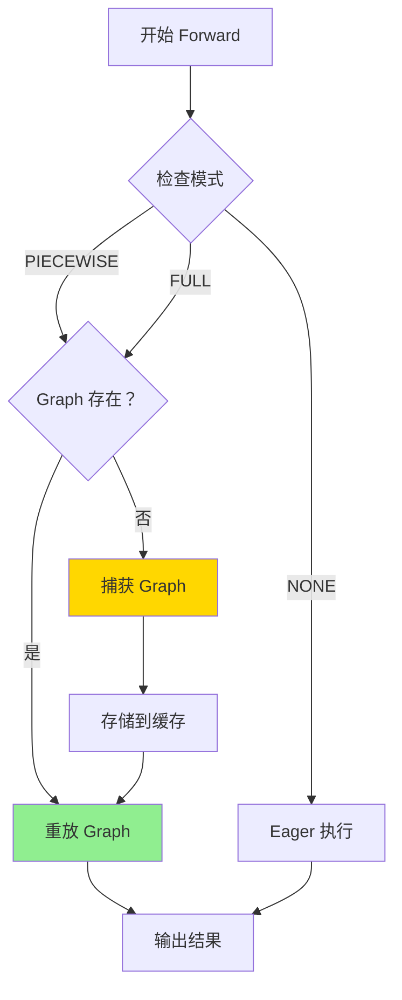
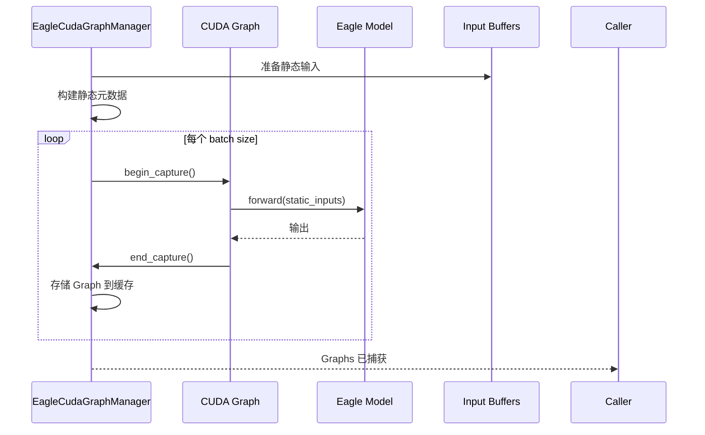
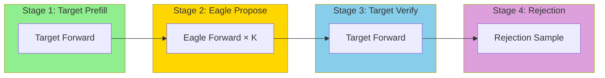

# 第八部分: CUDA Graph 与性能优化

## 8.1 CUDA Graph 在 Spec Decode 中的应用

### 8.1.1 CUDAGraphDispatcher 工作原理

**文件位置**: `vllm/v1/cudagraph_dispatcher.py`

```python
class CUDAGraphDispatcher:
    """CUDA Graph 调度器。

    负责管理 CUDA Graph 的捕获、缓存和重放。
    """

    def __init__(self, vllm_config: VllmConfig):
        self.vllm_config = vllm_config
        self.compilation_config = vllm_config.compilation_config

        # 已捕获的 CUDA Graph 缓存
        self.graph_cache: dict[BatchDescriptor, CUDAGraphEntry] = {}

        # 支持的 batch sizes
        self.cudagraph_batch_sizes = compilation_config.cudagraph_batch_sizes

        # batch size 到 graph size 的映射
        self._bs_to_padded_graph_size = self._build_padding_map()

    def dispatch(
        self,
        num_tokens: int,
        valid_modes: set[CUDAGraphMode] = None,
    ) -> tuple[CUDAGraphMode, BatchDescriptor]:
        """调度 CUDA Graph 执行。

        Args:
            num_tokens: 当前 batch 的 token 数量
            valid_modes: 允许的 CUDA Graph 模式

        Returns:
            cudagraph_mode: 实际使用的模式
            batch_desc: batch 描述符（包含 padding 后的 size）
        """
        # 查找最接近的 batch size
        for bs in self.cudagraph_batch_sizes:
            if bs >= num_tokens:
                return CUDAGraphMode.FULL, BatchDescriptor(num_tokens=bs)

        # 没有找到合适的 graph，使用 eager mode
        return CUDAGraphMode.NONE, BatchDescriptor(num_tokens=num_tokens)

    def _build_padding_map(self) -> dict[int, int]:
        """构建 batch size 到 padding graph size 的映射。"""
        mapping = {}
        for i, bs in enumerate(self.cudagraph_batch_sizes):
            mapping[bs] = bs
            # 填充到下一个 graph size
            if i < len(self.cudagraph_batch_sizes) - 1:
                next_bs = self.cudagraph_batch_sizes[i + 1]
                for padding in range(bs + 1, next_bs + 1):
                    mapping[padding] = next_bs
        return mapping
```

### 8.1.2 PIECEWISE 模式解析

**CUDA Graph 模式**: 

| 模式 | 说明 | 适用场景 |
|------|------|----------|
| `NONE` | 不使用 CUDA Graph | 动态 batch、debug |
| `FULL` | 完整 CUDA Graph | 固定 batch size |
| `PIECEWISE` | 分段 CUDA Graph | 部分动态场景 |

**PIECEWISE 模式工作流程**: 



### 8.1.3 图捕获流程

```python
def capture_cudagraph(
    self,
    batch_size: int,
    model_forward: Callable,
) -> torch.cuda.CUDAGraph:
    """捕获 CUDA Graph。"""
    logger.info(f"Capturing CUDA Graph for batch size {batch_size}")

    # 创建 CUDA Graph
    graph = torch.cuda.CUDAGraph()

    # 开始捕获
    with torch.cuda.graph(graph, pool=self.graph_pool):
        # 执行模型前向（静态图）
        output = model_forward(
            input_ids=self.input_ids[:batch_size],
            positions=self.positions[:batch_size],
            hidden_states=self.hidden_states[:batch_size],
        )

    # 存储输出引用（弱引用，避免内存泄漏）
    self.graph_cache[batch_size] = CUDAGraphEntry(
        batch_descriptor=BatchDescriptor(num_tokens=batch_size),
        aclgraph=graph,
        output=weak_ref_tensors(output),
    )

    return graph
```

## 8.2 Eagle CUDA Graph Manager

### 8.2.1 `EagleCudaGraphManager` 架构

**文件位置**: `vllm/v1/worker/gpu/spec_decode/eagle/cudagraph.py`

```python
class EagleCudaGraphManager:
    """Eagle CUDA Graph 管理器。

    专门用于管理 Eagle Speculator 的 CUDA Graph。
    """

    def __init__(self, vllm_config: VllmConfig, device: torch.device):
        self.vllm_config = vllm_config
        self.device = device
        self.compilation_config = vllm_config.compilation_config

        # Graph 缓存
        self.graph_entries: dict[int, CUDAGraphEntry] = {}

        # 捕获状态
        self.is_capturing = False
        self.capture_batch_sizes = []

    def capture(
        self,
        generate_draft_fn: Callable,
        model_state: ModelState,
        input_buffers: InputBuffers,
        block_tables: BlockTables,
        attn_groups: list[list[AttentionGroup]],
        kv_cache_config: KVCacheConfig,
    ) -> None:
        """捕获 Eagle CUDA Graphs。"""
        logger.info("Capturing model for Eagle speculator...")

        for batch_size in self.compilation_config.cudagraph_batch_sizes:
            # 准备静态输入
            self._prepare_static_inputs(batch_size, input_buffers)

            # 构建静态 Attention 元数据
            attn_metadata = self._build_static_attn_metadata(
                batch_size, block_tables, attn_groups, kv_cache_config
            )

            # 捕获 Graph
            graph = torch.cuda.CUDAGraph()
            with torch.cuda.graph(graph, pool=self.graph_pool):
                generate_draft_fn(
                    num_reqs=batch_size,
                    num_tokens_padded=batch_size,
                    attn_metadata=attn_metadata,
                    slot_mappings=None,
                    num_tokens_across_dp=None,
                    cudagraph_runtime_mode=CUDAGraphMode.FULL,
                )

            self.graph_entries[batch_size] = CUDAGraphEntry(
                batch_descriptor=BatchDescriptor(num_tokens=batch_size),
                aclgraph=graph,
            )

    def run_fullgraph(self, num_tokens_padded: int) -> None:
        """运行完整 CUDA Graph。"""
        if num_tokens_padded in self.graph_entries:
            entry = self.graph_entries[num_tokens_padded]
            entry.aclgraph.replay()

    def get_cudagraph_runtime_mode(
        self, num_reqs: int
    ) -> tuple[CUDAGraphMode, int]:
        """确定运行时 CUDA Graph 模式。"""
        for bs in sorted(self.graph_entries.keys()):
            if bs >= num_reqs:
                return CUDAGraphMode.FULL, bs
        return CUDAGraphMode.NONE, num_reqs
```

### 8.2.2 图捕获与重放

**捕获流程**: 



**重放流程**: 

```python
def replay_graph(
    self,
    batch_size: int,
    input_buffers: InputBuffers,
) -> torch.Tensor:
    """重放 CUDA Graph。"""
    entry = self.graph_entries.get(batch_size)
    if entry is None:
        # 没有捕获的 graph，使用 eager mode
        return self.eager_forward(input_buffers)

    # 更新输入 buffers（在 graph 重放前）
    # 注意: 这里只是更新指针，不是 copy

    # 重放 graph
    entry.aclgraph.replay()

    # 返回捕获时存储的输出引用
    return entry.output
```

### 8.2.3 动态 Batch 处理

**动态 Batch 挑战**: 

CUDA Graph 要求静态形状，但实际推理中 batch size 是动态的。

**解决方案**: 

1. **Padding 到固定大小**: 
```python
def pad_to_graph_size(num_tokens: int) -> int:
    """Padding 到最近的 graph size。"""
    for bs in CUDAGRAPHS_BATCH_SIZES:
        if bs >= num_tokens:
            return bs
    return num_tokens  # 超过最大 graph size，使用 eager
```

2. **多 Graph 缓存**: 
```python
CUDAGRAPHS_BATCH_SIZES = [1, 2, 4, 8, 16, 24, 32, 48, 64, 96, 128, 256, 512]
```

3. **PIECEWISE 模式**: 只捕获部分计算图为静态，其余动态执行。

## 8.3 vLLM-Ascend 的图优化

### 8.3.1 昇腾图捕获 API

**ACL Graph 与 CUDA Graph 对比**: 

```python
# CUDA Graph (NVIDIA)
graph = torch.cuda.CUDAGraph()
with torch.cuda.graph(graph):
    output = model(inputs)
graph.replay()

# ACL Graph (昇腾)
graph = torch.npu.NPUGraph()
with torch.npu.graph(graph, pool=graph_pool):
    output = model(inputs)
graph.replay()
```

### 8.3.2 静态图约束与适配

**昇腾静态图约束**: 

| 约束 | 说明 | 适配方案 |
|------|------|----------|
| 输入形状固定 | Graph 捕获时形状必须固定 | Padding + 多 Graph 缓存 |
| 内存地址固定 | 输入/输出 tensor 地址不能变 | 预分配缓冲区 |
| 控制流限制 | 条件分支需要特殊处理 | 使用 `torch.cond` |
| 动态算子限制 | 某些算子不支持图捕获 | 拆分图或使用 eager |

**vLLM-Ascend 适配代码**: 

```python
# vllm_ascend/compilation/acl_graph.py
class ACLGraphWrapper:
    """昇腾 ACL Graph 包装器。"""

    def __call__(self, *args, **kwargs):
        forward_context = get_forward_context()
        batch_descriptor = forward_context.batch_descriptor
        aclgraph_runtime_mode = forward_context.cudagraph_runtime_mode

        # 检查是否匹配运行时模式
        if aclgraph_runtime_mode != self.runtime_mode:
            return self.runnable(*args, **kwargs)

        if batch_descriptor not in self.concrete_aclgraph_entries:
            # 捕获新图
            entry = ACLGraphEntry(batch_descriptor=batch_descriptor)
            aclgraph = torch.npu.NPUGraph()

            with torch.npu.graph(aclgraph, pool=self.graph_pool):
                output = self.runnable(*args, **kwargs)

            entry.aclgraph = aclgraph
            entry.output = weak_ref_tensors(output)
            self.concrete_aclgraph_entries[batch_descriptor] = entry
        else:
            # 重放图
            entry = self.concrete_aclgraph_entries[batch_descriptor]
            entry.aclgraph.replay()
            output = entry.output

        return output
```

## 8.4 性能优化技术

### 8.4.1 内存访问优化

**优化技术**: 

1. **合并内存访问**: 
```python
# 优化前: 多次小拷贝
for i in range(batch_size):
    dst[i] = src[i]

# 优化后: 单次大拷贝
dst[:batch_size] = src[:batch_size]
```

2. **使用 Pinned Memory**: 
```python
# CPU 端 pinned memory
cpu_buffer = torch.empty(size, device='cpu', pin_memory=True)

# 异步 H2D 传输
gpu_buffer.copy_(cpu_buffer, non_blocking=True)
```

3. **内存对齐**: 
```python
# 昇腾 NPU 内存对齐
torch_npu.npu_mem_align(tensor, alignment=128)
```

### 8.4.2 Kernel 融合

**融合策略**: 

```
原始计算图: 
  Input → LayerNorm → QKV Projection → Attention → Output Projection → MLP → Output

融合后: 
  Input → Fused Norm+Attn → Fused Proj+MLP → Output
```

**实现示例**: 

```python
class FusedEagleBlock(nn.Module):
    """融合的 Eagle Block。"""

    def __init__(self, config):
        super().__init__()
        # 融合 LayerNorm + Attention
        self.fused_norm_attn = FusedNormAttention(config)
        # 融合 Output Proj + MLP
        self.fused_proj_mlp = FusedProjMLP(config)

    def forward(self, x, metadata):
        x = self.fused_norm_attn(x, metadata)
        x = self.fused_proj_mlp(x)
        return x
```

### 8.4.3 流水线并行

**Spec Decode 流水线**: 



**时间线优化**: 

```
传统流水线: 
  Target: [█████][     ][     ][     ]
  Eagle:  [     ][█████][     ][     ]
  Verify: [     ][     ][█████][     ]
  Reject: [     ][     ][     ][█████]

优化后（重叠执行）: 
  Target: [█████][     ][█████][     ]
  Eagle:  [     ][█████][     ][█████]
  Verify: [     ][     ][█████][     ]
  Reject: [     ][     ][     ][█████]
```

---

