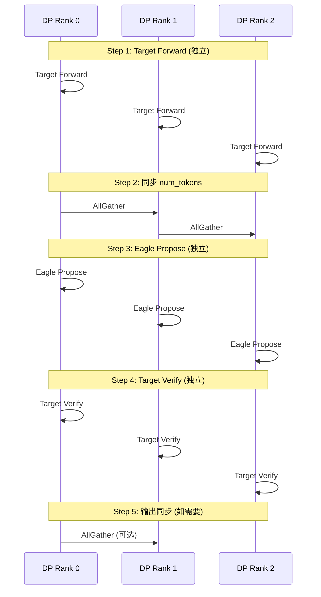

# 第九部分: 数据并行与分布式支持

## 9.1 Data Parallel 集成

### 9.1.1 DP 配置与初始化

**数据并行配置**: 

```python
# vllm/config/parallel_config.py
@dataclass
class ParallelConfig:
    """并行配置。"""

    # 数据并行大小
    data_parallel_size: int = 1

    # DP rank（每卡不同）
    data_parallel_rank: int = 0

    # DP 组
    data_parallel_group: Optional[dist.ProcessGroup] = None
```

**初始化流程**: 

```python
def init_data_parallel(
    world_size: int,
    rank: int,
    dp_size: int,
) -> None:
    """初始化数据并行。"""
    assert world_size % dp_size == 0

    # 计算 TP size
    tp_size = world_size // dp_size

    # 创建 DP 组
    for i in range(dp_size):
        ranks = list(range(i * tp_size, (i + 1) * tp_size))
        group = dist.new_group(ranks)
        if rank in ranks:
            set_data_parallel_group(group)
            set_data_parallel_rank(i)
```

### 9.1.2 跨 DP Rank 协调

**文件位置**: `vllm/v1/worker/dp_utils.py`

```python
def coordinate_batch_across_dp(
    num_tokens_unpadded: int,
    parallel_config: ParallelConfig,
    allow_microbatching: bool = False,
    num_tokens_padded: int = None,
    cudagraph_mode: int = CUDAGraphMode.NONE.value,
) -> tuple[bool, torch.Tensor | None, int]:
    """跨 DP Rank 协调 batch 执行。

    Returns:
        should_ubatch: 是否需要微批次处理
        num_tokens_across_dp: 所有 rank 的 token 数量 [dp_size]
        synced_cudagraph_mode: 同步后的 cudagraph mode
    """
    dp_size = parallel_config.data_parallel_size
    dp_rank = parallel_config.data_parallel_rank

    # ========== Step 1: Gather 所有 rank 的 num_tokens ==========
    num_tokens_tensor = torch.tensor(
        [num_tokens_unpadded], dtype=torch.int32, device="cuda"
    )
    num_tokens_across_dp = torch.empty(dp_size, dtype=torch.int32, device="cuda")

    dist.all_gather_into_tensor(
        num_tokens_across_dp, num_tokens_tensor,
        group=parallel_config.data_parallel_group
    )

    # ========== Step 2: 确定统一的执行模式 ==========
    max_tokens = num_tokens_across_dp.max().item()

    # 选择所有 rank 都能使用的 cudagraph size
    synced_cudagraph_mode = cudagraph_mode
    if cudagraph_mode == CUDAGraphMode.FULL.value:
        # 检查是否有 rank 无法使用 graph
        for rank_tokens in num_tokens_across_dp.cpu():
            if rank_tokens.item() > MAX_GRAPH_SIZE:
                synced_cudagraph_mode = CUDAGraphMode.NONE.value
                break

    # ========== Step 3: 决定是否需要微批次 ==========
    should_ubatch = allow_microbatching and max_tokens > MAX_GRAPH_SIZE

    return should_ubatch, num_tokens_across_dp, synced_cudagraph_mode
```

### 9.1.3 同步点分析

**Spec Decode DP 同步点**: 



## 9.2 Tensor Parallel 支持

### 9.2.1 TP 组配置

```python
from vllm.distributed.parallel_state import get_tp_group

def get_tensor_parallel_info():
    """获取 Tensor 并行信息。"""
    tp_group = get_tp_group()
    return {
        'world_size': tp_group.world_size,
        'rank': tp_group.rank,
        'device_group': tp_group.device_group,
    }
```

### 9.2.2 权重分布

**Eagle 模型 TP 切分**: 

```
TP Size = 2

Layer Norm: 不切分
QKV Projection: 按输出维度切分
  Q: [hidden, hidden/2] per rank
  K: [hidden, hidden/2] per rank
  V: [hidden, hidden/2] per rank
Attention Output: 按输入维度切分
MLP Gate: 按输出维度切分
MLP Down: 按输入维度切分
```

### 9.2.3 激活值通信

**TP 通信模式**: 

```python
def tensor_parallel_forward(self, x):
    """Tensor Parallel 前向传播。"""
    tp_group = get_tp_group()

    # QKV Projection (切分输出)
    q_local = self.q_proj(x)  # [seq, hidden/tp_size]
    k_local = self.k_proj(x)
    v_local = self.v_proj(x)

    # AllGather QKV
    q = tensor_model_parallel_all_gather(q_local)
    k = tensor_model_parallel_all_gather(k_local)
    v = tensor_model_parallel_all_gather(v_local)

    # Attention (每卡完整的 attention)
    out_local = scaled_dot_product_attention(q, k, v)

    # ReduceScatter 输出
    out = tensor_model_parallel_all_reduce(out_local)

    return out
```

## 9.3 Pipeline Parallel (如适用)

### 9.3.1 PP 组配置

```python
from vllm.distributed.parallel_state import get_pp_group

def get_pipeline_parallel_info():
    """获取 Pipeline 并行信息。"""
    pp_group = get_pp_group()
    return {
        'world_size': pp_group.world_size,
        'rank': pp_group.rank,
        'num_stages': pp_group.world_size,
    }
```

### 9.3.2 阶段划分

**Pipeline 阶段**: 

```
PP Size = 4

Stage 0: Embedding + Layers 0-7
Stage 1: Layers 8-15
Stage 2: Layers 16-23
Stage 3: Layers 24-31 + LM Head
```

### 9.3.3 Spec Decode 的 PP 挑战

**挑战**: 

1. **多步推测的流水线气泡**: 
   - Eagle 需要 K 步串行 forward
   - 每步都经过所有 PP stage
   - 气泡时间增加 K 倍

2. **KV Cache 跨 stage 管理**: 
   - 每 stage 存储部分 KV
   - 验证时需要跨 stage 访问

**解决方案**: 

```python
class PipelineEagleSpeculator:
    """Pipeline 感知的 Eagle Speculator。"""

    def propose(self, hidden_states, **kwargs):
        # 使用 1F1B 调度隐藏气泡
        for step in range(self.num_speculative_steps):
            # Forward 当前 stage
            hidden_states = self.current_stage_forward(hidden_states)

            # 如果不是最后 stage，发送给下一阶段
            if not self.is_last_stage():
                dist.send(hidden_states, dst=self.next_stage_rank)

            # 如果不是第一阶段，接收上一阶段
            if not self.is_first_stage():
                hidden_states = dist.recv(src=self.prev_stage_rank)

        return draft_tokens
```

## 9.4 vLLM-Ascend 分布式差异

### 9.4.1 HCCL 通信组

```python
# vllm_ascend/distributed/parallel_state.py
import torch_npu  # 必须导入以启用 HCCL 后端

def init_dist_group(backend='hccl', **kwargs):
    """初始化昇腾分布式组。"""
    # HCCL 会自动作为后端
    return dist.init_process_group(backend=backend, **kwargs)
```

### 9.4.2 昇腾分布式训练框架

**CANN 分布式特性**: 

| 特性 | 说明 |
|------|------|
| HCCL 集合通信 | AllReduce、AllGather、ReduceScatter |
| 混合精度训练 | FP16/BF16 支持 |
| 梯度压缩 | 通信优化 |
| 流水并行 | 1F1B 调度 |

---

